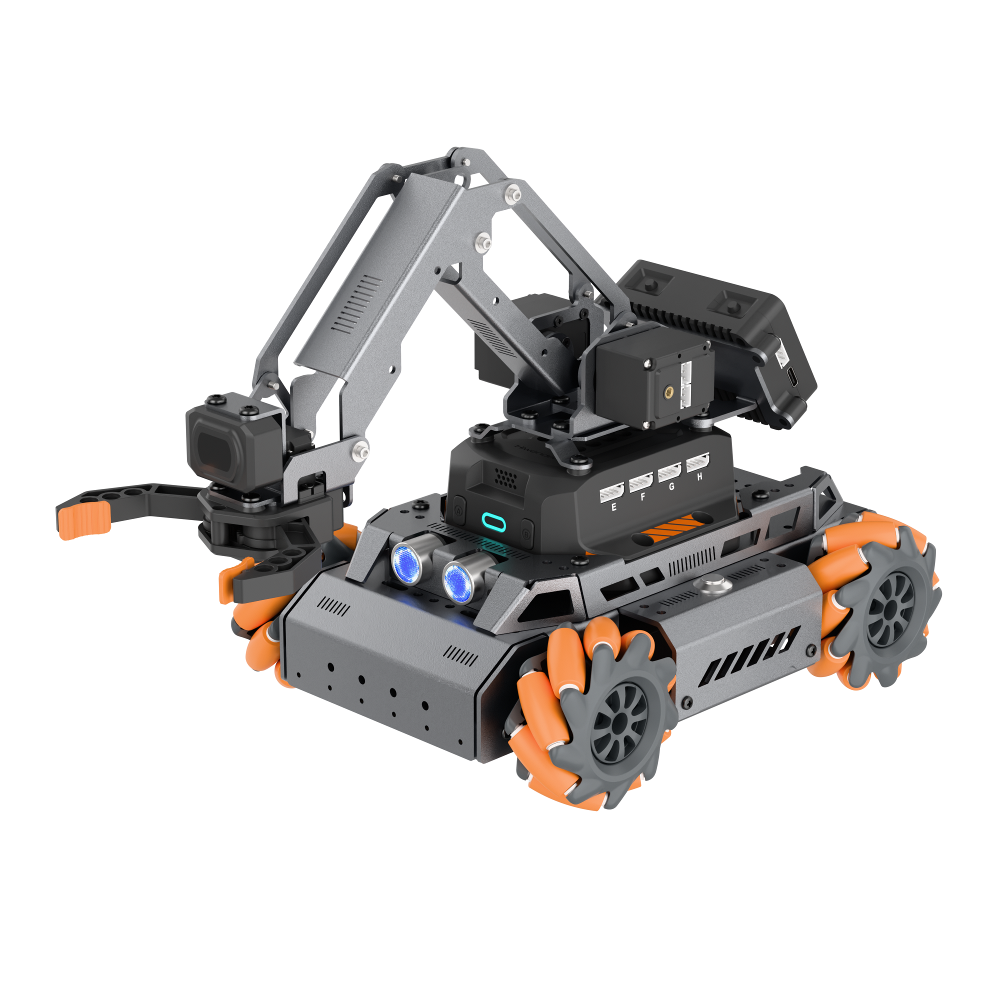

# 1. Kit Introduction

## 1.1 Kit Overview

AiMecha M1 is an AI mecha car developed by Hiwonder for K12 AI education. Built with an all-metal chassis, it features an ESP32 + MM32 dual-controller architecture, Mecanum wheels, encoder motors, an ultrasonic sensor, and line-following sensors, while supporting modular expansion. Equipped with a K230 vision module, the robot integrates embodied AI technologies, including large vision and speech models, and supports both Scratch and MicroPython programming. The course follows the embodied AI framework of perception, decision-making, and control for step-by-step instruction. This approach builds hands-on skills and logical thinking, making the kit suitable for primary and secondary school STEAM and information technology classes.

## 1.2 Kit Features

* Full-metal mecha body with a compact and agile design
* Mecanum wheels for omnidirectional movement
* ESP32 + MM32 dual-core controller architecture
* High-precision encoder motors for accurate motion control
* Complex path navigation and high-precision smart obstacle avoidance
* High-performance K230 large AI model modules

## 1.3 Kit Specifications

|                Name                |                        Specification                         |
| :--------------------------------: | :----------------------------------------------------------: |
|               Brand                |                           Hiwonder                           |
|           Product model            |                   AiMecha M1 Advanced Kit                    |
|        Programming software        |               WonderLab graphical programming                |
|          Recommended age           |                             10+                              |
|         Electronic modules         | Ultrasonic sensor, 6-channel line follower sensor × 2, detachable large model module, 3DOF linkage robotic arm, PS3 Bluetooth controller, encoder motor × 4 |
|            Chassis type            |                    Mecanum wheel chassis                     |
|        Communication ports         |                          USB Type-C                          |
|          Product material          |               All-metal anodized aluminum body               |
|            Power supply            |                  Detachable lithium battery                  |
|          Core controller           |                            ESP32                             |
|           Control method           |           PS3 Bluetooth controller and mobile app            |
| Product weight including packaging |                           ≤ 2680 g                           |
|         Package dimensions         |                      485 × 250 × 210 mm                      |

## 1.4 Precautions

* The products described in this manual, including hardware and software, are provided **as is**. Every effort has been made to ensure content accuracy during preparation, though complete freedom from errors or omissions cannot be guaranteed. This documentation undergoes periodic review, and feedback for improvement is always welcome.
* Product specifications and contents are subject to change with version upgrades. Please contact customer service when ordering to obtain the latest product information.
* Additionally, Hiwonder is not responsible for any losses caused by malfunction or damage under extreme usage conditions unless the product is explicitly stated to be suitable for such purposes.