# 3.1 Lesson 1: Basic Hardware Structure

## 3.1.1 Lesson Introduction

Starting with hardware assembly, this lesson systematically introduces the overall architecture and core components of the AiMecha M1 Mecanum-wheel car. It focuses on two core concepts: "the dual-controller drive architecture" and "the motion principles of Mecanum wheels". The lesson examines key components including the controller, chassis controller, encoder motors, and line-following sensors. Through force analysis, it explains how Mecanum wheels achieve omnidirectional movement and derives 9 trajectories across 18 motion directions, building a solid hardware foundation for subsequent programming projects.

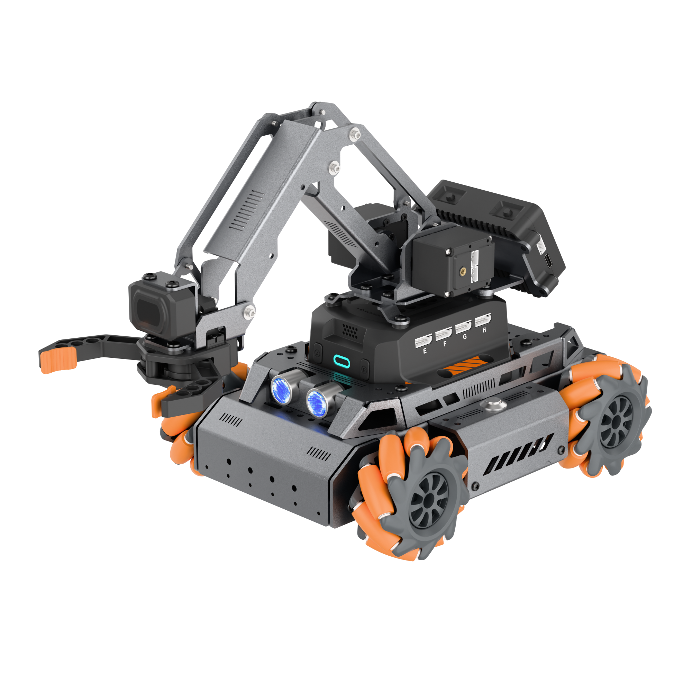

## 3.1.2 Learning Objectives

1. Understand the overall hardware architecture of the AiMecha M1 Mecanum-wheel car and how the dual controllers collaborate. Learn the structural composition of Mecanum wheels and the design principle behind their 45° rollers.

2. Complete the hardware assembly of the Mecanum-wheel car independently and distinguish the mounting positions of A-wheels and B-wheels. Identify the functions and port labels on the controller.

3. Develop a systems-thinking approach to hierarchical control by separating upper-level decision-making from lower-level execution. Build physical modeling skills by deducing motion outcomes through force analysis.

4. Explore real-world applications of omnidirectional movement in warehouse AGVs and industrial transport robots. Understand the technical advantages and ideal use cases of Mecanum wheels compared to standard wheels.

## 3.1.3 Preparation

**Hardware Preparation:**

- AiMecha M1 Mecanum-Wheel Car Standard Kit

## 3.1.4 Hands-On Project

**(1) Project Analysis**

AiMecha M1 adopts a dual-controller hierarchical architecture. Serving as the "brain" of the car, the upper-level controller runs programs, collects sensor data, and issues motion commands. Meanwhile, the lower-level chassis controller acts as the "driver", receiving commands to precisely regulate the four encoder motors. The two controllers communicate via a serial port. The controller simply issues commands, while the chassis controller handles wheel speed calculations and motor driving. The ultrasonic sensor and 6-channel line follower sensors connect directly to the controller for centralized data processing and decision-making. The system uses an isolated power supply, equipping the chassis and the controller with separate batteries and charging ports to prevent high-power motor operation from interfering with the controller.

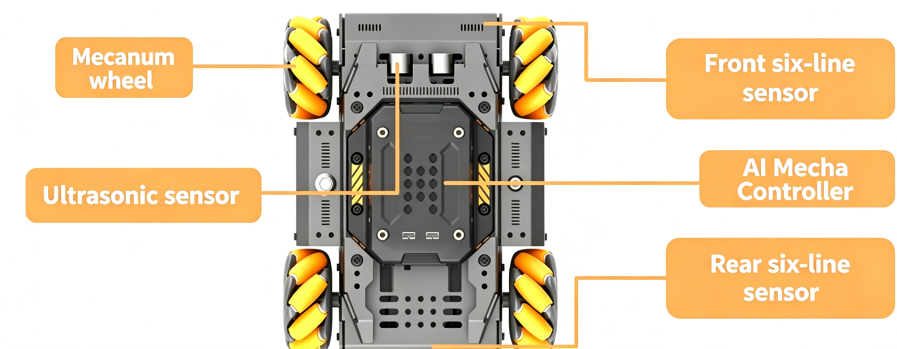

**(2) Core Hardware Modules**

| Module Category | Core Module | Functional Description |
| :--- | :--- | :--- |
| Controller | Mecha controller | Acts as the brain of the car to execute programs, process sensor data, and issue motion commands. |
| Motion control | Chassis controller | Acts as the driver of the car to receive commands and precisely control the four encoder motors driving the Mecanum wheels. |
| Drive mechanism | Mecanum wheels: A-wheels and B-wheels | Features a hub with 45° angled rollers to achieve omnidirectional movement through wheel speed combinations. |

**(3) Hardware Assembly**

💡 M1 Assembly Steps: <Pdf src="../_static/shared/pdf/Ai Mecha M1 Ai Mecha M1 English accessory assembly step diagram.pdf" />

**(4) Controller Port Identification and Functions**

- Identify the 8 sensor ports A through H, and understand the 4-pin wiring standard.

- Identify the locations and functions of the encoder motor ports and bus servo ports S1 and S2.

- Locate the power switch, charging port, program upload port, and power indicator.

- Locate the programmable buttons, RGB LEDs, and buzzer, and understand their feedback functions.

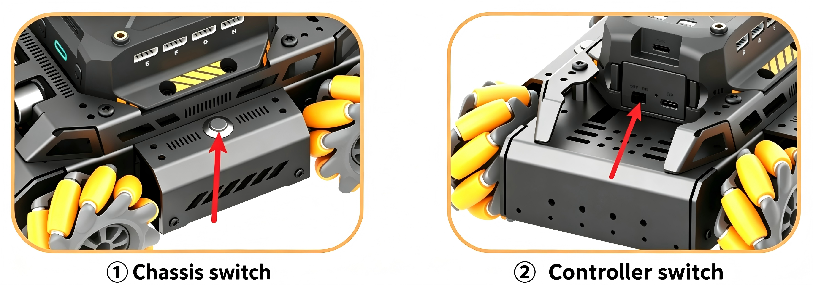

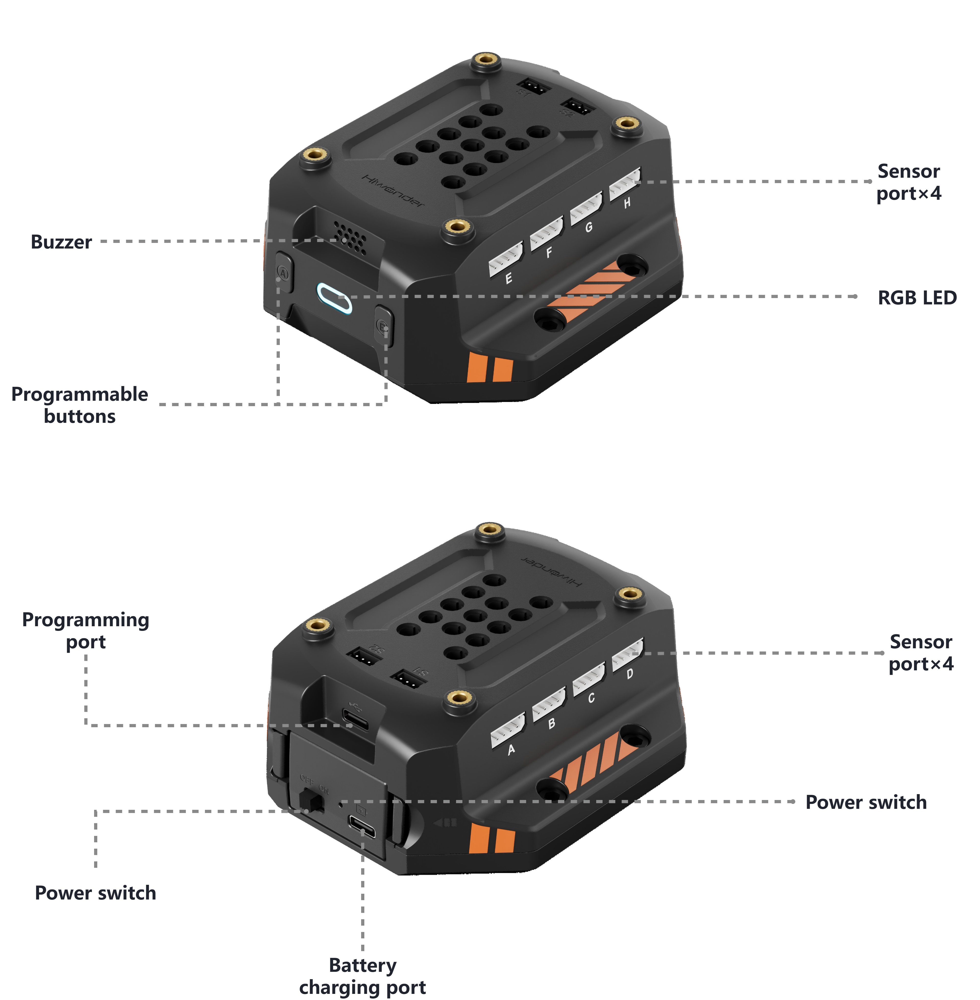

**(5) Mecanum Wheel Structure**

The defining feature of a Mecanum wheel is the ring of small, freely rotating rollers mounted around the circumference of the hub. These rollers are arranged at a specific angle, much like precision bevel gears. This structure allows the wheel not only to roll forward and backward, but also to move laterally and diagonally.

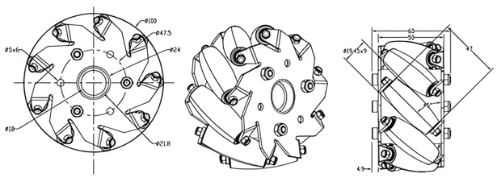

A Mecanum wheel consists of a central hub and multiple angled rollers. The hub serves as the main mounting frame, while the drum-shaped rollers are mounted around its perimeter. The rotational axis of each roller is set at a 45° angle to the main wheel axle. Mecanum wheels operate in sets of four, comprising two left-handed wheels, known as A-wheels, and two right-handed wheels, known as B-wheels. The A-wheels and B-wheels are mirror images of each other.

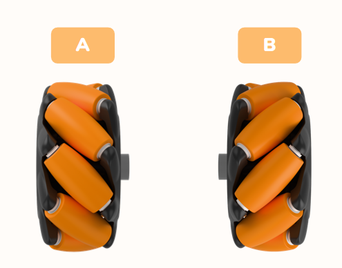

**(6) Motion Principles**

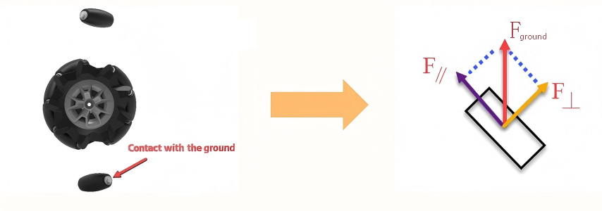

Force analysis focuses on the bottom roller in direct contact with the ground, whose orientation runs crosswise to the roller at the top of the wheel. Consider the forward rotation of the wheel, analyzing only the roller in contact with the ground. As the wheel rotates forward, the contacting roller acts as an instantaneous stationary point, upon which the ground exerts a forward static frictional force. This frictional force can be decomposed into two components: one along the roller axis and the other perpendicular to it.

**1. Force Analysis of Forward and Backward Movement**

When all four Mecanum wheels rotate at the same speed in the same direction, the lateral force components cancel out. High-speed forward rotation drives the car straight ahead, while high-speed reverse rotation drives it straight back.

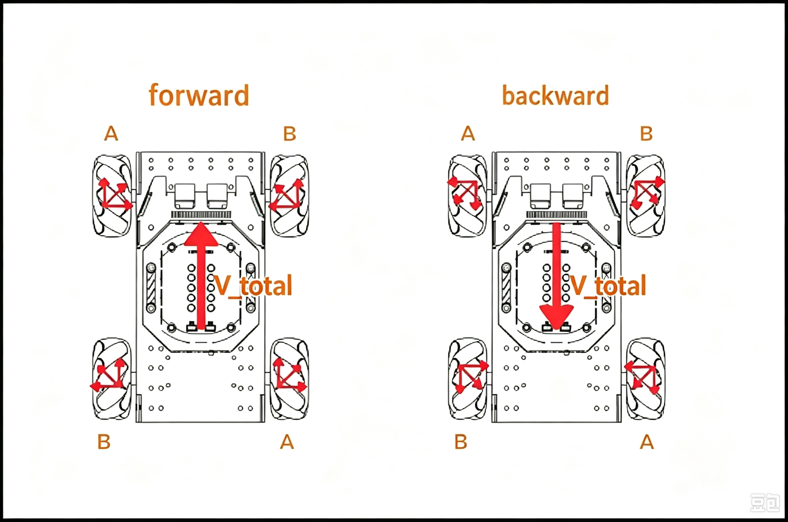

**2. Force Analysis of Left and Right Steering**

"Differential steering" creates a speed difference between the left and right wheels of the car. When turning left, the right wheels rotate faster than the left wheels. When turning right, the left wheels rotate faster than the right wheels.

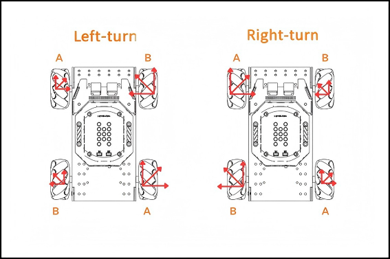

**3. Force Analysis of In-Place Rotation**

When the left and right Mecanum wheels rotate in opposite directions, they generate a rotational torque. Precisely controlling the magnitude and direction of the wheel speeds produces stable in-place rotation. For clockwise rotation, the left wheels rotate forward while the right wheels rotate backward. Counterclockwise rotation reverses these directions.

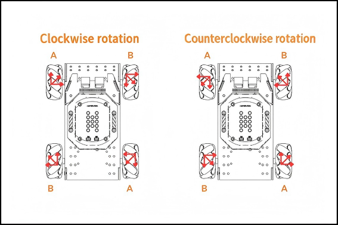

**4. Left and Right Lateral Movement**

When the two diagonally opposite A-type Mecanum wheels rotate in the same direction, and the two diagonally opposite B-type Mecanum wheels rotate together in the opposite direction, the longitudinal force components cancel each other out while the lateral force components combine. As a result, the chassis maintains its orientation, achieving agile left-to-right lateral movement.

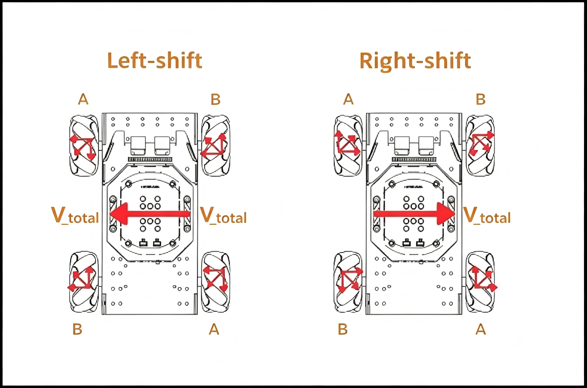

**5. Force Analysis of Diagonal Movement**

Based on Mecanum wheel mechanics, when the A-wheels remain stationary and the B-wheels rotate forward, the car moves diagonally front-left. When the A-wheels rotate forward and the B-wheels remain stationary, the car moves diagonally front-right. When the A-wheels rotate backward and the B-wheels remain stationary, the car moves diagonally rear-left. When the A-wheels remain stationary and the B-wheels rotate backward, the car moves diagonally rear-right.

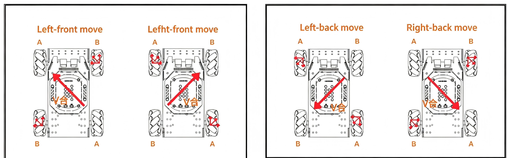

## 3.1.5 Expansion and Challenge

**Project 1: Mecanum-Wheel Motion Direction Deduction**

Given a combination of rotation directions for the four wheels, deduce the actual movement direction of the car through force analysis, and sketch a force vector diagram to verify the result.

**Project 2: Robot Hardware Architecture Research**

Research the hardware architectures of commercial warehouse AGVs and service robots, then compare the advantages and disadvantages of single-controller versus dual-controller designs.

## 3.1.6 Q&A

**Q1: Why is the AiMecha M1 designed with a dual-controller architecture instead of a single controller?**

**Answer**: The dual-controller architecture is designed for task decoupling. The chassis controller handles real-time motor control, while the controller manages programs and sensor data. Separating these tasks prevents processing interference, making the system more stable and easier to program.

**Q2: How do Mecanum wheels achieve omnidirectional movement, and why can standard wheels not do the same?**

**Answer**: The core of the Mecanum wheel lies in its rollers angled at 45°. Ground friction can be resolved into two force components, parallel and perpendicular to the roller axis, with the perpendicular component providing the lateral thrust needed for sideways motion. With four wheels mounted symmetrically, combining different rotational directions and speeds superimposes these force components to achieve omnidirectional movement.

## 3.1.7 Technical Support and Product Discussion

Join the forum for sharing questions, ideas, or suggestions, and answers will be provided promptly. Click the hyperlink [Hiwonder Forum](http://forum.hiwonder.com) or enter the URL in a browser: http://forum.hiwonder.com
