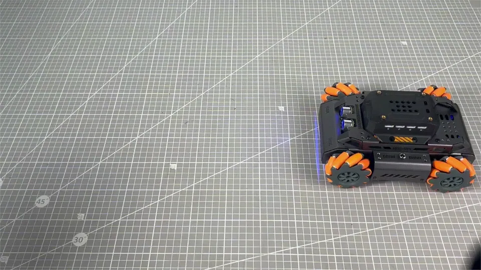
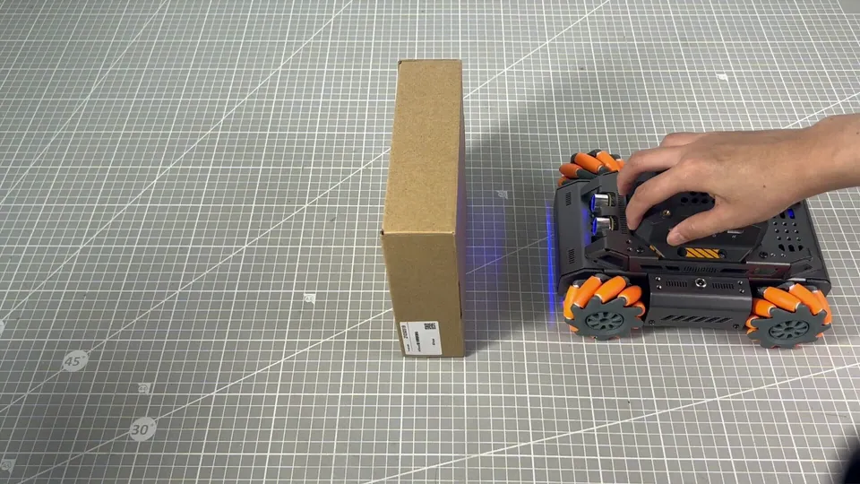
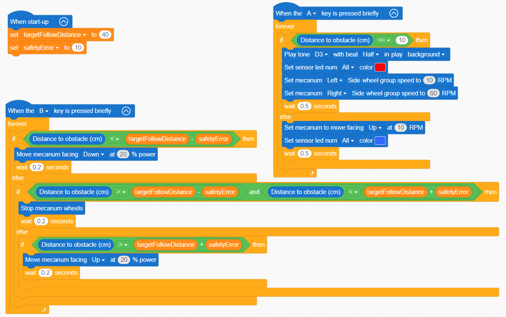
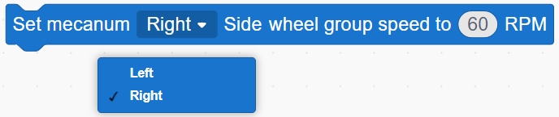
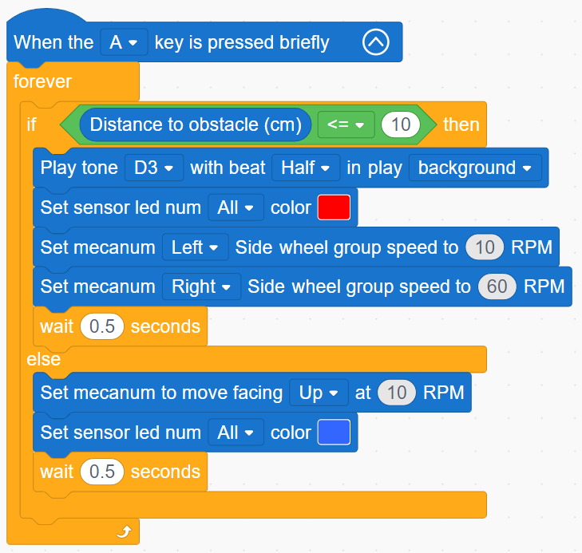
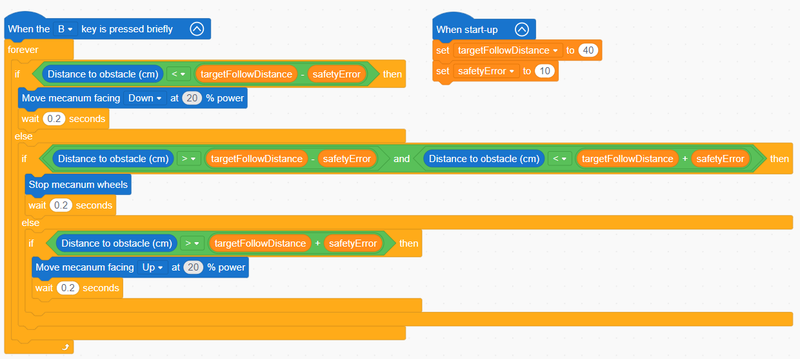

# 3.10 Lesson 10: Dynamic Obstacle Avoidance Practice

## 3.10.1 Lesson Introduction

As part of the embodied AI large model curriculum series, this lesson builds upon the distance-based sound and light alarm to advance from "stopping at obstacles" to "steering around obstacles" while introducing intelligent object following. Taking inspiration from autonomous driving obstacle avoidance and adaptive cruise control, ultrasonic ranging is combined with differential steering to illustrate active obstacle avoidance and dynamic following. Following the path of "obstacle avoidance principles → variable introduction → avoidance implementation → following implementation → dual-mode integration", variable programming is introduced to transform obstacle stopping into left-turn avoidance and achieve three-speed object following. Integrating A for obstacle avoidance and B for object following establishes a dual-mode system that lays the foundation for intelligent navigation.

## 3.10.2 Learning Objectives

**1.** Understand the working principle of ultrasonic dynamic obstacle avoidance. Master the closed-loop distance control logic for object following. Gain a thorough understanding of variable definition, assignment, and invocation, and learn the roles of target values and error margins in control systems.

**2.** Create and use variables to store parameter values. Master independent rotational speed control commands for the left and right wheel groups to achieve differential steering. Proficiently apply multi-layer conditional judgments to implement three-speed following control.

**3.** Establish a motion control mindset for differential steering. Cultivate a parameterized programming approach using variables. Strengthen logical thinking in closed-loop feedback control, and form an initial system design capability for integrating multi-mode programs.

**4.** Connect obstacle avoidance and object following technologies to real-world application scenarios such as autonomous vehicles, factory AGV transport robots, following service robots, and tracking drones.

## 3.10.3 Preparation

**Hardware Preparation**:

- AiMecha M1 Mecanum-wheel robot base × 1

- Type-C USB data cable × 1

- Computer running Windows or macOS × 1

**Software Preparation:**

- WonderLab graphical programming platform installed and running normally

**Core Concept Description**:

**Variable**: A variable acts like a reusable label attached to data, serving as a data container that can be stored, modified, and called at any time. Once created, a variable can be assigned new values or read whenever needed, eliminating the need to repeatedly enter the same numerical value.

**Obstacle Avoidance Principle:** This process mirrors how a pedestrian navigates around an obstacle. First, the ultrasonic sensor acts as the eyes to measure distance ahead. Next, the program acts as the brain, detecting the obstacle and deciding to take a detour. Finally, differential motor control acts as the feet, steering the car to the left by creating a speed difference between the left and right wheels.

**Object Following Principle**: Similar to walking behind a person, the ultrasonic sensor continuously measures distance like eyes locked onto a target. → The program evaluates distance intervals to speed up when too far or slow down when too close. → Three-stage motor speed regulation drives the car forward or backward accordingly.

**Hardware Port**: Connect the ultrasonic sensor to port K.

## 3.10.4 Hands-On Project

**1. Project Analysis**

This project features two core functions, obstacle avoidance and object following, operating as two independent button-triggered modes. The obstacle avoidance mode relies on the ultrasonic sensor to measure distance. When the distance is less than 10 cm, left-right wheel speed differentials steer the car to the left to bypass the obstacle while activating a sound and light alarm, whereas normal distances keep the car driving straight. The object following mode sets a 40 cm target following distance with a 10 cm safety margin, dividing the range into three distance intervals to maintain a stable following distance via closed-loop control of moving forward, stopping, and moving backward. Triggered separately by Button A and Button B, the two modes run independently without interfering with each other.

💡**Complete Program Preview:**

**2. Core Commands**

|   Command Category   |                         Core Command                         | Functional Description                                       |
| :------------------: | :----------------------------------------------------------: | :----------------------------------------------------------- |
|  Variable operation  |  | Creates a new variable container to store data.              |
|  Variable operation  |  | Assigns a specified numerical value to a variable.           |
|    Sensor reading    |  | Reads the real-time distance value.                          |
| Differential control |  | Independently controls the rotational speeds of the left and right wheel groups. |
|    Buzzer control    |  | Triggers an alarm tone during obstacle avoidance.            |

**3. Complete Program Description**

**Task 1: Obstacle Avoidance Implementation**

- Trigger condition: Start the program when Button A is short-pressed, with an outer repeat forever loop.

- Conditional judgment: Check whether the ultrasonic distance is less than or equal to 10 cm.

- Obstacle encountered branch: Play note D3 for a 1/2 beat in the background. + Set the ultrasonic RGB lights to red, set the left wheels to 10 rpm. + Set the right wheels to 60 rpm, and wait 0.5 s.

- Normal branch: Move the car straight ahead at 10 rpm. + Set the ultrasonic RGB lights to blue. + Wait 0.5 s.

- Differential principle: Driving the right wheels faster than the left wheels steers the car to the left, resuming straight driving once the obstacle is bypassed.

**Task 2: Object Following Program**

- Initialization: Create a `target following distance` variable set to 40, and create a `safety margin` variable set to 10.

- Trigger condition: Start the program when Button B is short-pressed, running inside a repeat forever loop.

- Stage 1: When the distance is greater than the target plus the margin, meaning greater than 50 cm. → Drive forward at 20% power.

- Stage 2: When the distance is between the target minus the margin and the target plus the margin, meaning between 30 cm and 50 cm. → Stop the car.

- Stage 3: When the distance is less than the target minus the margin, meaning less than 30 cm. → Drive backward at 20% power.

**Task 3: Dual-Mode Integrated Program**

- Initialize two variables at startup: Set target following distance to 40 cm and safety margin to 10 cm.

- When Button A is short-pressed: Start the obstacle avoidance mode to steer left around obstacles.

- When Button B is short-pressed: Start the object-following mode for three-speed dynamic following.

- The two modes operate independently and switch functions via button presses.

  

  > [!NOTE]
  >
  > **The program source files can be downloaded from [Program Files/Dynamic Obstacle Avoidance Practice](https://drive.google.com/drive/folders/1vQnjkHE58XJU_cquYayobwkfJD5ZQ1KT?usp=sharing).**

**Program Upload**:

- Step 1: Power on the mecha controller and insert the Type-C data cable into the data port above the power switch on the controller.

- Step 2: Connect the other end of the data cable to a USB port on the computer.

- Step 3: Click the **Connect device** button at the top of the software interface and select the COM port corresponding to CH340 from the port list.

- Step 4: Click the upload button in the upper-right corner to download the compiled program to the mecha controller for execution.

## 3.10.5 Expansion and Advancement

**Project 1: Intelligent Obstacle Avoidance Path Optimization**

Upgrade the obstacle avoidance logic by adding turning duration control so that the car resumes straight driving after turning a specific angle, completing a full detour trajectory. Implement an S-shaped avoidance path by turning left, driving forward, and then turning right to make the avoidance maneuver smoother rather than spinning continuously in place.

**Project 2: Intelligent Following with Speed Gradients**

Upgrade the three-stage following system to multi-stage gradient following, driving faster at greater distances and slower at closer distances for smooth acceleration and deceleration. To clearly indicate the device's state, incorporate RGB status lights that glow green when moving forward, yellow when stopped, and red when moving backward.

## 3.10.6 Q&A

**Q1: What is the primary purpose of setting a 10 cm safety margin in the object following program?**

**Answer**: The primary purpose is to prevent the Mecanum-wheel car from frequently starting and stopping due to minor distance fluctuations, thereby protecting the motors and improving overall stability.

**Q2: What is the key motor control method for making the Mecanum-wheel car turn left when encountering an obstacle ahead?**

**Answer**: The ultrasonic sensor detects whether an obstacle is ahead, and if an obstacle is present, the controller commands the motors to turn left. Left steering relies on a speed differential between the left and right wheels, where setting the right wheel rotational speed higher than the left wheel rotational speed turns the car to the left.

## 3.10.7 Technical Support and Discussion

Join the forum for sharing questions, ideas, or suggestions, and answers will be provided promptly. Click the hyperlink [Hiwonder Forum](http://forum.hiwonder.com) or enter the URL in a browser: http://forum.hiwonder.com