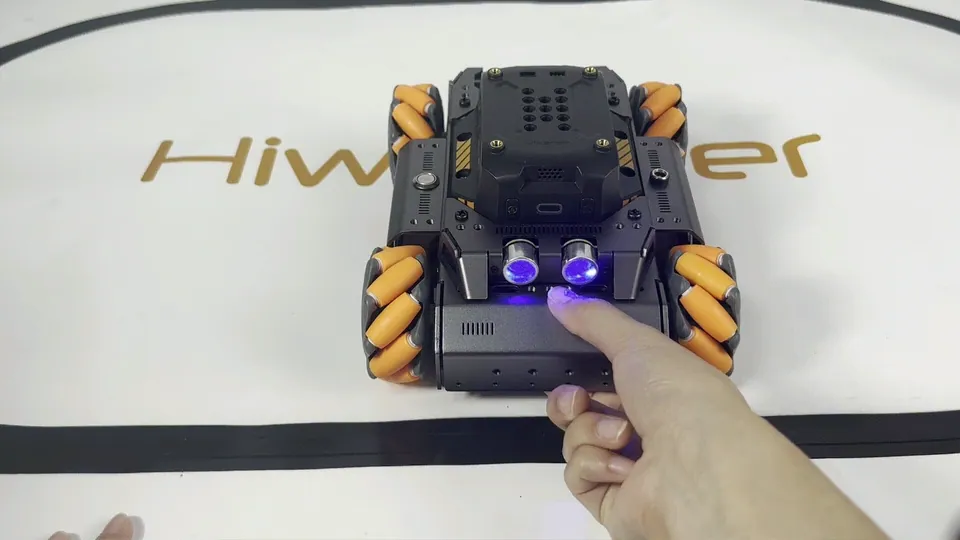
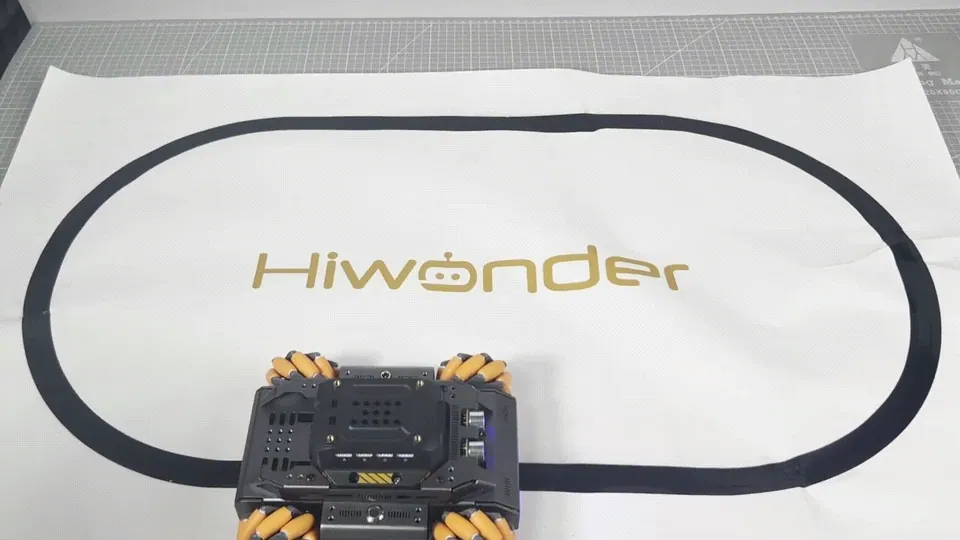
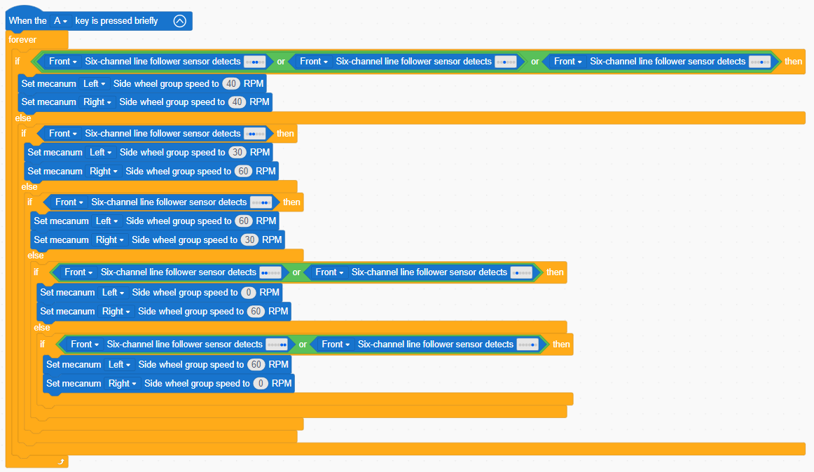
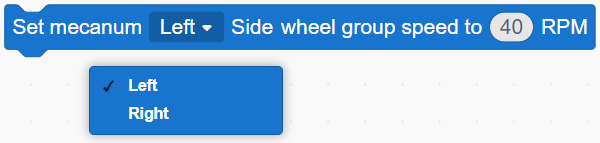
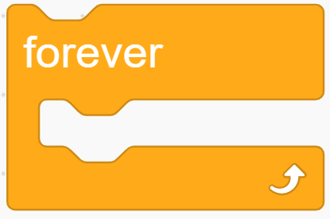
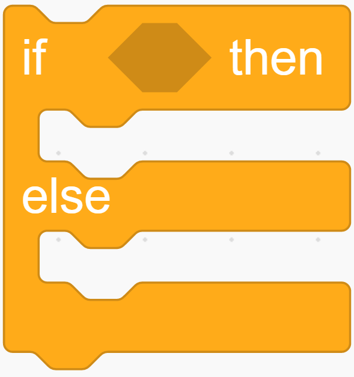
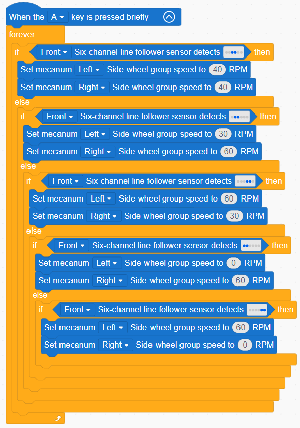

# 3.11 Lesson 11: Intelligent Line-Following Design

## 3.11.1 Lesson Introduction

As part of the embodied AI large model curriculum series, this lesson introduces the 6-channel line follower sensor to initiate line-following navigation. Taking inspiration from automotive adaptive cruise control and lane-keeping systems, black line recognition via sensors is used to illustrate driving along preset paths. Following the progression of "Sensor Principles → Calibration → Sensor Array Analysis → Basic Line Following → Optimization," this lesson covers light detection and calibration, analyzes multi-sensor states, and applies conditional logic to achieve precise line following on an oval track. This lays a solid foundation for advanced line-following and integrated applications.

## 3.11.2 Learning Objectives

**1.** Understand the optical sensing principles of the 6-channel line follower sensor, including light reflection differences between black lines and white surfaces, the purpose and methods of calibration, and how the six sensor states determine driving directions.

**2.** Perform sensor calibration, apply both single-channel and all-channel detection commands, and use multi-layer nested if-else statements to implement multi-state line-following logic.

**3.** Develop the ability to map sensor states to motion control, structure complex conditional logic, apply closed-loop feedback systems thinking, and build foundational engineering habits in parameter tuning and performance optimization.

**4.** Recognize the real-world value of path navigation in industrial automation and smart logistics, stimulating curiosity and enabling further exploration in autonomous navigation.

## 3.11.3 Preparation

**Hardware Preparation**:

- AiMecha M1 Mecanum-wheel robot base × 1

- Type-C USB data cable × 1

- Computer running Windows or macOS × 1

**Software Preparation:**

- WonderLab graphical programming platform installed and running normally

**Sensor Principle Description**:

The 6-channel line follower sensor uses light-sensitive elements to detect the intensity of light reflected from the ground. Black lines absorb light and produce weak reflections, illuminating the corresponding probe indicator light, whereas white backgrounds reflect strong light and keep the indicator light off. The relative position of the black line is determined by the on-off combination of the six side-by-side probes to adjust the driving direction of the car.

**Sensor Numbering Rule**: The six probes are numbered sequentially from right to left as 1, 2, 3, 4, 5, and 6, with Probe 1 on the far right and Probe 6 on the far left.

**Sensor Calibration Steps**:

1. Point the probes directly at the white background and long-press the learning key until the indicator lights for Probe 1 and Probe 6 flash.

2. Wait until all probe indicator lights flash, move the sensor over the black line, and press the learning key again.

3. Calibration is complete when the middle two probes flash, and all probe indicator lights subsequently remain steadily lit.

4. Maintain a ground clearance of 8 mm to 16 mm for the probes during operation.

**Probe State Reference List**:

- Straight driving state: Probe 3 and Probe 4 are lit, while all other probes are off.

- Left turn state: Probe 1 and Probe 2 are lit, or Probe 2 and Probe 3 are lit.

- Right turn state: Probe 5 and Probe 6 are lit, or Probe 4 and Probe 5 are lit.

**Hardware Port**: Connect the front 6-channel line follower sensor to port J.

## 3.11.4 Hands-On Project

**1. Project Analysis**

This project focuses on autonomous line following along an oval trajectory, adopting a closed-loop control architecture of loop detection, state matching, and differential speed adjustment. The sensing layer relies on the 6-channel line follower sensor to continuously scan the ground and feed back probe states in real time. The decision-making layer uses nested conditional judgments to match driving conditions, including straight driving, left turns, and right turns. The execution layer relies on left-right wheel speed differentials to correct the trajectory, keeping both wheel groups at equal speed for straight driving and applying wheel speed differentials for flexible cornering. Continuous loop detection and dynamic adjustments keep the car closely following the black line. The project is divided into a basic version and an optimized version, where the optimized version incorporates additional sensor state combinations for finer and smoother steering control.

💡**Complete Program Preview:**

**2. Core Commands**

|   Command Category   |                         Core Command                         | Functional Description                                       |
| :------------------: | :----------------------------------------------------------: | :----------------------------------------------------------- |
|    Sensor reading    |  | Determines whether a single specified probe detects a black line. |
|    Sensor reading    |  | Determines the overall combination state of all six probes.  |
| Sensor configuration |  | Adjusts the detection sensitivity of the sensor.             |
| Differential control |  | Independently controls the rotational speeds of the left and right wheel groups. |
|     Loop control     |  | Continuously detects the line-following state in a loop.     |
| Conditional judgment |  | Implements multi-state branching via multi-layer nesting.    |
|  Logical operation   |  | Combines multiple probe states into a single condition.      |

**3. Complete Program Description**

**Task 1: Basic Line Following Program**

- Trigger condition: Start the program when the A key is short-pressed, running inside an outer repeat forever loop.

- First-level judgment: When Probe 3 and Probe 4 are lit simultaneously for straight driving. → Set both the left and right wheel groups to drive forward at a constant rotational speed of 40 rpm.

- Second-level judgment: When Probe 2 and Probe 3 are lit for a slight left deviation. → Set the left wheels to 30 rpm and the right wheels to 60 rpm to fine-tune toward the left.

- Third-level judgment: When Probe 4 and Probe 5 are lit for a slight right deviation. → Set the left wheels to 60 rpm and the right wheels to 30 rpm to fine-tune toward the right.

- Fourth-level judgment: When Probe 1 and Probe 2 are lit for a large left deviation. → Set the left wheels to 0 rpm and the right wheels to 60 rpm for a rapid left turn.

- Fifth-level judgment: When Probe 5 and Probe 6 are lit for a large right deviation. → Set the left wheels to 60 rpm and the right wheels to 0 rpm for a rapid right turn.

- Overall outcome: The car drives autonomously along the oval black line and automatically corrects its heading whenever it deviates.

**Task 2: Optimized Line Following Program**

- Add logical `OR` blocks to the basic version to merge similar probe states.

- Straight driving condition: Merge states where Probe 3 and Probe 4 are lit, all probes are off, or other centered states occur into a unified straight-driving branch.

- Left turn condition: Merge states where Probe 1 and Probe 2 are lit, or Probe 2 and Probe 3 are lit, into a left-turn branch.

- Right turn condition: Merge states where Probe 4 and Probe 5 are lit, or Probe 5 and Probe 6 are lit, into a right-turn branch.

- Sharp left turn condition: Configure stronger left-turning power for extreme states such as only Probe 1 being lit.

- Sharp right turn condition: Configure stronger right-turning power for extreme states such as only Probe 6 being lit.

- Optimization outcome: Provides more comprehensive probe state coverage, finer steering adjustments, and smoother line following that reduces jitter and track derailment.

> [!NOTE]
>
> **The program source files can be downloaded from [Program Files/Intelligent Line Following Design](https://drive.google.com/drive/folders/1vQnjkHE58XJU_cquYayobwkfJD5ZQ1KT?usp=sharing).**

**Program Upload**:

- Step 1: Power on the mecha controller and insert the Type-C data cable into the data port above the power switch on the controller.

- Step 2: Connect the other end of the data cable to a USB port on the computer.

- Step 3: Click the **Connect device** button at the top of the software interface and select the COM port corresponding to CH340 from the port list.

- Step 4: Click the upload button in the upper-right corner to download the compiled program to the mecha controller for execution.

## 3.11.5 Expansion and Advancement

**Project 1: Intelligent Line Following with Speed Feedback**

Add adaptive speed control to the line-following program, increasing the rotational speed to 60 rpm on straight segments and reducing the rotational speed to 30 rpm on curves to improve cornering stability. Incorporate RGB LED status indicators, illuminating white for straight driving, blue for left turns, and yellow for right turns, to visualize the driving state.

**Project 2: Intersection Recognition and Route Selection**

Upgrade the map to a complex route featuring intersections and add an all-lit state detection where all six probes lighting up simultaneously indicates arrival at an intersection. Program the car to stop, play a prompt tone upon reaching the intersection, and then select a preset route to continue line following, practicing intersection detection and branching decision logic.

## 3.11.6 Q&A

**Q1: Which probe indicator lights should normally be lit when the Mecanum-wheel car drives straight ahead?**

**Answer**: During normal straight driving, the middle two probes, probe 3 and probe 4, should be lit. Because the black line is positioned directly beneath the center of the car, the middle two probes align with the black line and light up upon detecting black, while the outer probes remain over the white background and stay off. If only probe 2 and probe 3 are lit, the black line is offset to the right, and the car needs to steer left to correct its heading. If probe 4 and probe 5 are lit, the black line is offset to the left, and the car needs to steer right to correct its heading. Having the middle two probes lit represents the ideal straight-driving state.

**Q2: Why must the left motors be set slower and the right motors faster when turning left on an oval track?**

**Answer**: During a left turn on an oval track, the left side follows the inner lane with a shorter circumference while the right side follows the outer lane with a longer circumference. Setting the left wheels slower and the right wheels faster matches the path-length difference between the inner and outer lanes, keeping the car aligned with the black line without veering off course. If both sides rotate at the same rotational speed, the inner wheels slip, or the outer wheels lag behind during a turn, causing the car to deviate from the trajectory. This follows the same principle as staggered starting lines on a running track, where inner lanes have shorter distances and therefore start further back, using differential speeds to match curved motion requirements.

## 3.11.7 Technical Support and Discussion

Join the forum for sharing questions, ideas, or suggestions, and answers will be provided promptly. Click the hyperlink [Hiwonder Forum](http://forum.hiwonder.com) or enter the URL in a browser: http://forum.hiwonder.com