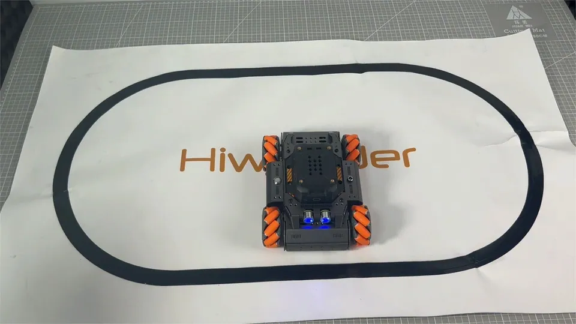
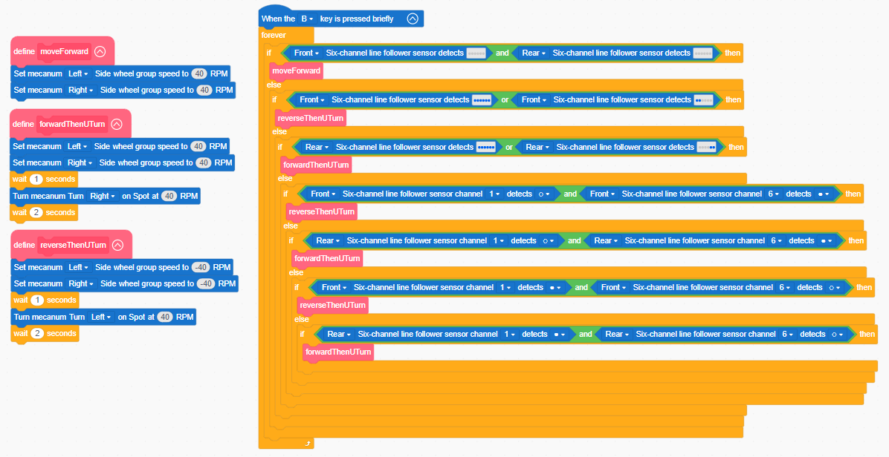
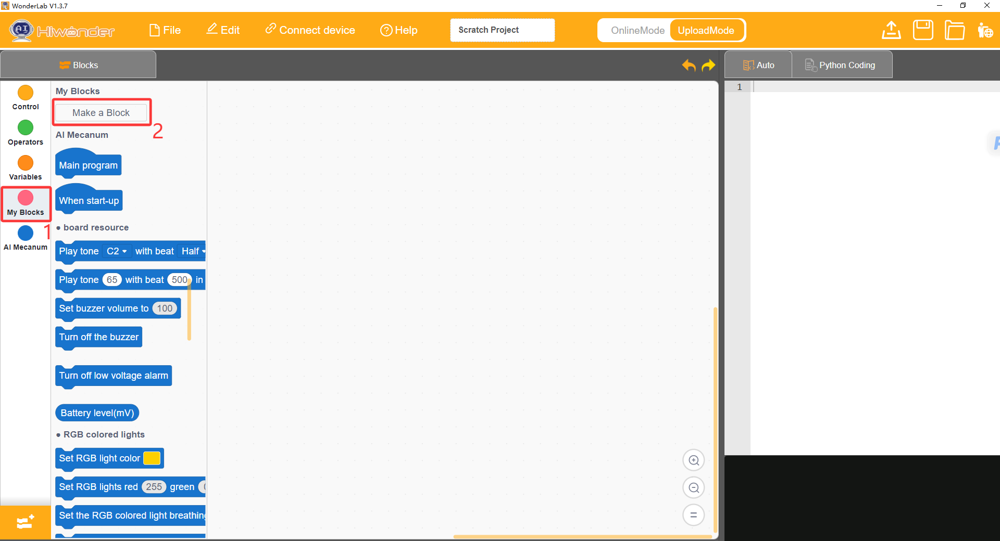
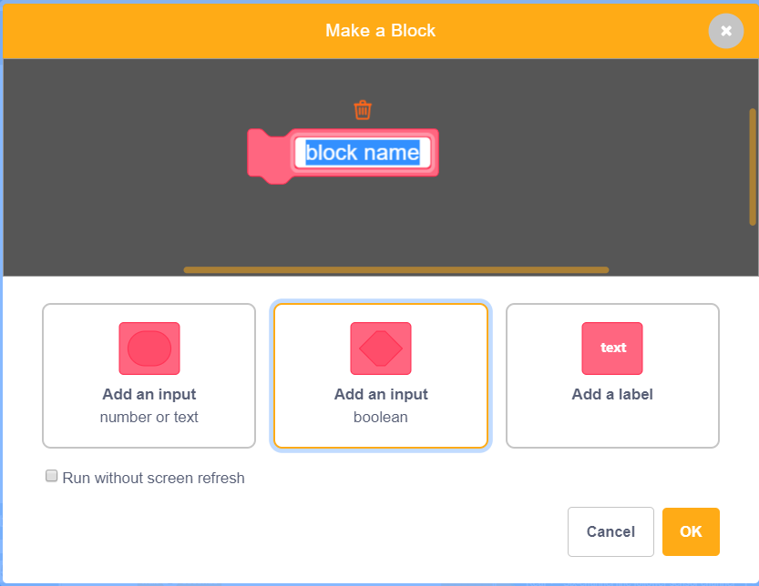
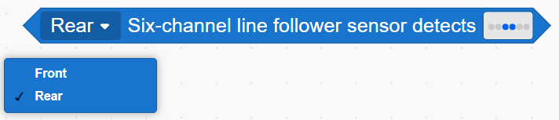
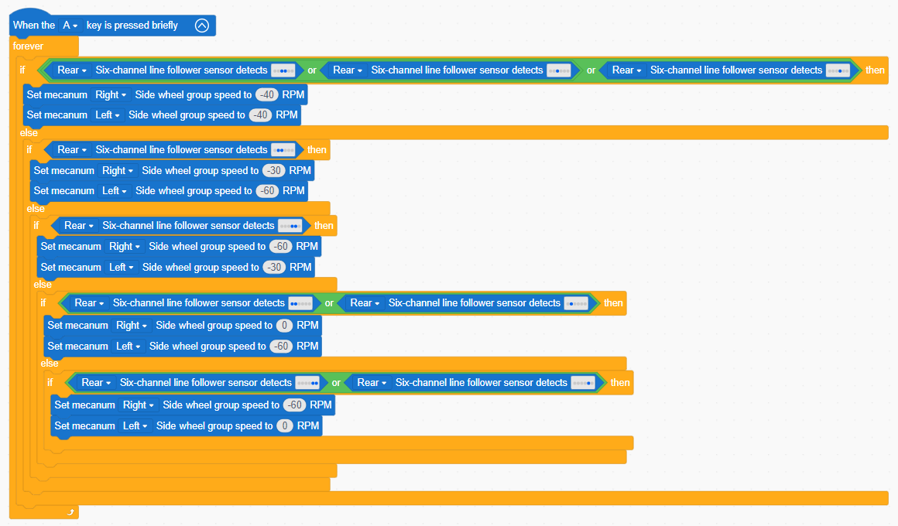
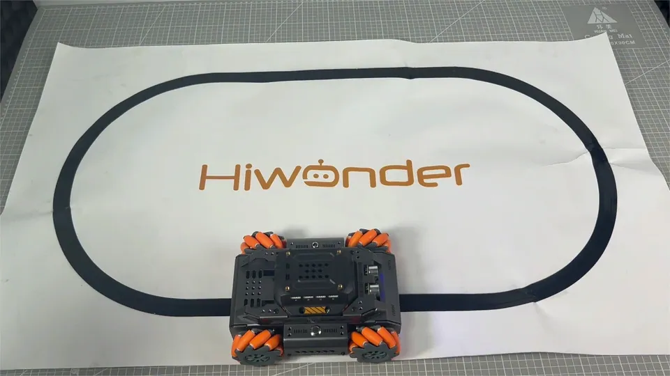
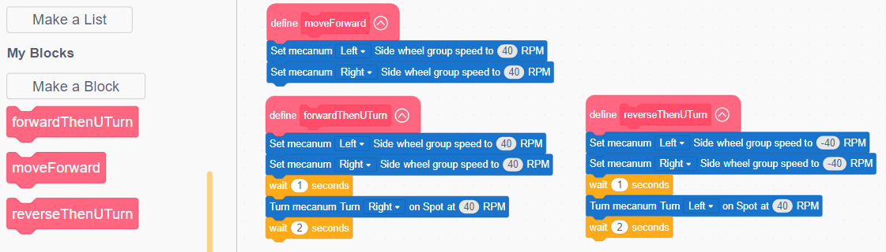
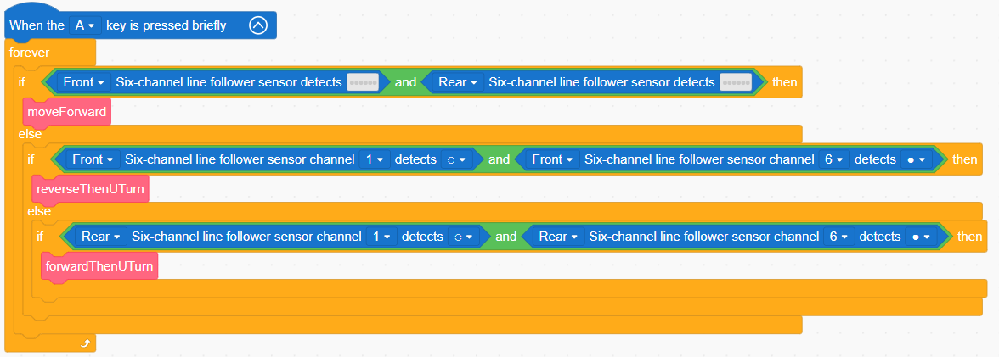
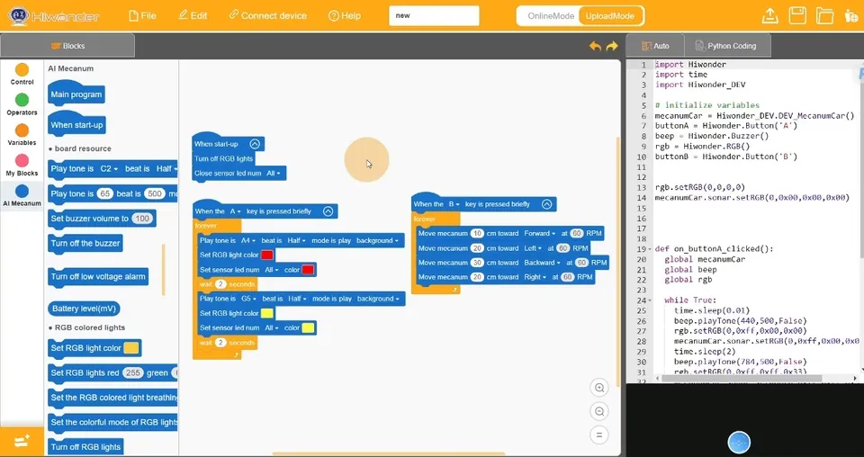

# 3.12 Lesson 12: Advanced Line-Following Innovation

## 3.12.1 Lesson Introduction

As part of the embodied AI large model curriculum series, this lesson builds upon single-sensor line following by introducing function encapsulation and a rear 6-channel line follower sensor to achieve front-and-rear coordination. Taking inspiration from "boundary-halting scenarios", the black line is treated as a cliff boundary. Following the progression of "rear line following → function encapsulation → motion modularization → front-and-rear boundary avoidance → program optimization", this lesson practices reverse line following with the rear sensor, explains function encapsulation, packages basic movements into custom functions, and combines dual sensors for boundary detection and automatic U-turns, elevating both advanced line-following applications and structured programming thinking.

## 3.12.2 Learning Objectives

**1.** Understand the core purpose and programming value of function encapsulation. Master the definition and invocation methods of custom functions. Understand the collaborative working principle of front and rear line follower sensors, and master the judgment logic for the three boundary-halting states.

**2.** Implement reverse line following using the rear 6-channel line follower sensor. Master the creation and definition of custom functions, and proficiently apply function calls to simplify the main program structure.

**3.** Establish structured thinking for modular programming. Cultivate design capabilities in code abstraction and encapsulation. Strengthen judgment logic for multi-sensor data fusion, and form an initial awareness of layered program architecture design.

**4.** Understand the vital value of modular programming in large-scale software development and stimulate interest in software engineering principles.

## 3.12.3 Preparation

**Hardware Preparation**:

- AiMecha M1 Mecanum-wheel robot base × 1

- Type-C USB data cable × 1

- Computer running Windows or macOS × 1

**Software Preparation:**

- WonderLab graphical programming platform installed and running normally

**Core Concept Description**:

**Function Encapsulation**: Function encapsulation is like packaging frequently used code into a labeled box by grouping a sequence of repeated blocks under a custom name, allowing the entire sequence to be executed simply by calling that function name. This reduces duplicate code, simplifies modifications, and keeps the program structure clear.

**Difference Between Front and Rear Sensors**: The front sensor faces the front of the car to detect road conditions while driving forward, whereas the rear sensor faces the back of the car to detect road conditions while reversing. Both sensors follow the same probe numbering rule, but their steering logic is reversed when moving in opposite directions.

**Three Boundary-Halting States**:

- **Forward Driving State**: Both the front and rear sensors detect the white background inside the safe zone, and the car drives forward normally.

- **Move Forward and U-Turn**: When the rear sensor detects the black boundary line indicating the cliff edge ahead, the car moves forward briefly and spins in place to make a U-turn.

- **Move Backward and U-Turn**: When the front sensor detects the black boundary line indicating the cliff edge behind, the car moves backward briefly and spins in place to make a U-turn.

**Hardware Port**: Connect the front 6-channel line follower sensor to port J, and connect the rear 6-channel line follower sensor to its corresponding port.

## 3.12.4 Hands-On Project

**1. Project Analysis**

This project implements a boundary-constrained driving function for the Mecanum-wheel car, adopting a dual-sensor detection and modular function control architecture. Using both front and rear 6-channel line follower sensors, the system monitors ground boundary states at the front and rear of the chassis in real time. Multi-layer conditional judgments distinguish among three operating conditions: safe forward driving, front boundary U-turn, and rear boundary U-turn, packaging the corresponding motion sequences into independent custom functions. The main program calls these functions as needed to complete autonomous control with clean and concise logic, keeping the car driving continuously within the oval boundary and automatically making a U-turn whenever it touches the black line without exiting the designated area.

💡**Complete Program Preview:**

**2. Core Commands**

|  Command Category   |                         Core Command                         | Functional Description                                       |
| :-----------------: | :----------------------------------------------------------: | :----------------------------------------------------------- |
| Function definition |  | Creates a custom function.                                   |
| Function definition |  | Defines the specific execution blocks inside the custom function. |
|   Sensor reading    |  | Reads the state of the front or rear line follower sensor.   |
|  Logical operation  |  | Jointly evaluates the states of both the front and rear sensors. |

**3. Complete Program Description**

**Task 1: Autonomous Reverse Line Following with the Rear Sensor**

- Trigger condition: Start the program when the A key is short-pressed, running inside a repeat forever loop.

- Use the rear 6-channel line follower sensor for detection and judgment.

- Set the rotational wheel speeds to negative values to achieve reverse line following.

- Straight driving state: Set both the left and right wheel groups to -40 rpm to drive straight backward.

- Adjust the backward rotational speed differential between the left and right wheel groups according to left or right deviations.

- Functional purpose: Master the usage of the rear sensor and understand the steering logic during backward driving.

**Task 2: Function Encapsulation for Basic Movements**

- Create three custom functions: Move Forward, Forward and U-Turn, and Backward and U-Turn.

- Move forward function: Set both the left and right wheel groups to drive forward at a constant rotational speed of 40 rpm.

- Forward and U-Turn function: Drive forward for a short distance. → Spin right in place at 40 rpm. → Resume forward driving once the turn is complete.

- Backward and U-Turn function: Drive backward for a short distance. → Spin left in place at 40 rpm. → Resume forward driving once the turn is complete.

- Once function encapsulation is complete, the main program only needs to call the function names, keeping the code concise and clear.

**Task 3: Basic Boundary Avoidance Program**

- Trigger condition: Start the program when the A key is short-pressed, running inside an outer repeat forever loop.

- Condition 1: When both the front sensor and the rear sensor detect the white background. → Call the move forward function.

- Condition 2: When front Probe 1 does not detect a black line and front Probe 6 detects a black line. → Call the backward and U-turn function.

- Condition 3: When rear Probe 1 does not detect a black line and rear Probe 6 detects a black line. → Call the forward and U-turn function.

- Overall outcome: The car drives within the oval ring and automatically makes a U-turn whenever it touches the black boundary line, remaining inside the ring at all times.

**Task 4: Optimized Boundary Avoidance Program**

- Add more probe state judgment conditions to cover a wider range of boundary detection scenarios.

- Add separate detections for the left boundary and right boundary, triggering U-turn maneuvers in the corresponding directions.

- Add intermediate state judgments for Probe 2 and Probe 5 to improve boundary detection sensitivity.

- Optimization outcome: Achieves more accurate boundary detection and faster response times, preventing the car from crossing the boundary or making false U-turns.

> [!NOTE]
>
> **The program source files can be downloaded from [Program Files/Advanced Line Following Innovation](https://drive.google.com/drive/folders/1vQnjkHE58XJU_cquYayobwkfJD5ZQ1KT?usp=sharing).**

**Program Upload**:

- Step 1: Power on the mecha controller and insert the Type-C data cable into the data port above the power switch on the controller.

- Step 2: Connect the other end of the data cable to a USB port on the computer.

- Step 3: Click the **Connect device** button at the top of the software interface and select the COM port corresponding to CH340 from the port list.

- Step 4: Click the upload button in the upper-right corner to download the compiled program to the mecha controller for execution.

## 3.12.5 Expansion and Advancement

**Project 1: Timed Area Patrol**

Add a timer variable to the boundary avoidance program to track the continuous driving time of the car inside the ring, playing a prompt tone and switching the RGB LED every 30 s. Record the total number of U-turns to practice the comprehensive application of variable counting and timing control.

**Project 2: Dual-Sensor Precision Backward Parking**

Utilize both the front and rear sensors to implement precision reverse parking. Use the front sensor to follow the line into the parking aisle while driving forward, and switch to the rear sensor while reversing to accurately guide the car into the parking space, practicing front-and-rear sensor switching and multi-stage task programming.

## 3.12.6 Q&A

**Q1: What is the primary purpose of encapsulating car movements into custom functions in the boundary avoidance program?**

**Answer**: The primary purpose is to reduce duplicate code and improve program maintainability.

**Q2: What is the core advantage of using dual front and rear line follower sensors compared to a single sensor?**

**Answer**: The core advantage is that the front sensor anticipates the route ahead while the rear sensor verifies the trajectory behind, working in coordination to reduce derailment and improve tracking accuracy.

## 3.12.7 Technical Support and Discussion

Join the forum for sharing questions, ideas, or suggestions, and answers will be provided promptly. Click the hyperlink [Hiwonder Forum](http://forum.hiwonder.com) or enter the URL in a browser: http://forum.hiwonder.com