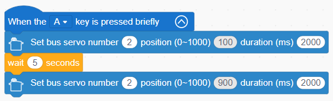
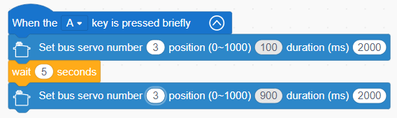
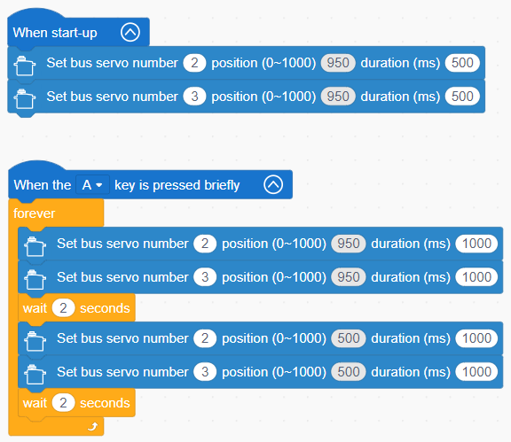

# 3.13 Lesson 13: Basic Manipulation Challenge

## 3.13.1 Lesson Introduction

Inspired by an "elevator mechanism", this lesson introduces the complete hardware architecture of the Mecanum-wheel car, focusing on bus servo operation, robotic arm joint structure, and transmission mechanics. By programming the angular positions of the bus servos to raise and lower the arm, the project culminates in a hands-on task where the "robotic arm cycles continuously between low and high positions". Through this process, the lesson provides a clear overview of the vehicle's hardware system and highlights the advantages of smart bus servos, laying a solid foundation for advanced manipulation tasks such as precision grasping and multi-level picking.

## 3.13.2 Learning Objectives

**1.** Understand the complete hardware composition of the AiMecha M1 Mecanum-wheel car, including the functions and roles of the mecha controller, encoder motors, 6-channel line follower sensor, ultrasonic sensor, WonderLens vision module, and bus servos. Learn the functional roles of the three robotic arm joints and the concept of initial angles.

**2.** Accurately identify each port on the mecha controller and complete the hardware wiring. Independently write programs to control the angular positions of bus servo ID 2 and bus servo ID 3, achieving forward extension, backward retraction, lifting, lowering, and cyclic low-to-high movements of the robotic arm.

**3.** Build a "Sense–Decide–Act" robot control mindset and understand how the controller acts as the central "brain" for processing data and dispatching commands. Develop parameterized programming skills to precisely control robotic arm movements by tuning angular position parameters.

**4.** Connect the lifting principle of the robotic arm to engineering equipment in daily life such as elevators, tower cranes, and hoists, understanding the practical value of vertical lifting modules in industrial scenarios.

## 3.13.3 Preparation

**Hardware Preparation:**

- AiMecha M1 Mecanum-wheel robot base × 1

- Type-C USB data cable × 1

- Computer running Windows or macOS × 1

**Software Preparation:**

- WonderLab graphical programming software

- Loading Extensions: Click the Add Extension icon in the lower-left corner of the WonderLab interface, select "Robot" → "AI Mecha Car", and then select "Output Module" → "Bus Servo".

## 3.13.4 Hands-On Project

**1. Program Logic**

This program focuses on the cyclic reciprocating motion of the robotic arm between low and high angles, following a closed-loop control logic of "input → processing → output". After the program starts, bus servo ID 2 and bus servo ID 3 automatically return to their default power-on low positions. Pressing the A key triggers the controller to sequentially send motion commands with position parameters to both servos via serial communication. Servo ID 2 controls the forward extension and backward retraction of the robotic arm, while servo ID 3 controls the lifting and lowering of the robotic arm, working in coordination to switch postures from low to high. A loop structure then drives the robotic arm to reciprocate continuously between the low and high positions. After completing each action, each servo sends status feedback to the controller, which updates the system state before initiating the next command interaction, forming a stable serial closed-loop control system throughout the entire process.

**2. Core Commands**

| Command Category |                         Core Command                         | Functional Description                                       |
| :--------------: | :----------------------------------------------------------: | :----------------------------------------------------------- |
|  Servo control   |  | Powers on the bus servo with the specified ID to enter a controllable state and record rotational speed. |
|  Servo control   |  | Powers off the bus servo with the specified ID, allowing manual adjustment of the robotic arm position. |
|  Servo control   |  | Sets the servo to rotate to a specified angular position and defines the execution time in milliseconds. |
|  Servo control   |  | Sets the servo to motor mode for continuous rotation at a specified speed. |
| Data acquisition |  | Reads the current angular position of the specified servo, typically used with variables. |
|   Flow control   |  | Pauses the program for a specified duration to maintain the state after a servo action completes. |
|   Flow control   |  | Loop structure that keeps the robotic arm lifting and lowering continuously. |
|  Event trigger   |  | Detects the A key press event on the controller to trigger the robotic arm action sequence. |

**3. Complete Program Description**

**Task 1: Setting the Angular Position of Bus Servo ID 2 for Robotic Arm Extension and Retraction**

- Initialize the AI Mecha Car module and the bus servo module.

- Power on bus servo ID 2.

- When the A key is pressed, set the angular position of servo ID 2 to 100 for the retracted state with a running time of 2,000 ms.

- Wait 5 s to observe the retraction process of the robotic arm.

- Set the angular position of servo ID 2 to 900 for the extended state with a running time of 2,000 ms.

- > [!CAUTION]
  >
  > **Setting the running time to 2,000 ms, equivalent to 2 s, makes the forward and backward motion of the robotic arm easier to observe. Limiting the angular position of servo ID 2 between a minimum of 100 and a maximum of 900 protects the servo from mechanical damage caused by extreme angles.**

**Task 2: Setting the Angular Position of Bus Servo ID 3 for Robotic Arm Lifting and Lowering**

- Building upon Task 1, add control blocks for servo ID 3.

- When the A key is pressed, set the angular position of servo ID 3 to lower the robotic arm with a running time of 2,000 ms.

- Wait 5 s.

- Set the angular position of servo ID 3 to raise the robotic arm with a running time of 2,000 ms.

- Setting bus servos ID 1, ID 2, and ID 3 to an angular position of 500 places them at their initial angles, where the gripper is closed and the robotic arm controlled by servo ID 2 and servo ID 3 stands in a vertical posture.

**Task 3: Cycling the Robotic Arm Between Low and High Angles**

- Combine bus servo ID 2 and bus servo ID 3 by setting their angular positions simultaneously to achieve coordinated low-to-high movement of the robotic arm.

- Low-angle state: Set servo ID 2 to a smaller angle for retraction and servo ID 3 to a smaller angle for lowering.

- High-angle state: Set servo ID 2 to a larger angle for extension and servo ID 3 to a larger angle for lifting.

- Add a repeat-forever loop structure so that pressing the A key drives the robotic arm to cycle continuously from low to high and back from high to low.

- Set the robotic arm to the low-angle posture at startup as the default power-on angle.

> [!NOTE]
>
> **The program source files can be downloaded from [Program Files/Orientation Navigation Challenge](https://drive.google.com/drive/folders/1vQnjkHE58XJU_cquYayobwkfJD5ZQ1KT?usp=sharing).**

**Program Upload:**

- Step 1: Power on the mecha controller and insert the Type-C data cable into the data port above the power switch on the controller.

- Step 2: Connect the other end of the data cable to a USB port on the computer.

- Step 3: Click the **Connect device** button at the top of the software interface and select the COM port corresponding to CH340 from the port list.

- Step 4: Click the upload button in the upper-right corner to upload the compiled program to the mecha controller for execution.

## 3.13.5 Expansion and Advancement

**Project 1: Three-Stage Lifting Transition with Sound and Light Feedback**

Optimize the robotic arm trajectory based on the basic lifting program to achieve a smooth three-stage transition across low, middle, and high positions. Introduce the RGB LEDs and buzzer for corresponding state feedback, precisely calibrating the angle parameters and matching the operating intervals so that the sound and light effects synchronize strictly with the arm movements.

**Project 2: Real-Time Robotic Arm Angular Position Readback and Limit Protection**

Write a program to read the angles of servo ID 2 and servo ID 3 in real time and print the values via the serial port. Configure limit protection so that when the angle of servo ID 2 is less than 100 or greater than 900, or when servo ID 3 exceeds its limits, the robotic arm automatically stops and illuminates a red warning light. Implement closed-loop control through continuous loop monitoring and conditional evaluation to reinforce the concepts of feedback mechanisms and robot safety control.

## 3.13.6 Q&A

**Q1: What advantages do bus servos have compared to traditional analog servos or digital servos?**

**Answer**: Bus servos support bidirectional communication and can feed back status data such as position and temperature to achieve precise closed-loop control. Compared to traditional analog servos, bus servos transmit commands via serial protocols and allow multiple servos to be daisy-chained in series, simplifying wiring and facilitating expansion. Their high intelligence and programmability make them an ideal choice for building multi-degree-of-freedom robotic arms.

**Q2: What components make up the robotic arm structure, and what movements do the three bus servos control respectively?**

**Answer**: The robotic arm consists of a base, an arm linkage, and an end effector. Servo ID 1 controls the opening and closing of the gripper, servo ID 2 controls horizontal extension and retraction, and servo ID 3 controls vertical lifting and lowering. The three servos work in coordination to achieve three-dimensional spatial positioning and grasping. In the initial state, the angular position of each servo is set to 500, keeping the gripper closed and the arm linkage vertical.

## 3.13.7 Technical Support and Discussion

Join the forum for sharing questions, ideas, or suggestions, and answers will be provided promptly. Click the hyperlink [Hiwonder Forum](http://forum.hiwonder.com) or enter the URL in a browser: http://forum.hiwonder.com