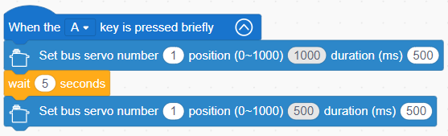
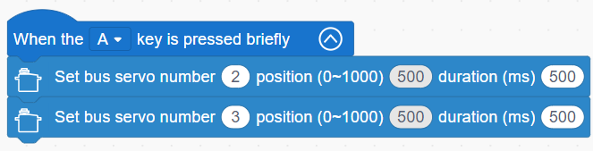
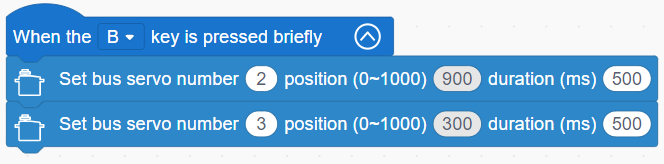
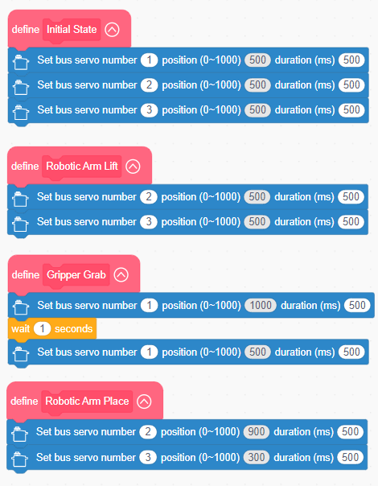
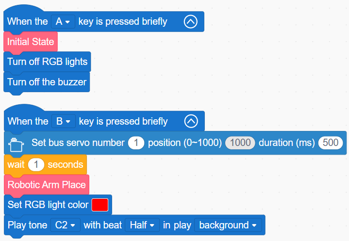
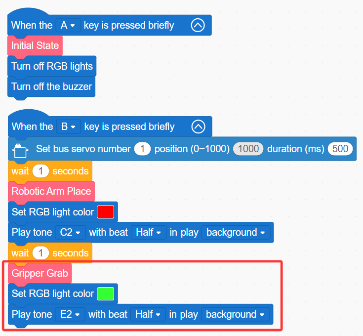
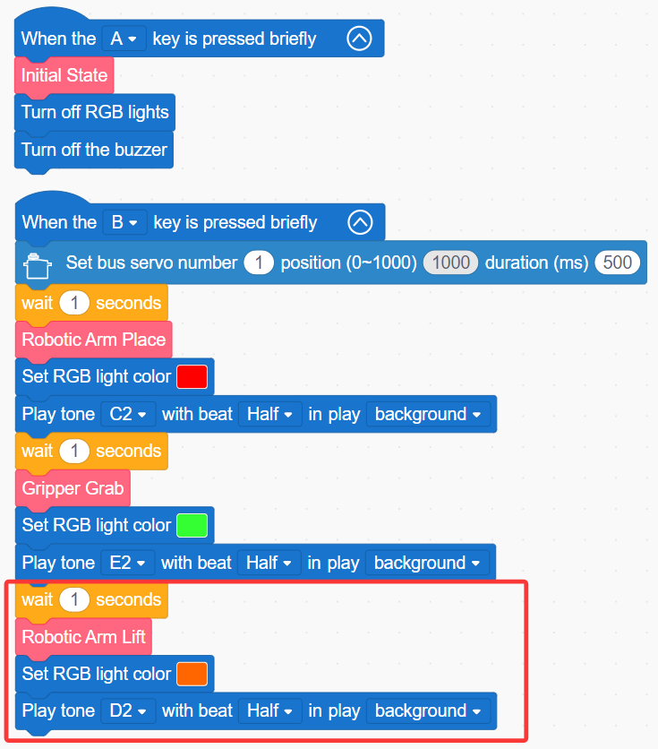

# 3.14 Lesson 14: Precision Grasping Challenge

## 3.14.1 Lesson Introduction

Building upon the previous lesson where servo ID 2 and servo ID 3 controlled the vertical and horizontal movements of the robotic arm, this lesson introduces servo ID 1 to control the opening and closing of the mechanical gripper, coordinating multi-servo grasping commands alongside the buzzer and RGB LEDs for status feedback.

Inspired by industrial robotic arm material handling, this lesson explains the mechanical gripper mechanism, reviews the usage of sound and light modules, and sets up five progressive tasks ranging from single-servo control to function encapsulation and multi-action coordination. Completing the hands-on project of positioning, grasping, and lifting demonstrates the "Sense, Decide, Act" control logic. Mastering gripper control, action sequencing, function reuse, and sound-light synchronization lays a solid foundation for subsequent advanced lessons.

## 3.14.2 Learning Objectives

**1.** Understand the working principle of the mechanical gripper and master the angular parameter settings of servo ID 1 for closing and opening the gripper. Understand the sound generation principle of the buzzer and master the RGB primary-color mixing principle of the RGB LEDs.

**2.** Independently set the angular position of servo ID 1 to close and open the mechanical gripper. Write programs to control servo ID 3 for raising and lowering the robotic arm. Encapsulate actions such as gripper grasping, arm raising, arm placing, and returning to the initial state into custom functions and call them.

**3.** Develop an action-sequencing mindset to break down complex grasping tasks into ordered steps of positioning, grasping, and lifting. Cultivate a modular programming approach to understand how encapsulating repeated actions into functions simplifies code structure and improves readability.

**4.** Connect robotic arm grasping technology to daily and industrial scenarios such as smart food lockers, industrial assembly line sorting, and warehouse palletizing. Understand the broad practical value of action-sequence programming in automated equipment.

## 3.14.3 Preparation

**Hardware Preparation:**

- AiMecha M1 Mecanum-wheel robot base × 1

- Type-C USB data cable × 1

- Computer running Windows or macOS × 1

**Software Preparation:**

- WonderLab graphical programming platform installed and running properly

**Key Parameter Description:**

- For Servo ID 1, a position value of 500 represents the initial closed state. Values less than 500 open the gripper, while values greater than 500 close it further. Specific values should be fine-tuned based on the actual gripper structure.

- The buzzer supports pitch and beat settings, where pitch is determined by frequency and beat is determined by duration.

- The RGB LEDs can be set to preset colors such as red, green, blue, yellow, and orange.

- Maintain a distance of approximately 9 cm between the small block and the Mecanum-wheel car to facilitate accurate grasping by the robotic arm.

## 3.14.4 Hands-On Project

**1. Program Logic**

This program focuses on in-place grasping of a small block combined with sound and light feedback, following a three-layer "Sense–Decide–Act" logic. The sensing layer receives commands via Button A and Button B. The decision-making layer uses the controller to determine the action stage, and the execution layer coordinates bus servos ID 1, ID 2, and ID 3 while driving different buzzer pitches and RGB LED colors for stage feedback. Modular actions are encapsulated into custom functions and called sequentially with time delays to ensure smooth execution.

**2. Core Commands**

|     Command Category     |                         Core Command                         | Functional Description                                       |
| :----------------------: | :----------------------------------------------------------: | :----------------------------------------------------------- |
|      Servo control       |  | Controls the mechanical gripper to close by increasing the angle or open by decreasing the angle, and sets the running time. |
| Sound and light feedback |  | Controls the buzzer to emit a sound of a specified frequency and duration as an action status prompt. |
| Sound and light feedback |  | Sets the onboard RGB LEDs on the controller to display specified colors such as red, green, or orange to indicate the current action stage. |
|       Flow control       |  | Extends the wait time to complete action transitions and ensure a stable grasping process. |
|  Function encapsulation  |  | Encapsulates grasping, raising, placing, and initial state actions into reusable custom functions. |
|      Event trigger       |  | Detects button press events to trigger the corresponding action sequence or state recovery. |

**3. Complete Program Description**

**Task 1: Setting Bus Servo ID 1 Position Parameters to Close and Open the Gripper, and Setting Bus Servo ID 3 to Raise and Place the Robotic Arm**

- Initialize the AI Mecha Car module and the bus servo module.

- When Button A is pressed, set the angle of servo ID 1 to open the mechanical gripper, and wait 5 s to observe the opening process.

- Set the angle of servo ID 1 again to close the mechanical gripper.

- When Button A is pressed, set the angle of servo ID 3 to raise the robotic arm.

- When Button B is pressed, set the angle of servo ID 3 to lower the robotic arm.

- Control each servo individually to become familiar with the robotic arm movement corresponding to each servo.

**Task 2: Encapsulating Functions for Gripper Grasping, Arm Raising, Arm Placing, and Initial State**

- Define the `Gripper Grab` function: Rotate servo ID 1 from the open state to the closed angle, setting a wait time to complete the grasping process.

- Define the `Robotic Arm Lift` function: Rotate servo ID 3 from the low position to the raised angle while retracting servo ID 2 in coordination.

- Define the `Robotic Arm Place` function: Lower servo ID 3 and extend servo ID 2 forward to the placement position.

- Define the `Initial State` function: Return all three servos to their initial position at angle 500.

- Once these actions are encapsulated into functions, calling the function names in the main program executes the complete routines and significantly simplifies the code.

**Task 3: Programming the Buzzer to Sound and the RGB LED to Illuminate Red When Positioning the Robotic Arm at the Small Block**

- When the A key is pressed, call the initial state function to restore the robotic arm position.

- When the B key is pressed, move the robotic arm to the target position by extending servo ID 2 forward and lowering servo ID 3 to the height of the block.

- Upon completing positioning, trigger the buzzer to play a prompt tone and illuminate the RGB LEDs in red to indicate that "positioning" is complete.

- > [!CAUTION]
  >
  > **Keep the distance between the block and the Mecanum-wheel car at approximately 9 cm to ensure the robotic arm accurately reaches the grasping position.**

**Task 4: Programming the Robotic Arm to Grasp the Small Block While Triggering the Buzzer and Illuminating the RGB LEDs in Green**

- Press Button A to restore the initial state, and press Button B to execute the grasping action.

- Call the `Gripper Grab` function so that servo ID 1 closes to clamp the block firmly.

- When the grasping action is triggered, sound a different pitch on the buzzer and illuminate the RGB LEDs in green to indicate "successful grasping".

**Task 5: Programming the Robotic Arm to Lift the Small Block While Triggering the Buzzer and Illuminating the RGB LEDs in Orange**

- Press Button A to restore the initial state, and press Button B to execute the lifting action.

- Call the `Robotic Arm Lift` function so that servo ID 3 rises and lifts the block off the ground.

- When the lifting action is triggered, sound a third pitch on the buzzer and illuminate the RGB LEDs in orange to indicate that the block is "lifted".

- Finally, integrate all tasks to achieve the complete action sequence from positioning → grasping → lifting alongside synchronized sound and light feedback.

> [!NOTE]
>
> **The program source files can be downloaded from [Program Files/Line Following Precision Parking](https://drive.google.com/drive/folders/1vQnjkHE58XJU_cquYayobwkfJD5ZQ1KT?usp=sharing).**

**Program Upload:**

- Step 1: Power on the mecha controller and insert the Type-C data cable into the data port above the power switch on the controller.

- Step 2: Connect the other end of the data cable to a USB port on the computer.

- Step 3: Click the **Connect device** button at the top of the software interface and select the COM port corresponding to CH340 from the port list.

- Step 4: Click the upload button in the upper-right corner to download the compiled program to the mecha controller for execution.

## 3.14.5 Expansion and Advancement

**Project 1: Combined Driving + Grasping Motion**

This composite task combines Mecanum-wheel car movement control with in-place grasping to complete a full six-step transport workflow. The core challenge is precisely controlling the travel distance and steering angle of the Mecanum-wheel car so that it stops approximately 9 cm from the block, while coordinating the timing transition between chassis stopping and robotic arm execution to illustrate the multi-degree-of-freedom collaborative control logic of a mobile manipulator.

**Project 2: Adaptive Grasping Force and Drop Detection**

Utilize bus servo position readback to implement intelligent drop prevention. Compare the actual position with the target position during grasping, maintaining the current angle if a deviation exists or continuing to close if no deviation is detected. Continuously monitor the servo position after lifting the block, identifying any sudden position change as an object slip and immediately triggering a sound and light alarm. This demonstrates stall detection principles, feedback control, and adaptive robot behavior.

## 3.14.6 Q&A

**Q1: Which bus servo angular positions need to be adjusted when the robotic arm grasps and lifts a small block, and why?**

**Answer**: A complete grasping maneuver requires the coordination of all three servos: servo ID 1 controls the gripper to close and clamp the object, servo ID 2 controls arm extension and retraction to position the horizontal distance, and servo ID 3 controls arm lifting and lowering to adjust the vertical height. All three servos are indispensable, as relying on only one or two servos cannot achieve accurate positioning and grasping. Coordinating all three servos executes the entire workflow from positioning and grasping to lifting, ensuring stable and efficient block transport.

**Q2: How can in-place grasping commands be executed in an orderly manner, and what is the purpose of adding wait blocks?**

**Answer**: In-place grasping must be executed sequentially in the order of positioning, grasping, and lifting, where the core lies in using wait blocks to regulate timing. Because bus servos require physical time to rotate to their target angles, issuing a new command without waiting interrupts the preceding action and causes erratic movement or grasping failure. Setting a delay duration that matches the servo running time ensures each step completes stably, such as clamping the block firmly before lifting the arm, to guarantee successful grasping.

## 3.14.7 Technical Support and Discussion

Join the forum for sharing questions, ideas, or suggestions, and answers will be provided promptly. Click the hyperlink [Hiwonder Forum](http://forum.hiwonder.com) or enter the URL in a browser: http://forum.hiwonder.com