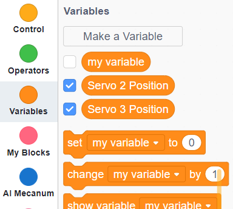
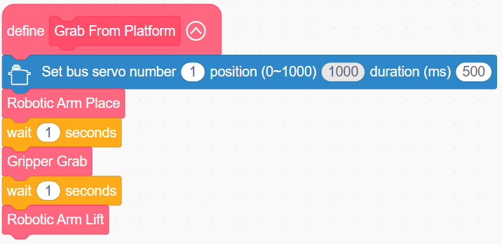
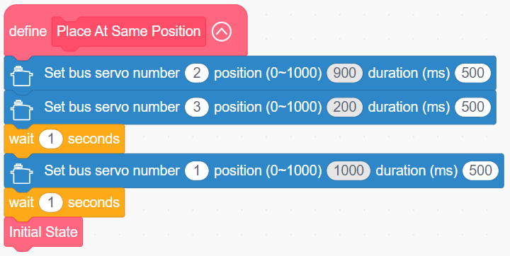
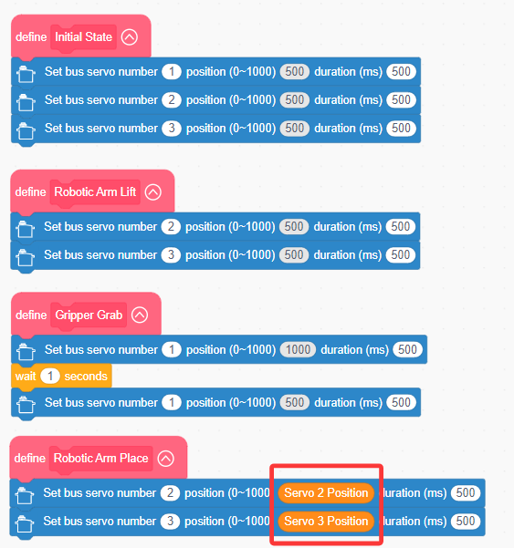
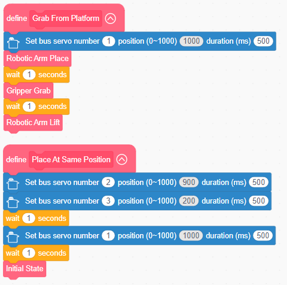
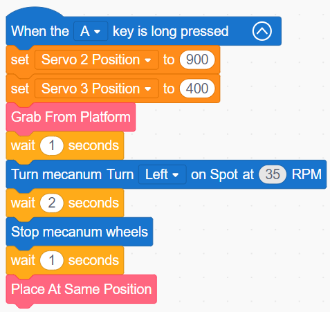
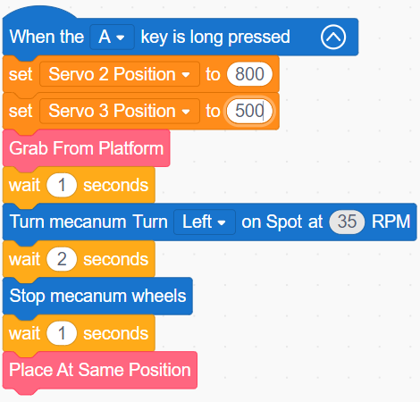

# 3.15 Lesson 15: Multi-Layer Gripping Training

## 3.15.1 Lesson Introduction

Building upon basic manipulation and in-place grasping from the previous two lessons, this third lesson in the robotic arm series focuses on multi-level grasping of objects at different heights. Adding a vertical height dimension to planar grasping, the robotic arm adjusts its grasping parameters according to the object height and coordinates with the movement of the Mecanum-wheel car to pick up blocks from different heights and place them in a designated area.

Inspired by warehouse palletizing operations, this lesson highlights the importance of height and positional accuracy. Analyzing the positions of high and low blocks determines the corresponding servo angles across four progressive tasks, including variable definition and function encapsulation. The core project coordinates the Mecanum-wheel car and the robotic arm to grasp and return blocks from high and low platforms, practicing parameterized programming, variable operations, height parameter tuning, and chassis-arm coordination in preparation for distance measurement and vision sorting lessons.

## 3.15.2 Learning Objectives

**1.** Understand how to determine the command parameters for positioning the robotic arm at different heights, and master the relationship between the angular positions of servo ID 2 and servo ID 3 and the resulting grasping height. Understand the role of variables in programming and master how to define, assign, and call variables.

**2.** Tune the angular position parameters of servo ID 2 and servo ID 3 according to object height. Use variables to store servo angular positions for flexible switching between grasping parameters at different heights. Encapsulate custom functions for picking from a platform and placing at the same location.

**3.** Develop a parameterized programming mindset by using variables instead of fixed numerical values to make programs more flexible and versatile. Build multi-level task decomposition skills to break down complex multi-height grasping tasks into independent picking and placing modules.

**4.** Connect multi-level grasping technology to practical application scenarios such as logistics warehouse palletizing, factory material loading and unloading, and library book sorting. Understand the practical value of parameterized programming in adapting automated equipment to objects of varying specifications.

## 3.15.3 Preparation

**Hardware Preparation:**

- AiMecha M1 Mecanum-wheel robot base × 1
- Type-C USB data cable × 1
- Computer running Windows or macOS × 1

**Software Preparation:**

- WonderLab graphical programming platform installed and running properly

**Key Parameter Description:**

- Low-position small block: Located 3.5 cm above the reference plane at a distance of 10 cm from the Mecanum-wheel car, with the angular position of servo ID 2 set to 800 and servo ID 3 set to 500.

- High-position small block: Located 9.5 cm above the reference plane on a 9.5 cm platform at a distance of 10 cm from the Mecanum-wheel car, with the angular position of servo ID 2 set to 900 and servo ID 3 set to 400.

- The angular positions of servo ID 2 and servo ID 3 above serve as reference values and can be adjusted according to the actual placement locations.

- In-place 90° rotation of the Mecanum-wheel car is achieved by configuring the rotational speeds and wait time.

## 3.15.4 Hands-On Project

**1. Program Logic**

This program implements multi-level grasping and unified placement by configuring servo angles for high and low positions using parameterized variables. After the Mecanum-wheel car moves into position, the robotic arm adjusts its height according to the variable values to grasp the block and transport it to a fixed location for placement. By encapsulating the picking and placing functions, the main program sequentially calls the low-position and high-position tasks, completing multi-height block handling and unified placement while improving code reusability.

**2. Core Commands**

|    Command Category    |                         Core Command                         | Functional Description                                       |
| :--------------------: | :----------------------------------------------------------: | :----------------------------------------------------------- |
|   Variable operation   |  | Defines angular position variables for servo ID 2 and servo ID 3, assigning different parameter values according to target heights. |
|     Servo control      |  | Uses variables to control the forward extension and backward retraction of the robotic arm, dynamically adjusting variable values based on grasping height. |
|     Servo control      |  | Controls the mechanical gripper to open and close for grasping and releasing actions. |
|     Motor control      |  | Controls the Mecanum-wheel car to move forward, backward, and laterally toward different platforms and placement areas. |
|     Motor control      |  | Controls the Mecanum-wheel car to rotate 90° in place, adjusting its heading to align with different platforms or placement areas. |
| Function encapsulation |  | Encapsulates the complete sequence of lowering→ grasping → raising the robotic arm, using variable parameters to adapt to different heights. |
| Function encapsulation |  | Encapsulates the placement sequence of lowering → releasing → raising the robotic arm to place all blocks at the same location. |

**3. Complete Program Description**

**Task 1: Setting the Angular Positions of Servo ID 2 and Servo ID 3 as Variables**

- Building upon the program from the previous lesson, define two variables: `servo 2 position` and `servo 3 position`.

- Because the lowering angle of the robotic arm varies when picking up small blocks from platforms of different heights, variables are used to dynamically store the angular values.

- Initialize the variables with the low-position grasping parameters by setting `servo 2 position` to 800 and `servo 3 position` to 500.

- Assign the corresponding angular values to the variables before executing grasping maneuvers at different heights.

**Task 2: Encapsulating Functions for Picking from a Platform and Placing at the Same Location**

- Define the `Grab From Platform` function: Extend servo ID 2 forward to its variable value position → lower servo ID 3 to its variable value position → wait → close servo ID 1 to grasp the block → wait → raise servo ID 3 → retract servo ID 2.

- Define the `Place At Same Position` function: Extend servo ID 2 forward to the placement position → lower servo ID 3 to the placement height → open servo ID 1 to release the block → wait → raise servo ID 3 → retract servo ID 2 to return to the initial position.

- Both functions use variables to control key angles, allowing a single set of code to adapt to different heights.

**Task 3: Picking Up a Small Block from a Low Position and Placing It at a Specified Location**

- Set the low-position parameters by assigning `Servo 2 Position` to 800 and `Servo 3 Position` to 500.

- Move the Mecanum-wheel car in front of the low platform, maintaining a distance of approximately 10 cm.

- Call the `Grab From Platform` function to grasp the small block located 3.5 cm above the reference plane.

- Move the Mecanum-wheel car to the unified placement area.

- Call the `Place At Same Position` function to place the block at the designated position.

  > [!CAUTION]
  >
  > **The angular positions of servo ID 2 and servo ID 3 can be adjusted according to the actual placement locations.**

  

**Task 4: Picking Up a Small Block from a High Position and Placing It at a Specified Location**

- Set the high-position parameters by assigning `Servo 2 Position` to 900 and `Servo 3 Position` to 400.

- Move the Mecanum-wheel car in front of the high platform, maintaining a distance of approximately 10 cm.

- Call the `Grab From Platform` function to grasp the small block on the 9.5 cm platform.

- Move the Mecanum-wheel car to the unified placement area.

- Call the `Place At Same Position` function to place the block at the same location as the low-position block.

- Similarly, the angular positions of servo ID 2 and servo ID 3 can be adjusted according to the actual placement locations.

- Finally, integrate Task 3 and Task 4 to sequentially pick up small blocks from different heights and place them at a unified location.

> [!NOTE]
>
> **The program source files can be downloaded from [Program Files/Line Following Intersection Feedback](https://drive.google.com/drive/folders/1vQnjkHE58XJU_cquYayobwkfJD5ZQ1KT?usp=sharing).**

**Program Upload:**

- Step 1: Power on the mecha controller and insert the Type-C data cable into the data port above the power switch on the controller.
- Step 2: Connect the other end of the data cable to a USB port on the computer.
- Step 3: Click the **Connect device** button at the top of the software interface and select the COM port corresponding to CH340 from the port list.
- Step 4: Click the upload button in the upper-right corner to upload the compiled program to the mecha controller for execution.

## 3.15.5 Expansion and Advancement

**Project 1: Multi-Height Stepped Grasping and Rotational Placement**

Expand the task to three-tiered stepped grasping by using arrays to manage multiple sets of height parameters. Drive the Mecanum-wheel car sequentially to each tier, grasp the block, and rotate 90° in place to place the blocks at the front, left, and right positions, respectively. This project focuses on data structure application and multi-task scheduling, requiring precise control over vehicle movement and steering.

**Project 2: Automatic Grasping Height Measurement and Parameter Adaptation**

Integrate the ultrasonic sensor to achieve automatic height measurement and adaptive grasping. Slowly lower the robotic arm from a high position while monitoring the distance in real time, recording the servo angle as the grasping height whenever a sudden distance change occurs. Using a height search algorithm links sensor data with actuator movements, replacing manually preset parameters.

## 3.15.6 Q&A

**Q1: Which servo IDs need their angles adjusted when grasping at different heights, and why?**

**Answer**: Adjusting servo ID 2 and servo ID 3 requires coordinated tuning. Due to the mechanical linkage structure, changing the vertical height via servo ID 3 simultaneously affects the horizontal reach of the gripper, requiring a synchronized adjustment to the forward extension of servo ID 2 to compensate for the horizontal displacement. For example, low-position grasping sets servo ID 2 to 800 and servo ID 3 to 500, whereas high-position grasping sets servo ID 2 to 900 and servo ID 3 to 400. Only by varying both parameters together can the mechanical gripper accurately reach the target point, whereas adjusting a single servo cannot balance both height and horizontal distance.

**Q2: How is the in-place 90° rotation of the Mecanum-wheel car achieved, and what parameters need to be configured?**

**Answer**: In-place 90° rotation of the Mecanum-wheel car is achieved through four-wheel differential speed control, where rotating the left and right motors in opposite directions generates rotational torque. Because open-loop control is affected by ground friction, the rotation angle is indirectly controlled by "setting the rotational speed + tuning the wait time". Estimate the duration first before fine-tuning through field testing, or introduce an IMU gyroscope for closed-loop feedback to eliminate errors and ensure an accurate 90° rotation.

## 3.15.7 Technical Support and Discussion

Join the forum for sharing questions, ideas, or suggestions, and answers will be provided promptly. Click the hyperlink [Hiwonder Forum](http://forum.hiwonder.com) or enter the URL in a browser: http://forum.hiwonder.com