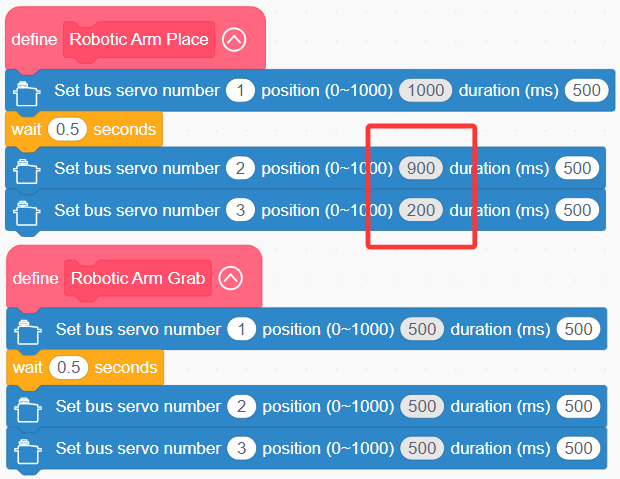
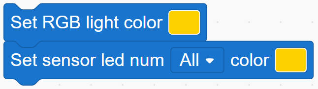
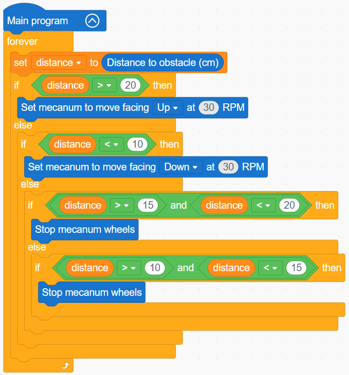
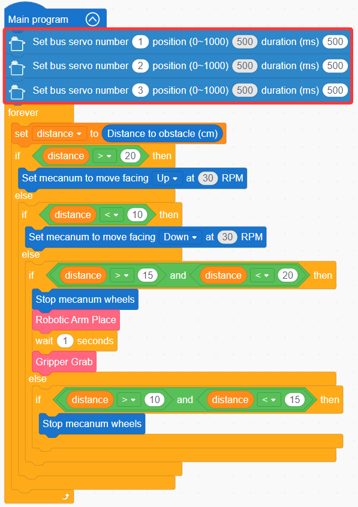
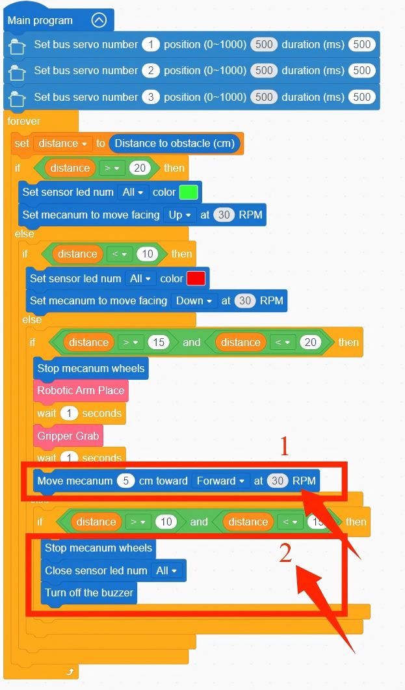

# 3.16 Lesson 16: Chassis and Robotic Arm Programming Practice

## 3.16.1 Lesson Introduction

Building upon basic manipulation, precision grasping, and multi-level grasping from the previous three lessons, this fourth lesson in the robotic arm series incorporates the ultrasonic sensor to link perception with execution. Moving beyond manual key triggers, this lesson implements a fully automated workflow of ultrasonic distance measurement, Mecanum-wheel car approach, and automatic robotic arm grasping upon arrival, completing the transition from manual control to intelligent control.

Inspired by automated food assembly line picking, this lesson demonstrates the value of sensor integration. After reviewing ultrasonic ranging principles, four progressive tasks are set up to complete detection-driven movement, encapsulate angular functions, enable automatic grasping, and optimize anti-repeat grasping. The core project drives the Mecanum-wheel car to advance automatically based on distance measurement and complete grasping upon reaching the target range. Mastering ultrasonic programming, sensor-variable integration, conditional evaluation, and automated workflow design lays a solid foundation for line-following, obstacle avoidance, and vision recognition courses.

## 3.16.2 Learning Objectives

**1.** Understand the distance measurement principle of the ultrasonic module. Master the hardware structure and I2C communication method of the ultrasonic sensor, and learn how to combine sensor data with variables in programming.

**2.** Write programs to read the distance detected by the ultrasonic sensor and store it in a variable. Use conditional statements to control different movement modes of the Mecanum-wheel car based on ultrasonic distance values.

**3.** Establish a closed-loop control mindset by understanding the complete control loop of sensor detection → controller decision-making → actuator execution → status feedback. Cultivate data-filtering awareness by recognizing that reading the ultrasonic sensor multiple times within a single cycle can cause inconsistent evaluations, whereas storing the reading in a variable resolves this issue.

**4.** Connect ultrasonic ranging and robotic arm coordination technology to industrial scenarios such as smartphone screen assembly lines, food processing lines, and automated warehouse sorting.

## 3.16.3 Preparation

**Hardware Preparation:**

- AiMecha M1 Mecanum-wheel robot base × 1
- Type-C USB data cable × 1
- Computer running Windows or macOS × 1

**Software Preparation:**

- WonderLab graphical programming platform installed and running properly

**Key Parameters and Layout Description:**

- Mount the ultrasonic sensor onto the Mecanum-wheel chassis at a height of approximately 8 cm and a width of approximately 6 cm.

- Place the small target block in front of a "black support block" at a fixed position.

- A stack of eight textbooks with an average thickness of 1 cm each can substitute for the "black support block".

- Grasping range: An ultrasonic detection distance between 10 cm and 15 cm represents the optimal grasping range.

- Stopping threshold: The Mecanum-wheel car stops when the obstacle distance detected by the ultrasonic sensor is less than 25 cm.

## 3.16.4 Hands-On Project

**1. Program Logic**

Focusing on ultrasonic distance measurement, Mecanum-wheel car movement, and automatic robotic arm grasping, this program operates across a three-layer logic. Distance measurement data is cached in a variable for conditional evaluation, stopping the car to trigger grasping and synchronized sound-light feedback once the target range is reached. After grasping the object, the Mecanum-wheel car moves forward 5 cm to exit the trigger zone, forming a complete closed loop that prevents repeated grasping.

**2. Core Commands**

|     Command Category     |                         Core Command                         | Functional Description                                       |
| :----------------------: | :----------------------------------------------------------: | :----------------------------------------------------------- |
|      Sensor reading      |  | Reads the distance to an object ahead, measured by the ultrasonic sensor in centimeters, typically stored in a variable. |
|      Servo control       |  | Controls the mechanical gripper to close for grasping a block or open for releasing a block. |
|  Function encapsulation  |  | Encapsulates the complete grasping and placing action sequences, including lowering, grasping or releasing, and lifting. |
| Sound and light feedback |  | Illuminates different light colors as status feedback when detecting obstacles or executing grasping actions. |
| Sound and light feedback |  | Emits prompt tones during key state transitions.             |

**3. Complete Program Description**

**Task 1: Programming Ultrasonic Obstacle Distance Detection and Mecanum-Wheel Car Movement**

- Define a `Distance` variable and assign the obstacle distance detected by the ultrasonic sensor to this variable.

- Note: Reading the ultrasonic sensor directly multiple times during obstacle detection can lead to inconsistent evaluations, which is resolved by storing the reading in a variable.

- Continuously update the value of the `Distance` variable inside the repeat forever loop.

- Apply conditional evaluation: When `Distance` is greater than 25, drive the Mecanum-wheel car forward to approach the target. When `Distance` is less than or equal to 25, stop the Mecanum-wheel car.

- Add ultrasonic RGB light changes as detection status feedback.

**Task 2: Tuning the Robotic Arm Lowering Angle to Align with the Small Block and Encapsulating Placing and Grasping Functions**

- Manually tune the angular positions of servo ID 2 and servo ID 3 so that the mechanical gripper reaches the exact grasping height of the small block.

- Fine-tune the angles according to the actual physical setup to account for minor positional differences.

- Define the `Robotic Arm Place` function: Extend the robotic arm forward → lower it to the grasping height → open the mechanical gripper → wait → raise the arm back to the initial position.

- Define the `Robotic Arm Grab` function: Extend the robotic arm forward → lower it to the grasping height → close the mechanical gripper → wait until clamped firmly → raise the arm back to the initial position.

- Initialize the robotic arm posture to the initial state.

**Task 3: Adding Grasping Code Blocks for Automatic In-Range Grasping**

- Add a branch to the conditional statement: When `Distance` is within the grasping range, call the `Gripper Grab` function.

- Because the car remains within the grasping range, the loop triggers the grasping action repeatedly.

- Trigger buzzer and RGB LED responses during grasping.

**Task 4: Resolving Repeated Grasping and Adding Ultrasonic RGB Light Responses**

- Optimize the logic: After the robotic arm completes grasping within the target range, drive the Mecanum-wheel car forward by 5 cm.

- Moving forward 5 cm places the ultrasonic detection distance outside the 10 cm to 15 cm trigger interval, stopping the Mecanum-wheel car and preventing repeated grasping.

- Add ultrasonic RGB light changes as status responses, illuminating one color during detection and another color during grasping.

- Finally, integrate all tasks to achieve the complete automated workflow of ultrasonic detection → automatic approach → in-range grasping → forward movement to prevent repetition.

> [!NOTE]
>
> **The program source files can be downloaded from [Program Files/Line Following and Obstacle Avoidance Switching](https://drive.google.com/drive/folders/1vQnjkHE58XJU_cquYayobwkfJD5ZQ1KT?usp=sharing).**

**Program Upload:**

- Step 1: Power on the mecha controller and insert the Type-C data cable into the data port located above the power switch on the controller.

- Step 2: Connect the other end of the data cable to a USB port on the computer.

- Step 3: Click the **Connect device** button at the top of the software interface and select the COM port corresponding to CH340 from the port list.

- Step 4: Click the upload button in the upper-right corner to download the compiled program to the mecha controller for execution.

## 3.16.5 Expansion and Advancement

**Project 1: Ultrasonic Ranging and Height-Adaptive Grasping**

Add height-adaptive functionality to the basic automatic grasping program by placing target blocks on black support blocks of varying heights. Slowly lower the robotic arm from a high position while measuring distance with the ultrasonic sensor, recording the angle of servo ID 3 as the grasping height whenever a sudden distance change is detected before executing the grasp. Linking distance data with servo positions optimizes the search algorithm and illustrates autonomous three-dimensional environmental perception.

**Project 2: Multi-Target Sequential Automatic Grasping and Transport**

Design a multi-target automatic grasping system where the Mecanum-wheel car drives along a straight line to approach three equally spaced blocks sequentially, stopping automatically via ultrasonic ranging to grasp each block, transporting them to a unified placement area, and returning in a loop. Use a counter variable to record the number of grasped blocks and rely on movement distance to locate the next target, building a full-process state machine logic to practice decomposing and sequencing complex tasks.

## 3.16.6 Q&A

**Q1: After the ultrasonic sensor measures the distance, what are the primary grasping parameters that must be tuned on the robotic arm, and why?**

**Answer**: The core grasping parameters are the angular positions of servo ID 2 and servo ID 3. The ultrasonic sensor only controls the Mecanum-wheel car to stop at an appropriate horizontal distance and cannot determine whether the grasp succeeds. An incorrect height causes the gripper to pass over the object or collide with the ground, while an incorrect forward extension causes the gripper to fall short or push the object away. Both servo angles must be tuned accurately so that the mechanical gripper reaches the exact position of the object for a stable grasp.

**Q2: What is the purpose of adding wait time during the robotic arm grasping process?**

**Answer**: Adding wait time ensures that the mechanical gripper clamps the object firmly and stably. After receiving a closing command, the bus servo requires physical time to complete its rotation and build sufficient clamping force on the gripper. Lifting the arm immediately without waiting easily causes the object to slip due to an incomplete grasp. Setting the wait duration slightly longer than the servo running time guarantees complete action execution and stabilizes the timing of the entire sequence, preventing consecutive actions from interfering with each other.

## 3.16.7 Technical Support and Discussion

Join the forum for sharing questions, ideas, or suggestions, and answers will be provided promptly. Click the hyperlink [Hiwonder Forum](http://forum.hiwonder.com) or enter the URL in a browser: http://forum.hiwonder.com