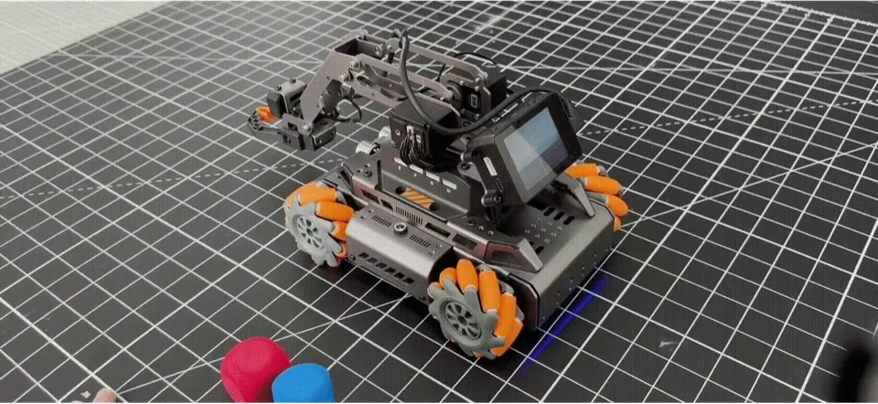
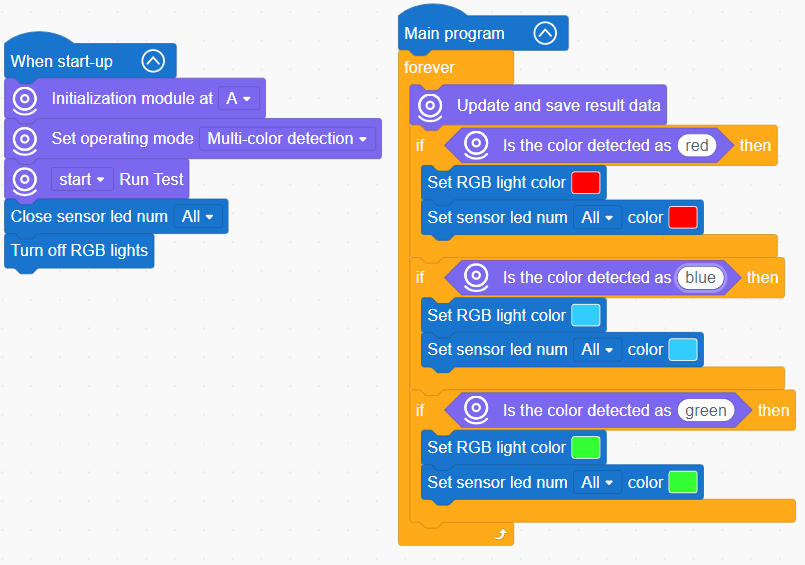
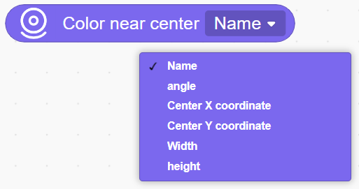
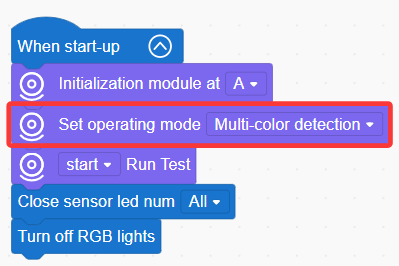
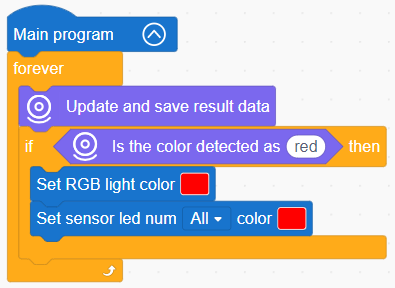
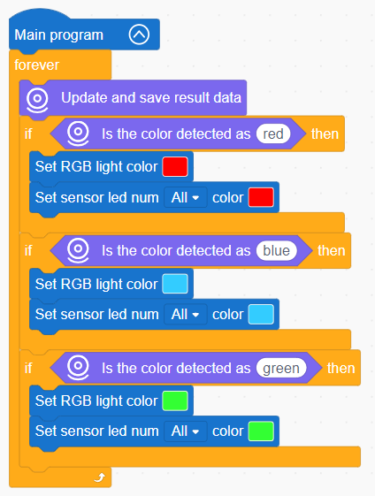

# 3.17 Lesson 17: Multi-Color Recognition

## 3.17.1 Lesson Introduction

Inspired by automated fruit sorting, this lesson bridges human color perception with machine RGB recognition, introducing the K230 module hardware and its library of over 30 AI vision functions. By mastering core operations such as vision initialization, multi-color detection, and real-time data updating, students enable the car to identify red, green, and blue objects and trigger matching RGB LEDs in a seamless "what you see is what lights up" interaction. Serving as the foundation for AI vision, this lesson establishes a unified programming paradigm of "initialization, detection, data updating, and conditional evaluation" for subsequent courses such as face recognition.

## 3.17.2 Learning Objectives

1. Understand the RGB three-channel principle of machine vision color recognition and master the fundamental concept of pixel brightness analysis. Learn the dual-module architecture of the K230 split-type vision module, which pairs a camera with a screen processor, along with the advantages of its split design.

2. Independently complete the hardware installation of the K230 split-type module and wire it to port A. Proficiently master the three-step initialization workflow of port initialization, mode configuration, and detection startup.

3. Establish a three-layer machine vision architectural mindset of visual perception, AI processing, and command output. Cultivate modular programming habits and master the standard program structure of initialization, main loop, and conditional response.

4. Connect color vision technology to real-world application scenarios such as color sorters, smart shelves, traffic light recognition, and industrial optical sorting machines, understanding its broad value in industrial automation and daily life.

## 3.17.3 Preparation

**Hardware Preparation:**

- AiMecha M1 Mecanum-Wheel Car Advanced Kit
- Type-C USB data cable
- Computer × 1
- Remote controller

**Software Preparation:**

- WonderLab graphical programming software

**Hardware Structure Description:**

- **HD Camera Module**: Captures images like the eyes of the robot and is mounted at the front of the car.

- **K230 Screen Module**: Features a built-in AI processor for image analysis and computation, mounted in the middle of the car body.

- The two modules are connected via a data cable, featuring a split design that allows flexible installation without mutual interference.

**Wiring Instructions:**

- Connect the K230 screen module to port A of the controller using a serial cable.

- Connect the camera module to the camera port on the screen module using the dedicated ribbon cable.

- Mount the camera facing forward and the screen facing upward for easy observation of recognition results.

**Color Recognition Mode Categories:**

- **Single-Color Detection**: Detects only one specified color, suitable for simple scenarios.

- **Multi-Color Detection**: Simultaneously detects multiple preset colors, which is the mode used in this lesson.

- **Color Self-Learning**: Learns and names custom colors, suitable for specialized color targets.

## 3.17.4 Hands-On Project

**1. Program Logic**

This lesson builds a machine vision system based on "visual perception, real-time detection, and status feedback". The split camera transmits images via the ribbon cable to the K230 processor, where AI algorithms analyze RGB values pixel by pixel to identify red, green, and blue color blocks along with their coordinates and confidence scores, synchronizing the results across the onboard RGB LEDs and ultrasonic RGB lights. The program follows the four-step K230 paradigm: initialize the communication port, select multi-color detection mode, start detection, and turn off the lights. In each frame of the main loop, the controller updates and caches the latest results, sequentially checking for red, green, or blue detections to illuminate the corresponding lights. Operating at approximately 30 frames per second, the system achieves real-time "color-triggered lighting" interaction.

💡**Complete Program Preview:**

**2. Core Commands**

|   Command Category    |                         Core Command                         | Functional Description                                       |
| :-------------------: | :----------------------------------------------------------: | :----------------------------------------------------------- |
| Module initialization |  | Configures the communication port of the K230 module to establish a serial connection between the controller and the vision module. |
|  Mode configuration   |  | Switches the operating mode of the vision module to select the color recognition function. |
|   Detection control   |  | Starts the vision detection engine so the module begins capturing images and running AI algorithms. |
|      Data update      |  | Reads the latest recognition results from the vision module and synchronizes them to the controller cache. |
|    Color detection    |  | Determines whether a specified color appears in the frame and returns a boolean value for conditional evaluation. |
|   Color parameters    |  | Reads detailed information about the target color, including name, confidence, `x` and `y` coordinates, width, and height. |
|     Light control     |  | Controls the display color of the onboard RGB LEDs on the controller board. |
|     Light control     |  | Controls the full-color LED beads on the ultrasonic module.  |

**3. Complete Program Description**

**Task 1: Recognizing Red and Illuminating Red Lights**

- Initialization settings: At startup, execute the `Initialization module at A` to establish communication, execute `Set Operating mode Multi-color detection` to switch to color recognition mode, execute `Start Run Test` to enable the vision engine, and turn off both the onboard RGB LEDs and the ultrasonic sensor RGB lights to establish an initial off state.

- Main loop structure: Enter the repeat `forever` main loop and execute `Update and save result data` as the very first step to synchronize the latest detection results from the vision module to the controller, which is a mandatory step for all K230 programs.

- Conditional evaluation: Add an `if Is the color detected as red then` branch containing two commands to set the onboard RGB LED color to red and set all LED beads on the ultrasonic sensor to red.

- Program outcome: When a red object is placed in front of the camera, both sets of RGB lights illuminate red simultaneously. Because there is no else branch to turn off the lights, the lights remain red after the red object is removed, which is refined in Task 2.

**Task 2: Adding Green and Blue Recognition for Three-Color Synchronization**

- Expand conditional branches: Following the red detection branch, add two independent conditional branches to illuminate green lights when green is detected and illuminate blue lights when blue is detected.

- Parallel three-color detection: The three color evaluations operate independently and respond sequentially if multiple colors appear in the frame simultaneously. Because the human eye perceives the final triggered color state, keeping only one target color in the frame during testing is recommended.

- Complete program workflow: Initialize at startup → turn off all lights → repeat forever to update data → check for red to illuminate red lights → check for green to illuminate green lights → and check for blue to illuminate blue lights.

- Debugging method: Present red, green, and blue objects to the camera sequentially and verify whether the corresponding lights illuminate. If the lights fail to respond, check for loose wiring, incorrect mode settings, or a missing data update command.

**K230 Module Programming Notes**

- Initialize the communication port first, configure the running mode second, and start detection last without reversing the order.

- Place the `Update and save result data` command before all conditional evaluations inside the main loop and execute it once per cycle. Otherwise, the program evaluates outdated data from the previous frame.

- Reconfigure the running mode whenever switching functions, as color detection and face recognition cannot run simultaneously.

- Lighting conditions significantly affect recognition performance, so avoid direct strong light or backlighting and test under uniform ambient light for optimal accuracy.

- Preview the live camera feed and recognition bounding boxes on the split-module screen for intuitive debugging.

> [!NOTE]
>
> **The program source files can be downloaded from [Program Files/Multi-Color Recognition](https://drive.google.com/drive/folders/1qESIR7n_mxv3oQTrZhNbBTnPKVOk-yT4?usp=sharing).**

**Program Upload:**

- Step 1: Power on the mecha controller and insert the Type-C data cable into the data port located above the power switch on the controller.

- Step 2: Connect the other end of the data cable to a USB port on the computer.

- Step 3: Click the **Connect device** button at the top of the software interface and select the COM port corresponding to CH340 from the port list.

- Step 4: Click the upload button in the upper-right corner to download the compiled program to the mecha controller for execution.

## 3.17.5 Expansion and Advancement

**Expansion Project 1: Color-Triggered Intelligent Transport System**

Combine color recognition with robotic arm handling to design a color sorting system where the car drives forward to grasp a red block and transports it to the red zone, or transports a blue block to the blue zone. Incorporate line-following navigation to achieve multi-station automated delivery, simulating a warehouse color-sorting assembly line and demonstrating how machine vision drives complete automated workflows.

**Expansion Project 2: Custom Color Learning and Multi-Color Classification Counting**

Use the color self-learning function on the K230 module to learn custom colors such as orange, purple, and yellow, expanding the recognizable color categories to more than eight. Add counter variables to track the occurrences of each color and use different buzzer pitches to indicate color categories, achieving multi-color classification and counting that simulates an industrial optical color sorter.

## 3.17.6 Q&A

**Q1: Why is the K230 vision module designed as a split-type system?**

**Answer**: The core advantages of a split-type design are **installation flexibility and ergonomic optimization**, which represent a standard architecture in industrial machine vision equipment.

**Q2: Why must the `Update and save result data` command be executed before making conditional evaluations in the main loop?**

**Answer**: The K230 module and the controller are **two independently operating processors** that exchange data via serial communication rather than shared memory. While the vision module continuously runs detection algorithms and generates dozens of new frames per second independently, the controller does not receive these updates automatically and must actively issue a command to fetch the latest result data in each loop cycle.

## 3.17.7 Technical Support and Discussion

Join the forum for sharing questions, ideas, or suggestions, and answers will be provided promptly. Click the hyperlink [Hiwonder Forum](http://forum.hiwonder.com) or enter the URL in a browser: http://forum.hiwonder.com