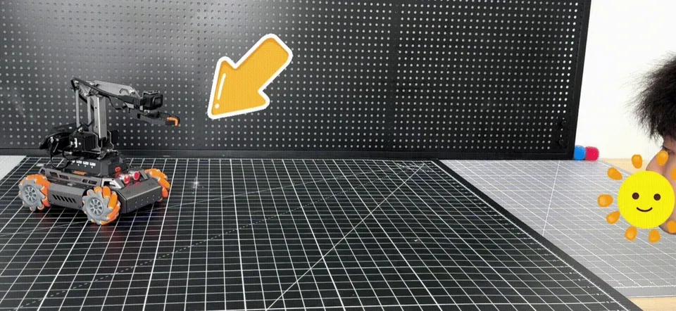
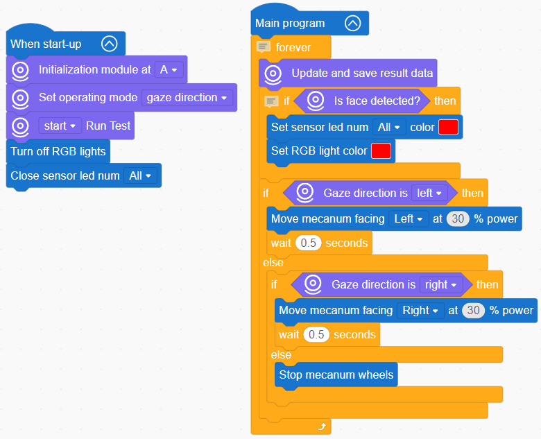
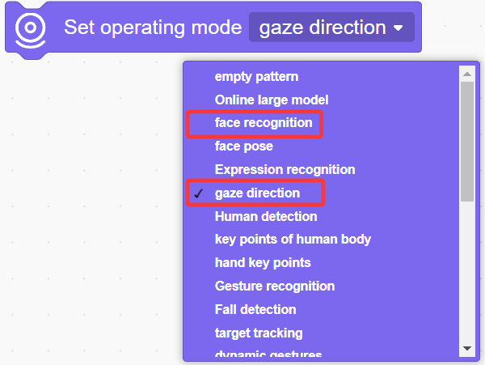
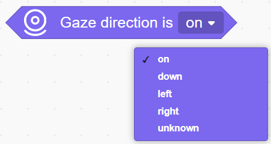
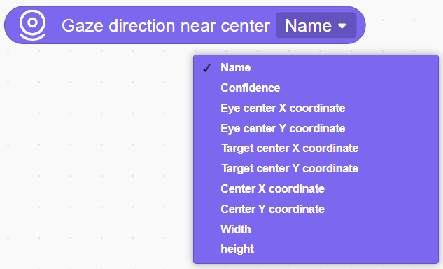
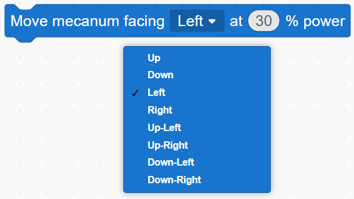
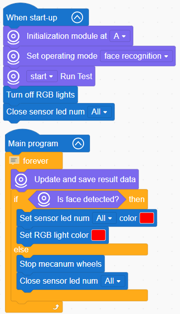
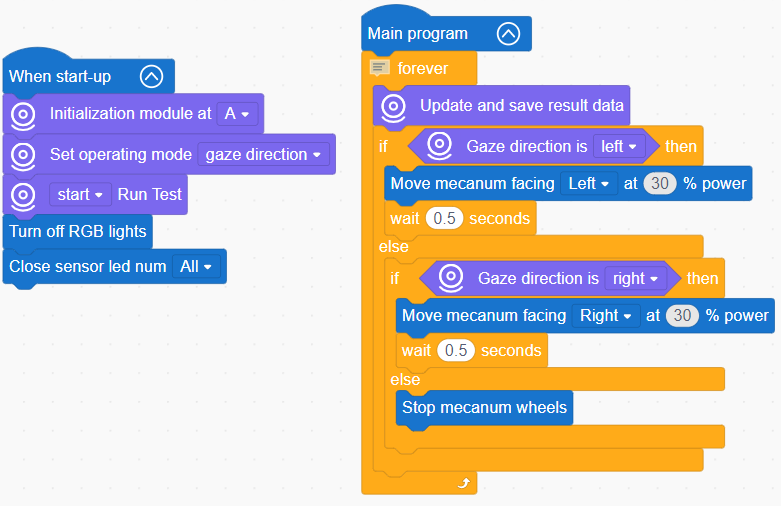

# 3.18 Lesson 18: Multi-Dimensional Face Perception

## 3.18.1 Lesson Introduction

Starting with facial unlocking and face-recognition access control systems, this lesson compares human facial cognition with machine algorithms to explore face recognition and gaze direction estimation. Mastering face detection, face counting, and gaze classification commands enables the implementation of "red-light illumination upon face detection" and "gaze-controlled car translation" interaction. Introducing face ID learning clarifies feature matching and identity recognition while providing an initial introduction to eye tracking. The lesson expands visual perception dimensions, lays the foundation for human pose and gesture recognition, and serves as a transition toward biometric perception.

## 3.18.2 Learning Objectives

1. Understand the feature comparison principle of face recognition and master the basic concepts of facial feature extraction and template matching. Learn the technical approach to gaze direction estimation, which combines pupil position analysis with head pose estimation.

2. Switch the K230 module between face recognition mode and gaze direction mode. Proficiently master core commands, including face presence detection, face quantity counting, and gaze direction classification.

3. Establish a technical cognition framework for biometric recognition and understand the AI processing pipeline from image pixels to semantic labels. Cultivate a multi-mode switching programming mindset to select appropriate vision functions according to task requirements.

4. Connect facial perception technology to real-world application scenarios such as facial payment, smart access control, driver fatigue detection, smart classroom attention analysis, and assistive communication devices, understanding its broad value in identity authentication and behavior analysis.

## 3.18.3 Preparation

**Hardware Preparation**:

- AiMecha M1 Mecanum-Wheel Car Advanced Kit

- Type-C data cable

- Computer × 1

- Remote controller

**Software Preparation**:

- WonderLab graphical programming software

**Four Sub-Modules of K230 Facial Functions**:

- **Face Recognition**: Detects whether a face is present in the frame and supports face ID learning and identity matching.

- **Face Orientation**: Determines head poses, including facing forward, turning left, turning right, looking up, and looking down.

- **Gaze Direction**: Analyzes where the eyes are looking, classified into looking left, looking right, looking up, looking down, and looking straight ahead.

- **Expression Recognition**: Recognizes facial expressions such as happy, sad, surprised, and angry.

**Wiring Instructions**:

- Connect the K230 screen module to **port A** of the controller for serial communication.

- Connect the camera module to the screen module via the ribbon cable.

- Align the camera height with the center of the human face for optimal recognition performance.

**Face ID Learning Procedure**:

- Select "Face Recognition" mode on the K230 module screen.

- Tap the "Learn" key or press key B to enter the learning state.

- Align the face directly with the camera and maintain a frontal posture to complete registration.

- Assign an ID name to the learned face so it can be called by its ID name in the program.

**Gaze Direction Classification Description**:

- Looking Left: The pupils are clearly shifted toward the left side of the frame.

- Looking Right: The pupils are clearly shifted toward the right side of the frame.

- Looking Straight: Both pupils are centered and looking directly at the lens.

- Looking Up or Down: Vertical gaze shifts upward or downward.

- Unknown: The default state when estimation fails, or no face is present.

## 3.18.4 Hands-On Project

**1. Program Logic**

This lesson builds two independent visual interaction systems, face presence detection and gaze-controlled car translation, both following the standard K230 programming paradigm. The face recognition mode detects facial features in real time to determine face presence, count faces, and obtain coordinates, illuminating red lights when a face is present and turning them off when no face is detected. The gaze direction mode locates the pupils and combines head pose data to estimate gaze direction, outputting left, right, or forward gaze results to drive lateral movement of the car under eye control. Both programs follow the structure of initialization, main loop data updating, and conditional execution, progressing from binary presence detection in Task 1 to multi-class directional judgment in Task 2.

💡**Complete Program Preview:**

**2. Core Commands**

|   Command Category   |                         Core Command                         | Functional Description                                       |
| :------------------: | :----------------------------------------------------------: | :----------------------------------------------------------- |
|  Mode configuration  |  | Switches the operating mode of the vision module to select the corresponding AI algorithm. |
|  Detection control   |  | Starts the vision detection engine to run facial analysis algorithms. |
| Data synchronization |  | Reads the latest recognition results from the module and synchronizes them to the controller cache. |
|    Face detection    |  | Determines whether a face is present in the frame and returns a boolean value. |
|    Face counting     |  | Counts the number of faces detected in the frame, typically used with variables. |
|   Face parameters    |  | Reads detailed information for a specified face ID, including confidence, `x` and `y` coordinates, width, and height. |
|    Gaze direction    |  | Determines the gaze direction category of the current face for conditional branching. |
|   Gaze parameters    |  | Reads detailed gaze data including direction name, confidence, and eye center coordinates. |
|    Motion control    |  | Controls eight-directional car movement using percentage power for gaze-driven navigation. |

**3. Complete Program Description**

**Task 1: Face Recognition Triggering Light Feedback**

- Initialization workflow: At startup, execute the `Initialization module at A` to establish communication, execute `Set operating mode face recognition` to switch to the face detection algorithm, execute `start Run Test` to enable recognition, and turn off both the onboard RGB LEDs and the ultrasonic sensor RGB lights to set an initial off state.

- Main loop update: Enter the repeat forever main loop and execute `Update and save result data` as the first step to synchronize the latest face detection data.

- Conditional response: Add an `if Is face detected? then` branch to set all LED beads on the ultrasonic sensor to red and set the onboard RGB LEDs to red.

- Else branch: Add an else branch so that when no face is detected, the program turns off the onboard RGB LEDs and turns off all LED beads on the ultrasonic sensor, automatically extinguishing the lights when the person leaves.

- Program outcome: The red lights illuminate immediately when a face enters the camera view and turn off as soon as the face leaves, providing responsive presence feedback. Multiple faces can be detected simultaneously, triggering the lights whenever at least one face is present.

**Task 2: Gaze Direction Controlling Left and Right Car Translation**

- Mode switching: Re-initialize the module by setting the running mode to `Gaze Direction`, starting detection, and turning off all lights.

- Main loop structure: Update the result data first inside the repeat forever loop, and then evaluate three states sequentially using nested if-else structures.

- Left-gaze branch: If `Gaze direction is left`, set the Mecanum-wheel car to move left at 30% power and wait 0.5 s to maintain the movement duration.

- Right-gaze branch: In the nested `else if` branch, check whether `Gaze direction is right`, set the car to move right at 30% power, and wait 0.5 s.

- Forward-gaze or no-face branch: In the final else branch, stop the Mecanum-wheel car so that it remains stationary when the eyes look straight ahead or when no face is present.

- Operational guide: Stand in front of the camera and look toward the left side of the frame to move the car left, look toward the right side to move the car right, and look directly at the lens to stop the car. Ensure the second conditional judgment is nested inside the first `else` branch to form a mutually exclusive three-branch structure.

**Debugging and Optimization Key Points**

- Distance range: Maintain a distance of 30 cm to 80 cm between the face and the camera for optimal recognition, as being too close or too far off-center degrades detection accuracy.

- Lighting requirements: Uniform frontal lighting yields the best results, whereas backlighting or strong side lighting casts facial shadows and reduces recognition rates.

- Posture requirements: Keep the face pointed directly toward the camera, as steep side-profile angles lower detection rates, and gaze direction estimation specifically requires a frontal posture.

- Response speed: The 0.5 s wait time controls the step length of each movement. Decreasing this value improves control precision, while increasing it speeds up continuous movement.

- Multi-person scenarios: By default, the algorithm selects the face closest to the center of the frame as the primary target, prioritizing the person facing directly toward the lens when multiple people appear simultaneously.

  > [!NOTE]
  >
  > **The program source files can be downloaded from [Program Files/Multi-Dimensional Face Perception](https://drive.google.com/drive/folders/1qESIR7n_mxv3oQTrZhNbBTnPKVOk-yT4?usp=sharing).**

**Program Upload:**

- Step 1: Power on the mecha controller and insert the Type-C data cable into the data port located above the power switch on the controller.

- Step 2: Connect the other end of the data cable to a USB port on the computer.

- Step 3: Click the **Connect device** button at the top of the software interface and select the COM port corresponding to CH340 from the port list.

- Step 4: Click the upload button in the upper-right corner to download the compiled program to the mecha controller for execution.

## 3.18.5 Expansion and Advancement

**Expansion Project 1: Face ID Access Control System**

Use the face learning function to register two to three authorized face IDs and design an intelligent access control program: illuminate green lights and play a welcome tone when an authorized face is recognized, illuminate red lights and sound an alarm when an unrecognized face is detected, and turn off the lights to stand by when no face is present. Add face counting judgments to support simultaneous multi-person detection, simulating the operating logic of a real-world facial recognition access control system.

**Expansion Project 2: Face-Following Tracking Car**

Utilize the face center X-coordinate parameter to design an automatic face tracking function: turn the car left when the face is on the left side of the frame and turn right when the face is on the right side to keep the face centered in the frame at all times. Simultaneously use the face width to estimate distance, driving forward to move closer when the face is too small and reversing to increase the distance when the face is too large. Implementing dual-axis face following keeps the car consistently facing the target like a "shadow"**, **demonstrating the fundamental principles of visual servo control.

## 3.18.6 Q&A

**Q1: Face detection and face recognition sound very similar. Are they the same technology?**

**Answer**: They are not the same technology. Instead, they represent two distinct levels of facial processing with significant differences in technical complexity and application scenarios.

Face detection answers the question of "whether a face is present in the frame and where it is located", performing only a binary classification between face and non-face regions.

Face recognition answers the question of "who the person is", requiring the system to first detect a face and then extract facial features for identity comparison.

## 3.18.7 Technical Support and Discussion

Join the forum for sharing questions, ideas, or suggestions, and answers will be provided promptly. Click the hyperlink [Hiwonder Forum](http://forum.hiwonder.com) or enter the URL in a browser: http://forum.hiwonder.com