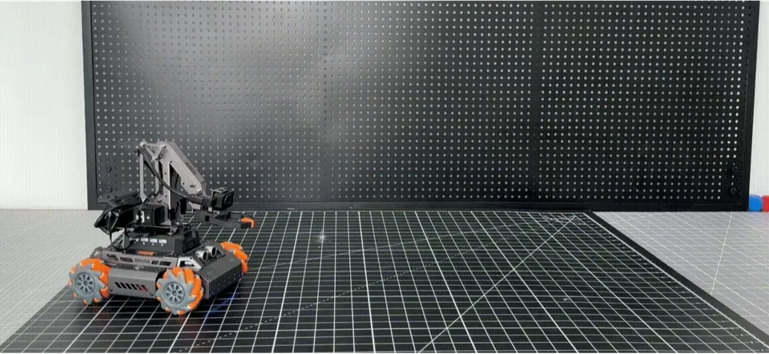
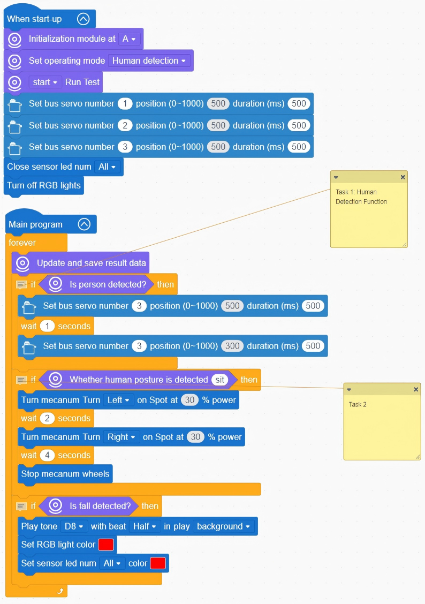
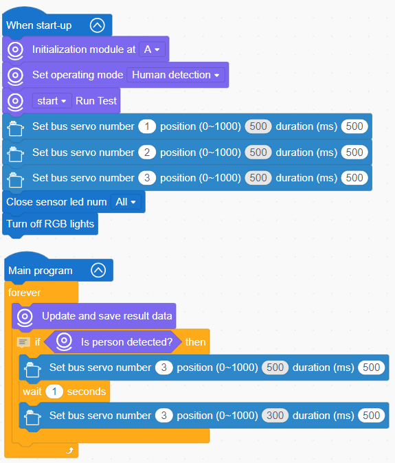
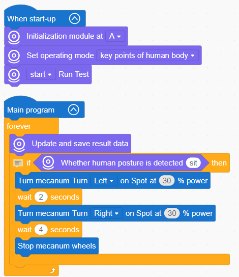
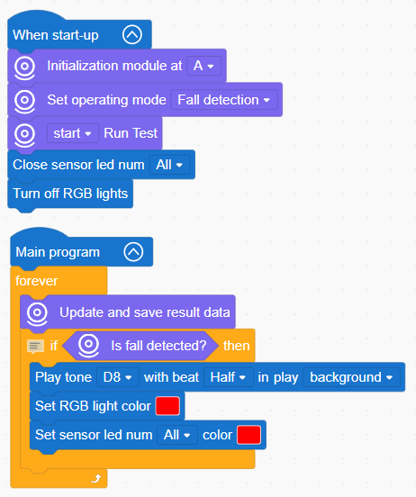

# 3.19 Lesson 19: Human Pose Recognition

## 3.19.1 Lesson Introduction

Starting with smart security and elderly fall detection scenarios, this lesson introduces a three-tier progressive framework of human body detection, keypoint recognition, and fall detection. Learning how the modular large model recognizes human contours, locates skeletal joints, and evaluates body postures enables the completion of three progressive tasks: triggering the robotic arm to wave hello upon human detection, controlling the car via custom postures, and triggering an audible and visual alarm upon fall detection. Introducing the self-learning mode enables the training of custom posture IDs, illustrating few-shot learning concepts. Combining smart security and elderly care scenarios fosters a technology-for-good mindset, making this an essential lesson toward humanistic reflection.

## 3.19.2 Learning Objectives

**1.** Understand the contour feature recognition principle of human body detection and master the concepts of object bounding boxes and confidence scores. Learn the skeletal joint localization technology of human keypoint detection and understand the composition of the 17-point human skeleton model.

**2.** Switch the K230 module among three operating modes: human detection, human keypoints, and fall detection. Proficiently master core commands, including human presence detection, posture classification judgment, and fall event recognition.

**3.** Establish a three-layer visual cognition framework progressing from "presence detection" to "keypoint localization" and "behavior understanding". Cultivate operational skills for self-learning training and awareness of parameter tuning.

**4.** Connect human pose recognition technology to real-world application scenarios such as elderly fall monitoring, smart security surveillance, fitness posture correction, and passenger flow analysis, understanding its social value in elderly care, security, fitness, and entertainment.

## 3.19.3 Preparation

**Hardware Preparation**:

- AiMecha M1 Mecanum-Wheel Car Advanced Kit

- Type-C data cable

- Computer × 1

- Remote controller

**Software Preparation**:

- WonderLab graphical programming software

**Three Functional Tiers of Human Vision**:

- **Human Detection**: The foundational tier that determines whether a person is present in the frame, counts the number of people, and locates their positions using rectangular bounding boxes.

- **Human Keypoints**: The intermediate tier that locates 17 skeletal keypoints on the human body, including the head, shoulders, elbows, wrists, hips, knees, and ankles, to output skeletal postures.

- **Fall Detection**: The application tier that evaluates temporal changes in keypoints to determine whether a fall event has occurred and outputs an alarm trigger.

**Wiring Instructions**:

- Connect the K230 screen module to **port A** of the controller.

- Connect the three bus servos in series to bus port S1 or S2 with IDs 1, 2, and 3.

- Mount the camera at a recommended height of 1.2 m to 1.5 m with a downward tilt angle of approximately 15° to capture an optimal full-body field of view.

**Custom Posture Learning Procedure**:

- Select Human Keypoints mode from the K230 module menu.

- Tap "Learn" to enter the learning state.

- Strike the target pose, such as standing, sitting, or raising a hand, and hold it steady.

- Confirm successful learning and assign an ID name to the posture, such as sit, stand, or raise.

- Call the posture by its assigned ID name in the program for detection.

**Fall Detection Principle and Parameters**:

- Core judgment feature: The central axis angle of the human body approaches horizontal, whereas normal standing is nearly vertical.

- Auxiliary feature: The height of the human bounding box drops sharply while its width increases abruptly.

- Detection delay: Requires confirmation across several consecutive frames to prevent false alarms.

- Optimal detection distance: Maintain a distance of 2 m to 5 m so that the entire body appears completely within the frame.

## 3.19.4 Hands-On Project

**1. Program Logic**

This lesson builds a three-tier progressive human pose perception system. The human detection mode identifies body contours and outputs bounding boxes, driving the robotic arm to lift and lower in a greeting wave whenever a person is detected. The keypoint mode locates 17 skeletal joints and matches them against posture templates, steering the car upon recognizing postures such as sitting or raising a hand. The fall detection mode tracks keypoint sequences over time, triggering a buzzer alarm and flashing red lights if the body axis shifts from vertical to horizontal, accompanied by a sudden drop in body height. All three programs share the unified framework of initialization, data updating, and conditional judgment, demonstrating the cognitive progression of computer vision from presence detection to posture recognition and behavior analysis.

💡**Complete Program Preview:**

**2. Core Commands**

|  Command Category   |                         Core Command                         | Functional Description                                       |
| :-----------------: | :----------------------------------------------------------: | :----------------------------------------------------------- |
|   Human detection   |  | Determines whether a human body is present in the frame and returns a boolean value. |
|   People counting   |  | Counts the number of people detected in the frame, typically used with variables. |
|  Human parameters   |  | Reads the `x` and `y` coordinates, width, and height of the centered human bounding box. |
| Posture recognition |  | Determines whether a specific self-learned human posture appears in the frame. |
| Keypoint parameters |  | Reads detailed data for each skeletal joint, including coordinates and confidence scores. |
|   Fall detection    |  | Determines whether a fall event has occurred to trigger alarm logic. |

**3. Complete Program Description**

**Task 1: Human Detection Triggering a Robotic Arm Greeting**

- Initialization settings: At startup, initialize port A, set the running mode to Human Detection, start detection, and reset all three bus servos to position 500 with a running time of 500 ms so the robotic arm returns to its initial neutral posture.

- Main loop update: Execute `Update and save result data` as the first step inside the repeat forever loop to synchronize the latest human detection data.

- Conditional response: If `Is person detected?` evaluates to true, execute the greeting sequence by setting servo ID 3 to position 500 to raise the robotic arm, waiting 1 s, and setting servo ID 3 to position 300 to lower the robotic arm, creating an "up-and-down waving motion".

- Program outcome: Whenever a person enters the camera view, the robotic arm automatically raises to wave hello and remains in the lowered position, waiting for the next detection once the person leaves.

- Debugging tip: Standing too close to the camera causes the body to exceed the frame boundary and prevents detection, so maintaining a distance of approximately 2 m yields optimal results.

**Task 2: Custom Posture Controlling Car Steering**

- Posture learning preparation: Select Human Keypoints mode on the K230 module, learn a custom posture such as a sitting pose, and assign the ID name `sit` so it can be called using the exact same name in the program.

- Initialization workflow: At startup, initialize port A, set the running mode to Human Keypoints, and start detection.

- Main loop structure: After updating the result data inside the repeat forever loop, add a posture judgment branch.

- Action logic: If the `sit` posture is detected, command the car to spin left in place at 30% power, wait 2 s, spin right in place at 30% power, wait 4 s, and stop, completing a left turn followed by a return maneuver.

- Expansion note: Multiple distinct postures can be learned and mapped to different movements, such as standing to move forward, raising a hand to stop, and placing hands on hips to move backward, forming a complete posture control command set.

- > [!CAUTION]
  >
  > **The posture ID name in the program must match the learned ID name character for character, including case sensitivity. Maintaining a clear and standard posture during learning improves recognition accuracy.**

**Task 3: Fall Detection Triggering a Sound and Light Alarm**

- Mode switching: During initialization, set the running mode to `Fall Detection`, start detection, and turn off all lights to establish a standby state.

- Main loop detection: Evaluate the fall detection state after updating the result data inside the `repeat forever` loop.

- Alarm response: If `Is fall detected?` evaluates to true, simultaneously execute three actions: play note D8 for a 1/2 beat in background mode to sound the buzzer alarm, set the onboard RGB LEDs to red, and set all LED beads on the ultrasonic sensor to red for a dual sound-and-light alarm.

- Continuous alarm: Because the main loop monitors the state continuously, the alarm remains active as long as the fall posture persists and automatically clears once the person stands back up.

- Simulation test: Slowly crouch down and lean sideways to simulate a fall posture during testing, ensuring the entire body remains inside the frame with a clear change in body axis angle.

**General Operating Guidelines for Self-Learning Mode**

- Hold the target posture steady for 2 s to 3 s during learning so the algorithm captures sufficient feature data.

- Learn the same posture multiple times from slightly different angles to improve recognition robustness.

- Ensure clear visual differences between different custom postures to prevent confusion between similar poses.

- Maintain consistent lighting conditions during both learning and usage, as large illumination changes reduce recognition accuracy.

- Use English letters or numbers when naming learned posture IDs rather than Chinese characters.

  > [!NOTE]
  >
  > **The program source files can be downloaded from [Program Files/Human Pose Recognition](https://drive.google.com/drive/folders/1qESIR7n_mxv3oQTrZhNbBTnPKVOk-yT4?usp=sharing).**

**Program Upload**:

- Step 1: Power on the mecha controller and insert the Type-C data cable into the data port located above the power switch on the controller.

- Step 2: Connect the other end of the data cable to a USB port on the computer.

- Step 3: Click the **Connect device** button at the top of the software interface and select the COM port corresponding to CH340 from the port list.

- Step 4: Click the upload button in the upper-right corner to upload the compiled program to the mecha controller for execution.

## 3.19.5 Expansion and Advancement

**Expansion Project 1: Intelligent People Counting and Passenger Flow Analysis**

Utilize the people counting function to design a passenger flow counter that increments a variable whenever the detected headcount increases, combining entry and exit direction judgments to track foot traffic. Add a time dimension to calculate headcount changes per minute and display crowd density using different RGB LED colors, simulating a commercial shopping mall foot-traffic analysis system and demonstrating the application of computer vision in business intelligence.

**Expansion Project 2: Human Following and Safe Distance Maintenance**

Utilize the human center x-coordinate and bounding box width parameters to implement automatic human following: steer left when the person is on the left side of the frame and steer right when the person is on the right side to keep the target centered. Drive forward when the bounding box width is too small and back up when the width is too large to maintain a safe following distance. Link this with fall detection so the car automatically approaches and sounds an alarm if the person falls, forming a prototype of an intelligent companion robot.

## 3.19.6 Q&A

**Q1: Human detection, human keypoints, and fall detection increase progressively in technical complexity and information depth. How do these three functions build upon one another?**

**Answer**: The three functions form a three-tier progression from **simple to complex, from static to dynamic, and from local to holistic**, representing three distinct levels of computer vision in understanding the human body.

**Q2: This lesson uses the self-learning function to let the machine recognize custom-defined postures. What are the similarities and differences between machine self-learning and human learning?**

**Answer**: Machine self-learning and human learning **appear similar on the surface but differ fundamentally in essence**, where the core distinction lies in whether learning starts from scratch.

## 3.19.7 Technical Support and Discussion

Join the forum for sharing questions, ideas, or suggestions, and answers will be provided promptly. Click the hyperlink [Hiwonder Forum](http://forum.hiwonder.com) or enter the URL in a browser: http://forum.hiwonder.com