# 3.2 Lesson 2: Programming Platform Practice

## 3.2.1 Lesson Introduction

Entering the core stage of software programming, this lesson utilizes the WonderLab graphical programming platform and an RGB flashing police light project to guide learning through sequential, loop, and branch programming structures, completing the transition from hardware cognition to software control. Following a structured progression of "platform introduction → basic syntax → project practice", the lesson employs three progressive tasks to master core programming logic. Upon completion of this course, the ability to independently write simple control programs will be acquired, laying a solid programming foundation for the subsequent study of functions such as line following and obstacle avoidance.

## 3.2.2 Learning Objectives

**1.** Understand the concepts and application scenarios of the three basic program structures. Master the fundamental principles of graphical programming and block-stacking logic. Learn the RGB additive color-mixing principle and the hardware operation of LED lights.

**2.** Independently complete the installation of the WonderLab programming platform, device connection, and program uploading operations. Master the usage of core control commands, including wait, repeat, and conditional judgment.

**3.** Establish a structured programming thinking framework. Cultivate the ability to decompose complex tasks into simple steps and develop preliminary engineering thinking for program debugging and troubleshooting.

**4.** Relate programming logic to automated control scenarios in daily life. Understand the wide application value of embedded programming in smart hardware, and stimulate interest in exploring robotics and artificial intelligence technologies.

## 3.2.3 Preparation

**Hardware Preparation**:

- AiMecha M1 Mecanum-Wheel Car Advanced Kit
- Type-C data cable
- Computer × 1

**Software Preparation**:

- WonderLab graphical programming software

## 3.2.4 Hands-On Project

**1. Project Analysis**

Centered on the flashing police RGB light, this project follows the "input → process → output" control logic. The perception layer collects button and clock signals. The decision-making layer utilizes sequential, loop, and branch structures to process signal logic and schedule timing. The execution layer drives the RGB LED module to display the corresponding colors and flashing effects. Once the program starts, the hardware is initialized first. Different program structures then implement light switching, loop execution, and button-triggered control. The three structures progressively build the lighting control system, visually demonstrating the design approach of embedded programs from simple to complex.

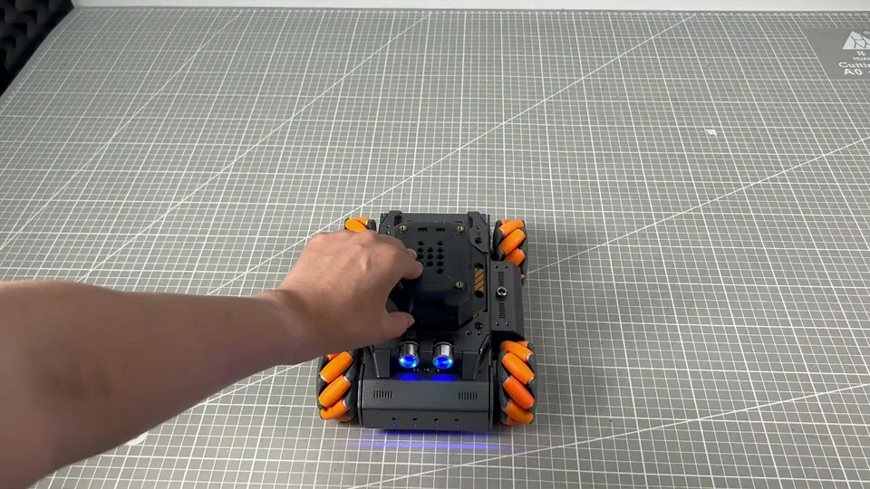

- **Complete Program Preview**:

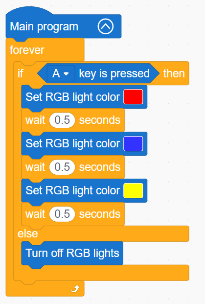

**2. Software Installation and Introduction**

Refer to [4. Deep Learning](<../4. Deep Learning.md>).

**3. Core Commands**

|    Command Category    |                         Core Command                         | Functional Description                                       |
| :--------------------: | :----------------------------------------------------------: | :----------------------------------------------------------- |
| Program initialization |  | Program entry block. All program commands must be attached below it to execute first when the program starts. |
|     Timing control     | 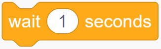 | Sets the pause duration of the program to control the light-switching interval and flashing frequency. |
|      Loop control      | 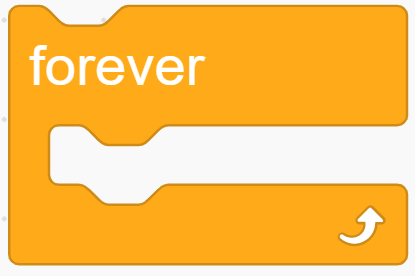 | Core loop structure block. Program blocks placed inside repeat indefinitely. |
|      Loop control      | 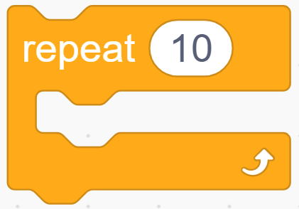 | Loop structure for a specified number of times. Automatically exits the loop after completing the set count. |
|   Conditional branch   | 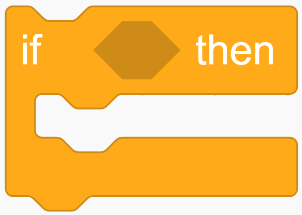 | Single-branch conditional structure. Executes the internal code blocks when the condition is true. |
|   Conditional branch   | 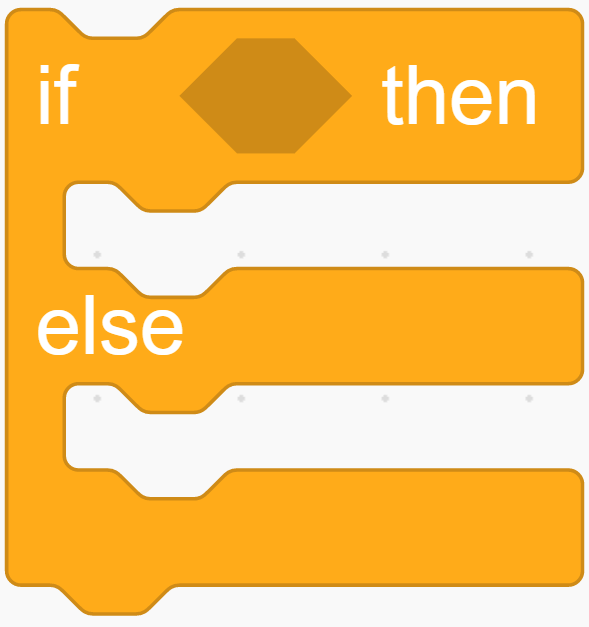 | Dual-branch conditional structure. Executes different code blocks depending on whether the condition is true or false. |
|    Lighting control    | 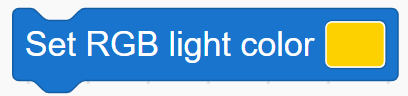 | Sets all RGB LEDs to a specified preset color such as red, yellow, blue, or green. |
|    Lighting control    | 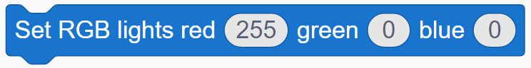 | Customizes the light color using RGB primary color values ranging from 0 to 255. |
|    Lighting control    | 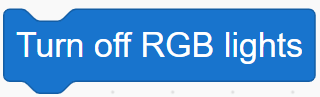 | Turns off all RGB LEDs and disables the lighting output.     |
|    Button detection    | 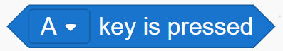 | Conditional judgment block. Detects whether A key on the controller board is pressed and returns a boolean value. |

**4. Complete Program Description**

**Task 1: The RGB LED to Emit Red Light First and Switch to Blue Light via Sequential Structure**

- Drag the `Main program `block into the workspace as the program entry.
- Add the block to `Set RGB light color` and select red so that the red light turns on first when the program starts.
- Add the block to `wait 0.5 seconds` to control the duration of the red light.
- Add the block to `Set RGB light color` and select blue to switch to the blue light after 0.5 s.
- Program features: The commands execute sequentially from top to bottom. Each command executes only once, and the program terminates upon completion.

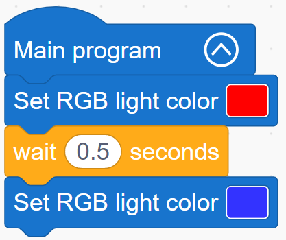

**Task 2: Loop Structure for Alternating Red and Blue Flashing**

- Drag the `Main program` block into the workspace as the program entry.
- Add the `forever` loop block to build an infinite loop framework.
- Inside the loop, sequentially add the commands to `Set RGB light color red` →  `wait 0.5 seconds` →  `Set RGB light color blue` →  `wait 0.5 seconds`.
- Program features: The four commands inside the loop execute repeatedly in alternation, creating a continuous red-and-blue flashing police light effect.
- Key parameters: The wait duration determines the flashing frequency. A 0.5 s interval corresponds to 120 flashes per minute, which is consistent with the visual alertness design principles of police lights.

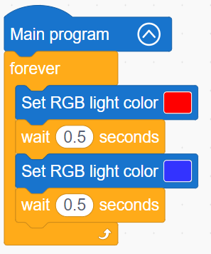

**Task 3: Branch Structure for Button-Triggered Lighting Effects**

- Drag the `Main program` block into the workspace and nest a `forever` block on the outside to ensure continuous detection of the button status.
- Add the `if A key is pressed then` dual-branch conditional block.
- True condition branch when Button A is pressed: Nest an inner `forever` loop. Inside the loop, sequentially turn on the red light → wait 0.5 seconds → turn on the blue light → wait 0.5 seconds → turn on the yellow light → wait 0.5 seconds to achieve a three-color cyclic flashing effect.
- False condition branch when Button A is not pressed: Execute the block to `Turn off RGB lights` so that the lights remain off.
- Project analysis: The program continuously polls and detects the button status. Pressing Button A triggers the flashing police light effect, and releasing the button turns off the lights, achieving interactive control.

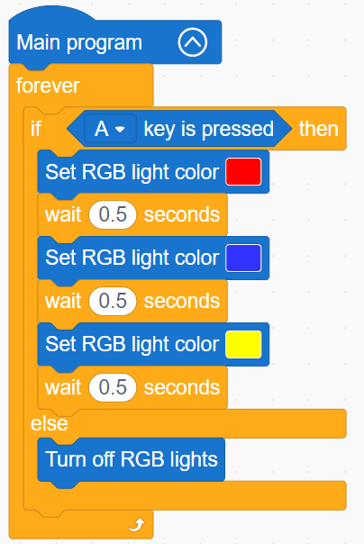

> [!NOTE]
>
> **The program source files can be downloaded from [Program Files/Programming Platform Practice](https://drive.google.com/drive/folders/1vQnjkHE58XJU_cquYayobwkfJD5ZQ1KT?usp=sharing).**

- **Program Upload**:

## 3.2.5 Expansion and Advancement

**Project 1: Multi-Color Ambient Light Loop Effect**

Building upon the basic red and blue flashing, add green, yellow, purple, cyan, and other colors to design a multi-color ambient light loop program with a 5 s cycle. Set a distinct duration for each color by adjusting the wait time parameters to create a rhythmic visual breathing transition. Experiment further with the custom RGB value command to mix more personalized colors.

**Project 2: Button-Controlled Multi-Mode Light Switching**

Design a multi-state switching program that cycles through different lighting modes by pressing Button A. The first press enters the red-and-blue police light mode, the second press enters the seven-color dazzling mode, the third press enters the breathing light mode, and the fourth press turns off all lights. Introduce a variable to record the current mode state and combine it with branch structures to implement the multi-mode switching logic, enhancing program interactivity and functional richness.

## 3.2.6 Q&A

**Q1: What are the three basic structures of a program?**

**Answer**: The three basic structures of a program are the sequential structure, the loop structure, and the branch structure.

**Q2: Why do RGB LEDs only need red, green, and blue to mix almost all colors?**

**Answer**: RGB LEDs operate based on the principle of primary color light superposition, which is an additive color mixing model. The human retina contains three types of cone cells that are most sensitive to red, green, and blue light, respectively. The brain perceives different colors through integrating these three signals.

## 3.2.7 Technical Support and Discussion

Join the forum for sharing questions, ideas, or suggestions, and answers will be provided promptly. Click the hyperlink [Hiwonder Forum](http://forum.hiwonder.com) or enter the URL in a browser: http://forum.hiwonder.com