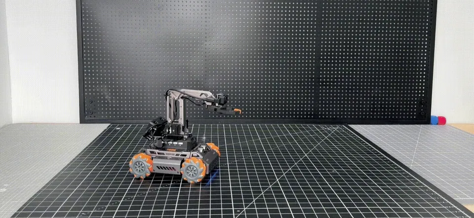
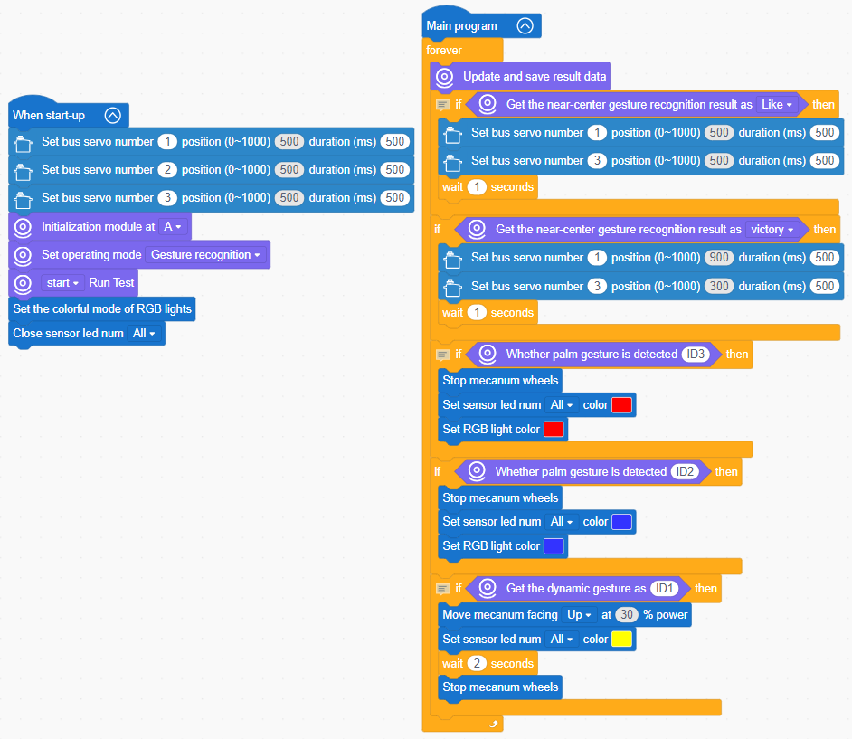
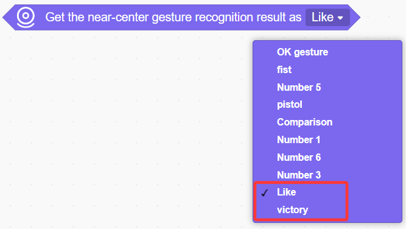
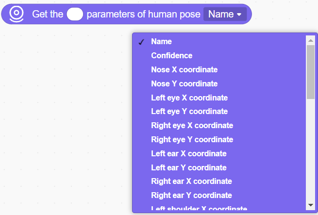
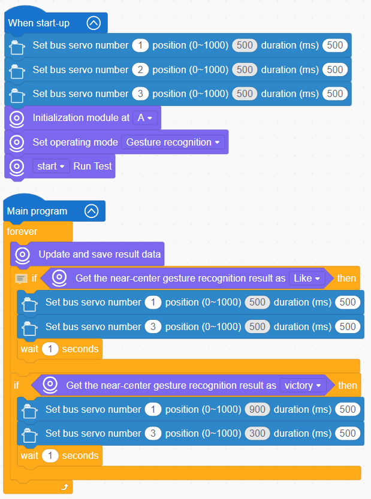
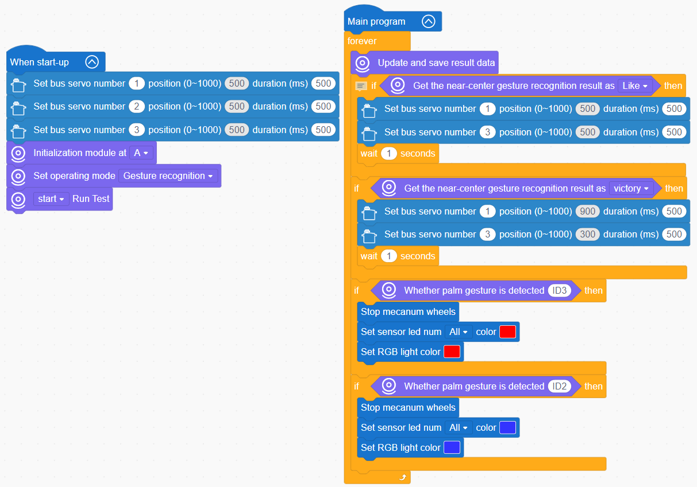

# 3.20 Lesson 20: Dynamic Gesture Interaction

## 3.20.1 Lesson Introduction

Taking inspiration from science fiction mid-air gesture control and motion-sensing games, this lesson explores three core technologies: fixed gestures, custom palm keypoints, and dynamic gestures. Three progressive tasks are completed: controlling the robotic arm with standard gestures, triggering lights with custom gestures, and driving the Mecanum-wheel car with dynamic gestures, mastering static classification, custom learning, and temporal recognition. By introducing temporal dynamic recognition for the first time, this lesson highlights the distinction between continuous frame tracking and static classification, completing the comprehensive vision capabilities of the K230 module and establishing a static-to-dynamic gesture interaction system that lays the foundation for large model interaction.

## 3.20.2 Learning Objectives

1. Understand the contour matching principle of fixed gesture recognition, the feature distribution concepts of palm keypoints, and the temporal trajectory analysis method of dynamic gesture recognition.

2. Utilize built-in standard gestures such as thumbs-up and victory to control robotic arm movements. Complete the learning registration and ID naming of custom palm keypoint gestures to trigger multicolored light feedback.

3. Establish a technical layering framework for gesture interaction, understanding the capability progression from static to dynamic and from general to custom. Cultivate design thinking for non-contact human-robot interaction and reflect on experience design principles for natural interaction.

4. Connect gesture interaction to real-world application scenarios such as smart TV gesture control, VR motion-sensing interaction, sign language translation, smart home mid-air control, and sterile industrial gesture operations, understanding the application value of gesture interaction across various fields.

## 3.20.3 Preparation

**Hardware Preparation**:

- AiMecha M1 Mecanum-Wheel Car Advanced Kit

- Type-C data cable

- Computer × 1

- Remote controller

**Software Preparation**:

- WonderLab graphical programming software

**Comparison of Three Gesture Recognition Functions**:

- **Fixed Gesture Recognition**: Features a built-in pre-trained model supporting standard gestures such as thumbs-up, victory, OK, and numbers, ready for use without prior learning.

- **Custom Palm Keypoints**: Locates 21 keypoints on the palm to support learning custom static gestures with custom designs and ID names.

- **Dynamic Gesture Recognition**: Tracks the motion trajectory of the palm across continuous frames to recognize dynamic movements such as waving and swiping, which requires prior recording and learning.

**Wiring Instructions**:

- Connect the K230 screen module to **port A** of the controller.

- Connect the three bus servos in series to bus port S1 or S2.

- Mount the camera at a height level with the palm, at a distance of 30 cm to 60 cm for optimal recognition.

**Gesture Learning Operating Standards**:

- Static gesture learning: Enter the palm keypoints mode → tap Learn → hold the gesture steady for 2 s → save it under an ID name.

- Dynamic gesture learning: Enter the dynamic gesture mode → tap Learn → perform the complete movement once → allow automatic recording → save it under an ID name.

- Naming convention: Use English letters or numbers for ID names without Chinese characters, such as ID1, ID2, open, or close.

- Learning environment: Maintain uniform lighting and a clean background to avoid complex background interference during recognition.

**Built-In Standard Gesture List**:

- Thumbs Up: Holding up the thumb.

- Victory: Making a V-shaped scissor sign with fingers.

- OK Gesture: Forming a circle with the thumb and index finger.

- Palm: Spreading all five fingers open.

- Fist: Clenching the hand into a fist.

## 3.20.4 Hands-On Project

**1. Program Logic**

This lesson builds a three-tier progressive gesture interaction system. The fixed gesture mode matches pre-trained templates such as thumbs-up and victory to trigger robotic arm lifting and lowering. The palm keypoint mode locates 21 skeletal points to compare self-learned custom gestures and trigger RGB LED feedback. The dynamic mode tracks keypoint temporal trajectories against pre-recorded templates to drive the car forward and illuminate yellow lights. All three modes share a unified framework of initialization, data updating, and conditional judgment, advancing detection from single-frame static analysis to multi-frame dynamic understanding and illustrating the progression from spatial to spatiotemporal vision processing.

💡**Complete Program Preview:**

**2. Core Commands**

|     Command Category      |                         Core Command                         | Functional Description                                       |
| :-----------------------: | :----------------------------------------------------------: | :----------------------------------------------------------- |
|       Fixed gesture       |  | Evaluates standard gesture types and returns the classification result. |
|      Palm detection       |  | Determines whether a palm is present in the frame.           |
|      Custom gesture       |  | Evaluates whether a self-learned custom static gesture appears in the frame. |
|      Palm parameters      |  | Reads palm keypoint names, confidence scores, and joint coordinates. |
| Dynamic gesture detection |  | Evaluates whether a custom dynamic gesture movement is recognized. |

**3. Complete Program Description**

**Task 1: Fixed Gesture Controlling Robotic Arm Lifting and Lowering**

- Initialization settings: At startup, reset all three bus servos to position 500 with a running time of 500 ms, initialize port A, set the running mode to gesture recognition, start detection, set the onboard RGB LEDs to dazzling mode, and turn off the ultrasonic sensor RGB lights.

- Main loop structure: Execute `Update and save result data` as the first step inside the repeat forever loop to synchronize the latest gesture data.

- Thumbs-up response: If `Get the near-center gesture recognition result as Like`, execute the action sequence: set servo ID 1 to position 500 to close the gripper, set servo ID 3 to position 500 to raise the robotic arm, and wait 1 s to complete the greeting lift.

- Victory response: If `Get the near-center gesture recognition result as victory`, execute the action sequence: set servo ID 1 to position 900 to open the gripper, set servo ID 3 to position 300 to lower the robotic arm, and wait 1 s to complete the lowering and opening maneuver.

- Parameter explanation: Position 500 on servo ID 3 represents the high position, and 300 represents the low position, while position 500 on servo ID 1 represents closing and 900 represents opening, linking the two gestures to distinct robotic arm postures.

**Task 2: Custom Palm Gesture Triggering RGB LEDs**

- Gesture learning preparation: Operate the palm keypoint function on the K230 module to learn two custom gestures named ID2 and ID3, keeping the hand steady during learning without using Chinese characters for names.

- Mode reuse: The gesture recognition mode simultaneously supports palm keypoint detection, allowing both functions to be mixed within the same program without switching modes.

- ID2 gesture response: If `Whether palm gesture is detected ID2?` is true, execute the actions: stop the car, set all ultrasonic sensor RGB lights to blue, and illuminate the onboard RGB LEDs in blue as the second state indicator.

- ID3 gesture response: If `Whether palm gesture is detected ID3?` is true, execute the actions: stop the car, set all ultrasonic sensor RGB lights to red, and illuminate the onboard RGB LEDs in red as the third state indicator.

- > [!TIP]
  >
  > **Expansion suggestion: Learn additional custom gestures corresponding to different colors to build a complete set of gesture-driven lighting commands.**

**Task 3: Dynamic Gesture Controlling Car Forward Movement**

- Dynamic gesture learning: Enter the dynamic gesture function on the K230 module and record a forward waving motion as the startup gesture, assigned the ID name ID1. Perform the movement smoothly and fluently from start to finish during recording.

- Initialization configuration: Similar to the gesture recognition mode, dynamic gestures run under the gesture recognition mode.

- Action trigger: If `Get the dynamic gesture as ID1` executes to true, execute the actions: move the Mecanum-wheel car forward at 30% power, illuminate the ultrasonic sensor RGB lights in yellow, wait 2 s, and stop the car to complete a forward movement command.

- Program outcome: Waving forward toward the camera automatically drives the car forward for 2 s before stopping, achieving wave-to-go contactless control.

- Debugging tip: Dynamic gesture recognition requires consistent movement speed and amplitude during both learning and usage, as excessive speed causes hand motion blur and reduces recognition accuracy.

**General Debugging Tips for Gesture Interaction**

- Distance control: Maintain a distance of 30 cm to 60 cm between the palm and the camera, as being too far makes the hand too small to see, while being too close exceeds the field of view.

- Angle requirement: Pointing the palm directly toward the camera yields the best results, whereas side or back hand orientations degrade recognition rates.

- Lighting requirements: Use uniform lighting to avoid backlighting or direct strong light causing hand overexposure.

- Clean background: A solid, simple background ensures the most accurate recognition, whereas cluttered backgrounds interfere with feature extraction.

- Distinctive design: Maximize visual differences between custom gestures to prevent similar gestures from causing misrecognition.

  > [!NOTE]
  >
  > **The program source files can be downloaded from [Program Files/Dynamic Gesture Interaction](https://drive.google.com/drive/folders/1qESIR7n_mxv3oQTrZhNbBTnPKVOk-yT4?usp=sharing).**

**Program Upload**:

- Step 1: Power on the mecha controller and insert the Type-C data cable into the data port located above the power switch on the controller.

- Step 2: Connect the other end of the data cable to a USB port on the computer.

- Step 3: Click the **Connect device** button at the top of the software interface and select the COM port corresponding to CH340 from the port list.

- Step 4: Click the upload button in the upper-right corner to download the compiled program to the mecha controller for execution.

## 3.20.5 Expansion and Advancement

**Expansion Project 1: Complete Gesture Remote Control System**

Design a comprehensive gesture control scheme that maps five gestures to five car actions, moving forward, moving backward, turning left, turning right, and stopping, to enable fully gesture-driven driving. Incorporate robotic arm gesture controls by assigning three additional gestures to control gripper opening/closing and arm lifting/lowering, ultimately achieving full 8-gesture control over the car to completely replace handheld remote controllers and experience true contactless motion sensing.

**Expansion Project 2: Dynamic Gesture Sign Language Translator**

Learn multiple dynamic gesture movements corresponding to different meanings, such as common sign language phrases like "hello", "thank you", and "goodbye". When the system recognizes a corresponding gesture, trigger the buzzer to play different musical pitches or display the textual meaning on the screen. Explore the mapping relationship between gesture language and machine commands to understand the basic principles of sign language translation and how AI assists communication for the hearing-impaired.

## 3.20.6 Q&A

**Q1: What are the fundamental technical differences among the three recognition methods: fixed gestures, custom palm gestures, and dynamic gestures?**

**Answer**: The fundamental differences lie in their **recognition dimensions and customization levels**, representing three technological tiers of gesture recognition.

Fixed gesture recognition performs single-frame image classification. Custom palm gestures involve keypoint feature matching. Dynamic gesture recognition relies on temporal trajectory matching.

**Q2: Why do custom palm gestures and dynamic gestures require prior learning, whereas fixed gestures work immediately without learning?**

**Answer**: Fixed gestures require no learning because they are **pre-trained on large datasets prior to manufacturing**, meaning the system has already learned them. Custom and dynamic gestures require learning because individual gestures vary, and the machine cannot predict in advance which custom movements are to be defined.

## 3.20.7 Technical Support and Discussion

Join the forum for sharing questions, ideas, or suggestions, and answers will be provided promptly. Click the hyperlink [Hiwonder Forum](http://forum.hiwonder.com) or enter the URL in a browser: http://forum.hiwonder.com