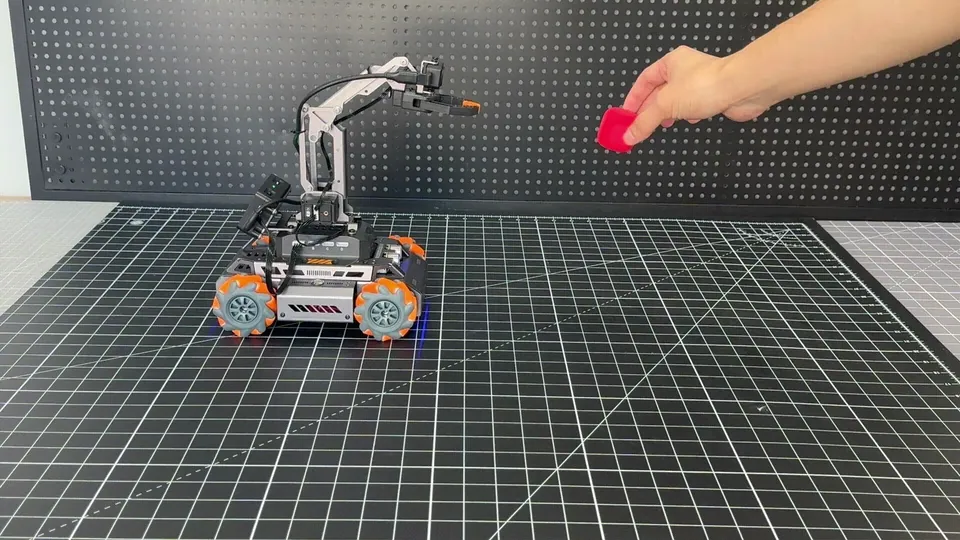
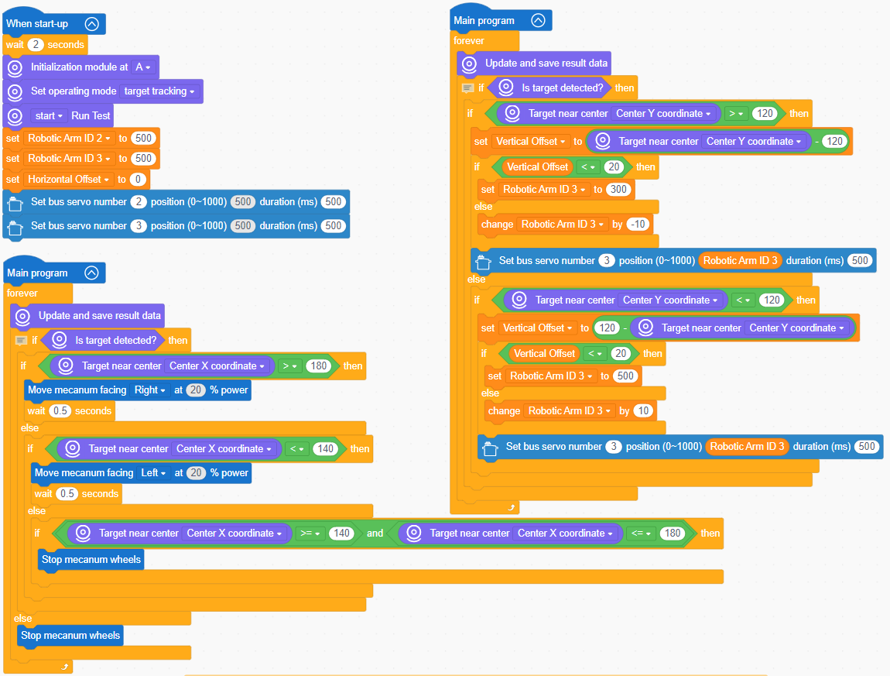
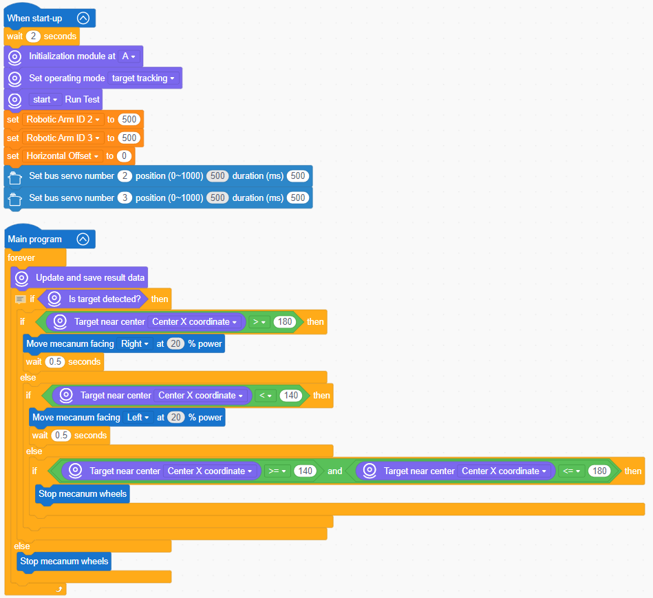
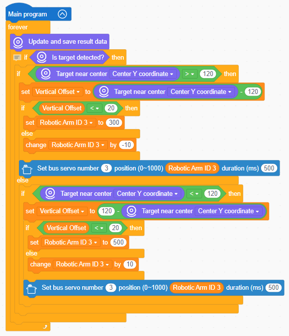

# 3.21 Lesson 21: Target Tracking and Positioning

## 3.21.1 Lesson Introduction

This lesson transitions from categorical recognition to dynamic target tracking, initiating visual servo control. Taking inspiration from star athlete tracking and drone aerial follow shots, this lesson explores the principles of target tracking. Image coordinate systems are introduced for the first time alongside K230 bounding-box target locking and tracking technology. By completing two tasks, horizontal car tracking and vertical robotic arm pitch tracking, a two-axis tracking system is constructed. For the first time, "visual closed-loop" control is implemented by learning coordinate-to-deviation conversion and servo adjustment to understand feedback control principles, expanding the application boundaries of the K230 module and establishing control theory foundations for automatic following.

## 3.21.2 Learning Objectives

1. Understand the definition of image coordinate systems and master coordinate representation methods for target positions alongside the technical principles of target tracking.

2. Manually frame target objects on the K230 module and initiate tracking. Proficiently read parameters such as the target center x-coordinate, center y-coordinate, width, and height. Write programs to control left and right car tracking based on x-coordinate deviations.

3. Establish a coordinate-based spatial mindset to describe positions and deviations using numerical values. Cultivate a closed-loop control mindset by understanding the feedback loop of "detecting deviation → adjusting actions → reducing deviation".

4. Connect target tracking technology to real-world application scenarios such as automated security camera tracking, drone follow shots, autonomous vehicle target tracking, and camera face-recognition tracking, understanding the broad value of target tracking technology across various fields.

## 3.21.3 Preparation

**Hardware Preparation**:

- AiMecha M1 Mecanum-Wheel Car Advanced Kit

- Type-C data cable

- Computer × 1

- Remote controller

**Software Preparation**:

- WonderLab graphical programming software

**Image Coordinate System Description**:

- **Origin Position**: The top-left corner of the frame serves as the coordinate origin \(0, 0).

- **X-Axis Direction**: Extends horizontally to the right, ranging from 0 to 319 pixels.

- **Y-Axis Direction**: Extends vertically downward, ranging from 0 to 239 pixels.

- **Frame Center**: Located at approximately \(160, 120).

- **Target Size**: Represented by width w and height h in pixels.

**Wiring Instructions**:

- Connect the K230 screen module to **port A** of the controller.

- Connect the three bus servos in series to bus port S1 or S2 with IDs 1, 2, and 3.

- Mount the camera at a height level with the center of the target for optimal tracking performance.

**Target Tracking Operating Workflow**:

- Select "target tracking" mode on the K230 module.

- Use a finger to draw a bounding box around the target object on the screen.

- The module automatically extracts target features and initiates locked tracking.

- Read target coordinates in the program and drive actuators accordingly.

**Control Parameter Description**:

- X-Axis Center Thresholds: Left threshold 140, right threshold 180, creating a 40-pixel central dead zone.

- Y-Axis Center Thresholds: Central reference line 120, offset threshold 20 pixels.

- Car Tracking Power: 20%, providing low speed for stable tracking.

- Robotic Arm Step Size: Adjusts by 10 servo units per step.

- Action Duration: Stepped adjustments at 0.5 s intervals.

## 3.21.4 Hands-On Project

**1. Program Logic**

This lesson constructs a dual-axis visual servo tracking system capable of horizontal movement and vertical pitch tracking, centered around deviation-driven closed-loop control. The K230 continuously captures and outputs target center coordinate parameters. The decision-making layer sets dead-zone segmented thresholds: targets shifted left or right drive the car left or right accordingly, while vertical shifts control robotic arm pitch. The execution layer adjusts Mecanum translations and servo pitches in 0.5 s steps to form a continuous feedback loop of detection, evaluation, adjustment, and re-detection. Operating at approximately 30 frames per second, the system continuously corrects deviations to keep the target centered for automated tracking.

💡**Complete Program Preview:**

**2. Core Commands**

|   Command Category    |                         Core Command                         | Functional Description                                       |
| :-------------------: | :----------------------------------------------------------: | :----------------------------------------------------------- |
|   Target detection    |  | Determines whether a target is successfully tracked and returns a boolean value. |
| Coordinate parameters |  | Reads the horizontal center x coordinate ranging from 0 to 319 and the vertical center y coordinate ranging from 0 to 239 of the target. |
|    Motion control     |  | Controls left and right car movement using percentage power to achieve horizontal tracking. |

**3. Complete Program Description**

**Task 1: Mecanum-Wheel Car Tracking Target Object Horizontally**

- Variable preparation: Create a `vertical offset` variable to store deviation calculations, and a robotic arm ID 3 variable to store servo position values.

- Initialization settings: At startup, wait 1 s for the module to start up, initialize port A, set the running mode to Target Tracking, start detection, set the robotic arm ID 3 variable to 500 for the middle position, set vertical offset to 0, and reset servo ID 3 to position 500.

- Main loop structure: Execute `Update and save result data` as the first step inside the repeat forever loop.

- Target presence evaluation: In the outer layer, check `Is Target Detected?`, executing tracking logic only when a target is detected and stopping the car otherwise.

- Right shift branch: If `Center X Coordinate > 180`, indicating the target is on the right side of the frame, set the car to move right at 20% power and wait 0.5 s.

- Left shift branch: In the nested `else if` branch, check whether the `Center X Coordinate < 140`, indicating the target is on the left side of the frame. Set the car to move left at 20% power and wait 0.5 s.

- Centered branch: In the else if branch where the X coordinate lies between 140 and 180 inside the dead zone, stop the Mecanum-wheel car because the target is centered and requires no adjustment.

- Target lost: The outermost else branch stops the car, standing by in place when the target is lost.

**Task 2: Robotic Arm Tracking Target Object Vertically**

- Reference explanation: The Y-axis ranges from 0 to 239 with a central reference value of 120, where larger Y values indicate positions lower down in the frame.
- Lower half branch: If `Center Y Coordinate > 120`, meaning the target is in the lower half of the frame, calculate offset = Y coordinate - 120. If the offset is less than 20, indicating closeness to the center, set robotic arm ID 3 to 300 for the low position. Otherwise, subtract 10 from robotic arm ID 3 to adjust downward. Finally, set servo ID 3 to the variable value with a running time of 500 ms.
- Upper half branch: In the else if branch where `Center Y Coordinate < 120`, meaning the target is in the upper half of the frame, calculate offset = 120 - Y coordinate. If the offset is less than 20, set robotic arm ID 3 variable to 500 for the middle-high position. Otherwise, increase the robotic arm ID 3 variable by 10 to adjust upward. Finally, set the position of servo ID 3 to the variable value.
- Program outcome: As the target moves upward, the robotic arm lifts accordingly. As the target moves downward, the robotic arm lowers accordingly, continuously maintaining alignment between the robotic arm height and the target.
- Stepped adjustment: Adjust by only 10 units at a time to prevent overshoot and achieve smooth tracking performance.

**Debugging and Parameter Optimization**

- Dead zone size: The range from 140 to 180 provides a 40-pixel dead zone. Making it too narrow causes frequent jitter, while making it too wide reduces tracking sensitivity, which should be tuned according to actual performance.

- Tracking speed: 20% power suits slow and stable tracking, while faster-moving targets require appropriately increasing the power percentage.

- Step duration: 0.5 s intervals provide stepped adjustments. Shorter step lengths yield faster response but risk jitter, whereas longer step lengths yield smoother movement at the cost of latency.

- Target selection: Objects with distinct colors and rich textures provide the best tracking performance, whereas pure black, pure white, or featureless objects are easily lost.

- Lighting influence: Uniform lighting ensures stable tracking, whereas backlighting or dim lighting obscures features and causes lost targets.

  > [!NOTE]
  >
  > **The program source files can be downloaded from [Program Files/Target Tracking and Localization](https://drive.google.com/drive/folders/1qESIR7n_mxv3oQTrZhNbBTnPKVOk-yT4?usp=sharing).**

**Program Upload**:

- Step 1: Power on the mecha controller and insert the Type-C data cable into the data port located above the power switch on the controller.

- Step 2: Connect the other end of the data cable to a USB port on the computer.

- Step 3: Click the **Connect device** button at the top of the software interface and select the COM port corresponding to CH340 from the port list.

- Step 4: Click the upload button in the upper-right corner to download the compiled program to the mecha controller for execution.

## 3.21.5 Expansion and Advancement

**Expansion Project 1: Dual-Axis Linkage Target Following Car**

Combine X-axis car tracking with Y-axis robotic arm tracking into a single program to achieve simultaneous horizontal and vertical dual-axis tracking. Further incorporate width parameter evaluations to control distance: an increasing target width indicates approaching, prompting the car to back up, while a decreasing target width indicates distancing, prompting the car to move forward, achieving three-dimensional distance following. This builds an intelligent following car capable of locking on and maintaining distance automatically, simulating the complete functions of an autonomous drone follow-shot system.

**Expansion Project 2: Multi-Target Switching Tracking System**

Design a multi-target management program: when multiple targets appear in the frame, automatically select the largest target to track, and automatically search to re-acquire the target once it is lost. Incorporate button-switching functionality, using Button A to switch to the next target. Explore multi-target management mechanisms in target tracking algorithms, understand concepts of target ID allocation and trajectory association, and experience how complex visual tracking systems operate.

## 3.21.6 Q&A

**Q1: Why is the origin of the image coordinate system set at the top-left corner with the Y-axis extending downward instead of upward?**

**Answer**: Setting the origin at the top-left corner with the Y-axis extending downward is an industry standard determined by a combination of **historical convention + hardware characteristics**, adopted by virtually all image processing systems.

**Q2: Why does the tracking program in this lesson incorporate a dead zone design where the car remains stationary when the target stays within a certain central range?**

**Answer**: The dead zone, also known as the insensitivity zone, is a classic design in control systems that **trades a small amount of precision for system stability**.

## 3.21.7 Technical Support and Discussion

Join the forum for sharing questions, ideas, or suggestions, and answers will be provided promptly. Click the hyperlink [Hiwonder Forum](http://forum.hiwonder.com) or enter the URL in a browser: http://forum.hiwonder.com