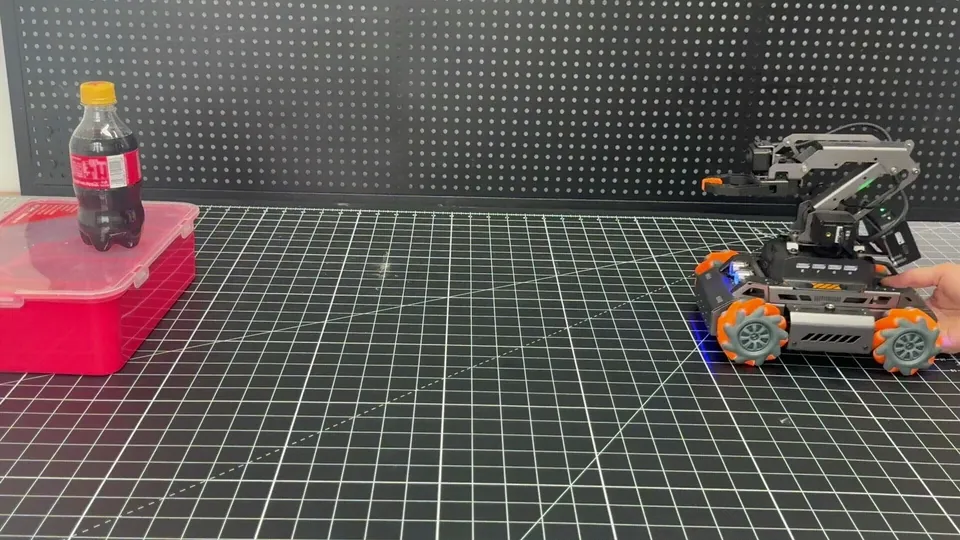
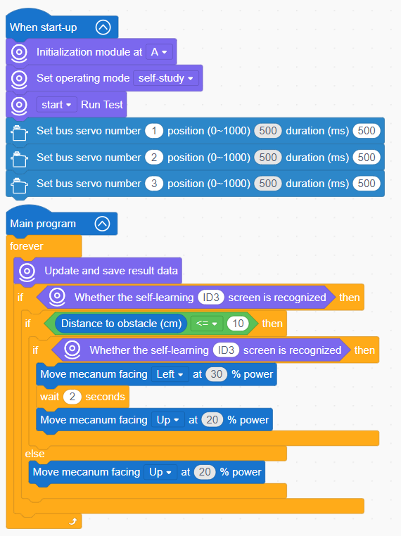
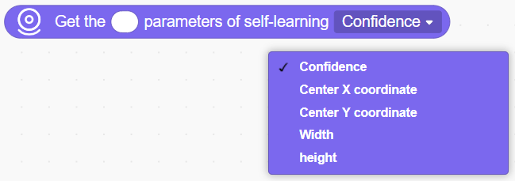

# 3.22 Lesson 22: Image Feature Learning

## 3.22.1 Lesson Introduction

This lesson focuses on the self-learning function of the K230 module, exploring few-shot learning to rapidly recognize new objects. Taking inspiration from how human eyes recognize everyday items such as cups and backpacks, human memory is compared with machine feature extraction principles. Operating the self-learning function involves aligning the camera with an object, initiating learning, and naming the ID. Combining this with the ultrasonic sensor completes an intelligent obstacle avoidance task that achieves multi-sensor fusion of visual perception and distance measurement. Introducing the concept of confidence scores ranging from 0 to 1 establishes an understanding of transfer learning and demonstrates how large models rapidly customize new categories, laying a methodological foundation for custom recognition.

## 3.22.2 Learning Objectives

**1.** Understand the concept of image features, master the basic principles of feature learning, comprehend the meaning of confidence scores, and learn the fundamental concepts of transfer learning and few-shot learning.

**2.** Independently complete the registration procedure for self-learned objects. Proficiently master the initialization and detection commands for self-learning mode, and read recognition parameters, including confidence scores, coordinates, and dimensions.

**3.** Establish a feature-based cognitive mindset to understand that object recognition is fundamentally feature comparison. Cultivate reliability awareness by using confidence scores to evaluate the credibility of AI recognition results.

**4.** Connect self-learning technology to real-world application scenarios such as industrial parts sorting, customized quality inspection, personalized item recognition, and rapid model customization, understanding its value in flexible manufacturing and personalized AI.

## 3.22.3 Preparation

**Hardware Preparation**:

- AiMecha M1 Mecanum-Wheel Car Advanced Kit

- Type-C data cable

- Computer × 1

- Remote controller

**Software Preparation**:

- WonderLab graphical programming software

**Core Concept Description**:

- **Image Features**: Distinct attributes in an image that differentiate various objects, including color distribution, edge shapes, and texture patterns.

- **Feature Vector**: A set of numerical features extracted by an algorithm to represent the visual fingerprint of an object.

- **Confidence Score**: A matching value ranging from 0 to 1 that indicates how certain the AI is that the current object matches the learned template.

- **Transfer Learning**: A method of rapidly learning new categories using only a few samples built upon a pre-trained general model.

**Wiring Instructions**:

- Connect the K230 screen module to **port A** of the controller.

- Connect the ultrasonic sensor to I2C **port K**.

- Connect the three bus servos in series to bus port S1 or S2.

**Three-Step Self-Learning Procedure**:

- Step 1: Select "Self-Learning" mode from the K230 module menu.

- Step 2: Center the target object in front of the camera and tap the "Learn" key.

- Step 3: Enter an ID name using English letters or numbers, such as ID3, cup, or block, and confirm to save.

**Factors Affecting Learning Performance**:

- A cleaner background yields more accurate feature extraction and higher recognition rates.

- Maintain uniform and sufficient lighting while avoiding backlighting or shadows.

- Position the object so that it occupies approximately one-third of the frame, avoiding sizes that are too large or too small.

- Learning the same object multiple times from different angles improves recognition robustness.

- Greater visual differences between different learned objects reduce the likelihood of confusion.

## 3.22.4 Hands-On Project

**1. Program Logic**

This project constructs an intelligent obstacle avoidance system fusing visual perception and distance measurement, centered around dual-sensor hierarchical decision-making. The K230 self-learning mode compares features to output matching results and coordinates, while the ultrasonic sensor measures distance in real time. The decision-making layer uses nested conditional judgments: first confirming the target visually and then triggering obstacle avoidance when the distance is less than or equal to 10 cm, utilizing dual confirmation to prevent false triggers. In the execution layer, upon encountering the target, the car moves left at 30% power for 2 s and then moves forward at 20% power, or otherwise cruises forward at a constant 20% power. By fusing visual identification of what the object is with ultrasonic measurement of how far away it is, the system achieves accurate and safe obstacle avoidance.

💡**Complete Program Preview:**

**2. Core Commands**

|     Command Category     |                         Core Command                         | Functional Description                                       |
| :----------------------: | :----------------------------------------------------------: | :----------------------------------------------------------- |
| Self-learning detection  |  | Determines whether a learned object with the specified ID is detected and returns a boolean value. |
| Self-learning parameters |  | Reads detailed information, including confidence score, x and y coordinates, width, and height. |
|    Confidence reading    |  | Reads the matching score ranging from 0 to 1 to evaluate recognition reliability. |
|    Ultrasonic ranging    |  | Reads the distance to an obstacle ahead in centimeters.      |
|      Motion control      |  | Controls eight-directional car movement using percentage power for obstacle avoidance detours. |
|      Servo control       |  | Controls the robotic arm servo positions for initialization and resetting. |

**3. Complete Program Description**

**Task: Evaluating Distance After Recognizing a Self-Learned Object for Intelligent Obstacle Avoidance**

- Preparation: Complete the registration of the self-learned object on the K230 module, name it ID3, and verify normal recognition.

- Initialization settings: At startup, initialize port A, set the running mode to Self-Learning, start detection, and reset all three bus servos to position 500 with a running time of 500 ms so the robotic arm returns to its initial state.

- Main loop structure: Execute `Update and save result data` as the first step inside the repeat forever loop to synchronize the latest self-learning recognition data.

- First-level visual judgment: If `Whether the self-learning ID3 screen is recognized?` evaluates to true, enter the distance judgment branch.

- Second-level distance judgment: Nest an if statement checking whether `Ultrasonic Obstacle Distance <= 10` to confirm that the target is at close range.

- Third-level secondary confirmation: Nest `Whether the self-learning ID3 screen is recognized?` a second time as a double safeguard to prevent false triggers caused by desynchronization between distance data and visual data.

- Obstacle avoidance maneuver: When all three conditions are met, execute the detour sequence by moving the car left at 30% power, waiting 2 s to clear the object laterally, and moving the car forward at 20% power to continue advancing.

- Normal forward driving: In the outermost else branch when the target object is not recognized, drive the car forward at 20% power to maintain a cruising state.

**Dual-Confirmation Design Description**

- `Whether the self-learning ID3 screen is recognized?` twice in the program ensures that the target remains present during distance measurement, preventing false triggers if visual tracking is lost and the ultrasonic sensor detects a different obstacle.

- The dual-confirmation mechanism combining vision + ultrasonic ranging is more reliable than a single sensor, illustrating the engineering concept of multi-sensor fusion.

- The 10 cm trigger distance can be adjusted according to actual needs, where a larger distance initiates avoidance earlier, and a smaller distance increases precision at the cost of shorter reaction time.

**Self-Learning Tips**

- Naming convention: Use concise English letters or numbers for ID names without Chinese characters for convenient program invocation.

- Number of learned objects: The module supports learning multiple objects under distinct ID names for separate evaluation in the program.

- Confidence threshold: In addition to the default internal confidence threshold, confidence values can be read directly in the program to set a higher threshold and filter out low-confidence false positives.

- Re-learning: If recognition performance is unsatisfactory, re-learn the object to overwrite the existing ID or delete it and register it again.

- Angular generalization: Learning the same object multiple times from different angles improves recognition rates across varying viewpoints.

  > [!NOTE]
  >
  > **The program source files can be downloaded from [Program Files/Image Feature Learning](https://drive.google.com/drive/folders/1qESIR7n_mxv3oQTrZhNbBTnPKVOk-yT4?usp=sharing).**

**Program Upload**:

- Step 1: Power on the mecha controller and insert the Type-C data cable into the data port located above the power switch on the controller.

- Step 2: Connect the other end of the data cable to a USB port on the computer.

- Step 3: Click the **Connect device** button at the top of the software interface and select the COM port corresponding to CH340 from the port list.

- Step 4: Click the upload button in the upper-right corner to download the compiled program to the mecha controller for execution.

## 3.22.5 Expansion and Advancement

**Expansion Project 1: Multi-Object Classification and Sorting System**

Learn three to five different objects under distinct ID names and design a multi-object sorting program: turn left toward Zone A when Object A is recognized, turn right toward Zone B when Object B is recognized, and drive forward toward Zone C when Object C is recognized. Combine this with robotic arm grasping to implement a complete sorting assembly line integrating visual recognition + categorized transport, simulating the operating mode of an industrial flexible sorting robot and demonstrating how self-learning technology rapidly adapts to new sorting tasks.

**Expansion Project 2: Confidence-Graded Response System**

Utilize the confidence score parameter to design a graded response mechanism: execute a definitive action such as precision grasping when the confidence score > 0.9, execute a cautious action such as slowing down to approach and re-verify when the confidence score is between 0.7 and 0.9, and ignore the detection when the confidence score < 0.7. Explore uncertainty handling methods in AI recognition, understand how ambiguous recognition results are processed in practical engineering, and establish a reliability design mindset for AI systems.

## 3.22.6 Q&A

**Q1: Why can the K230 module learn a new object after seeing it only once or twice, whereas training a standard AI model typically requires tens of thousands of images?**

**Answer**: Self-learning on the K230 module is not **training from scratch**, but rather **transfer learning + template matching**, meaning the two approaches start from completely different baselines.

**Training a model from scratch** requires tens of thousands of images to iteratively tune parameters, gradually learning to extract basic features such as edges, textures, and shapes before finally classifying objects.

**Self-learning on the K230** relies on a general vision model pre-trained on millions of images that is already pre-installed inside the module.

**Q2: What do confidence scores of 0.95 and 0.6 represent respectively?**

**Answer**: A confidence score represents the **degree of certainty** the AI has in its own recognition result, expressed as a decimal between 0 and 1 that can also be understood as a probability.

## 3.22.7 Technical Support and Discussion

Join the forum for sharing questions, ideas, or suggestions, and answers will be provided promptly. Click the hyperlink [Hiwonder Forum](http://forum.hiwonder.com) or enter the URL in a browser: http://forum.hiwonder.com