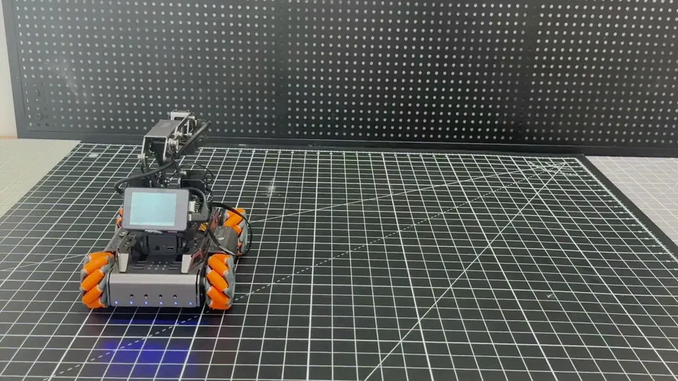
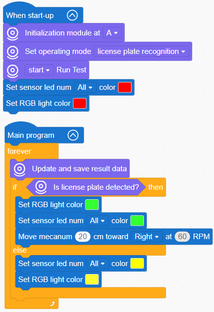
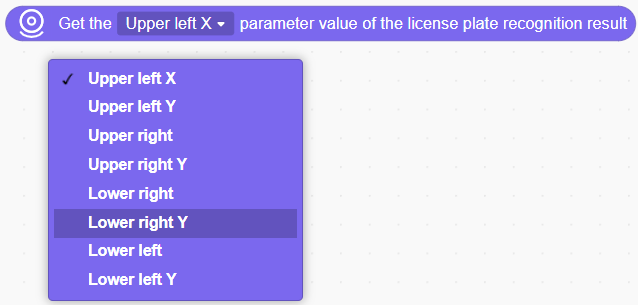

# 3.23 Lesson 23: License Plate Recognition

## 3.23.1 Lesson Introduction

Focusing on K230 license plate recognition, this lesson introduces optical character recognition, abbreviated as OCR. Taking inspiration from electronic toll collection, smart access control, and contactless passage, this lesson demonstrates how license plate recognition improves daily efficiency. This section covers the OCR workflow: image input, text region detection, character segmentation and matching, and text output. Through a hands-on unmanned parking lot project where the car acts as a barrier gate, illuminating a green light and moving aside when a license plate is recognized, and illuminating a yellow light to stand by when none is recognized, this lesson introduces text-output visual results for the first time, demonstrating how to retrieve text for decision-making and bridging the gap between images and semantic meaning. Establishing a general understanding of OCR lays the foundation for document digitization and related applications.

## 3.23.2 Learning Objectives

**1.** Understand the definition and basic principles of optical character recognition. Master the technical workflow of license plate recognition, and learn key technical stages including text region detection, character segmentation, and template matching.

**2.** Launch the license plate recognition mode on the K230 module and verify its functionality. Proficiently master programming commands related to license plate recognition and read the recognized license plate text content.

**3.** Establish procedural technical thinking to understand the step-by-step decomposition of complex recognition tasks. Cultivate systems thinking to translate visual recognition into automated control logic.

**4.** Connect highway electronic toll collection, residential barrier gates, parking lot contactless payment, traffic violation capture, and campus vehicle management to real-world application scenarios, understanding the broad value of license plate recognition technology in intelligent transportation and smart cities.

## 3.23.3 Preparation

**Hardware Preparation**:

- AiMecha M1 Mecanum-Wheel Car Advanced Kit

- Type-C data cable

- Computer × 1

- Remote controller

**Software Preparation**:

- WonderLab graphical programming software

**OCR Principle Description**:

- **Definition**: Optical Character Recognition, abbreviated as OCR, is a technology that converts text within images into editable text.

- **Workflow**: Image input → text region detection → character segmentation → character matching → text output.

- **Core**: Translating image pixels into semantic text information so that machines can "read and interpret" image content.

**License Plate Recognition Technical Workflow**:

- Step 1: **License Plate Localization**: Locate the license plate region within the frame using color characteristics such as a blue background with white characters or a yellow background with black characters, alongside rectangular contour features.

- Step 2: **Character Segmentation**: Segment individual characters within the license plate region one by one to prepare them for standalone recognition.

- Step 3: **Character Recognition**: Recognize each character using OCR technology and assemble them into a complete license plate number.

- Step 4: **Result Output**: Output the license plate text, four-corner coordinates, and other information.

**Wiring Instructions**:

- Connect the K230 screen module to **port A** of the controller.

- Connect the RGB LEDs to the corresponding lighting effect ports.

- Connect the ultrasonic sensor to **port K**.

**Menu Navigation Path**:

- Recognition Mode → Image Recognition → License Plate Recognition.

**Factors Influencing Recognition Performance**:

- Face the license plate directly toward the camera for optimal results, as excessive tilt angles reduce the recognition rate.

- Ensure uniform and sufficient lighting, as glare or backlighting reduces recognition accuracy.

- Keep the license plate at a moderate size within the frame, as being too large or too small compromises performance.

- Ensure the license plate is clear, intact, and unobstructed, as partial occlusion may cause recognition failure.

## 3.23.4 Hands-On Project

**1. Program Logic**

This project simulates an unmanned smart parking lot barrier gate, centered around visual recognition triggering automated gate control. The K230 captures the frame, and the license plate algorithm locates, segments, and processes OCR to output text and coordinates. The decision-making layer checks for the presence of a license plate, granting passage when present and standing by when absent. The execution layer illuminates green lights while driving the car right by 20 cm at 60 rpm to simulate lifting the gate, or illuminates yellow lights on standby when no license plate is present. The system simulates the complete workflow of vehicle entry → recognition → gate lifting → passage, illustrating a typical application of vision-driven automated decision-making.

💡**Complete Program Preview:**

**2. Core Commands**

|   Command Category    |                         Core Command                         | Functional Description                                       |
| :-------------------: | :----------------------------------------------------------: | :----------------------------------------------------------- |
|  Presence detection   |  | Determines whether a license plate is present in the current frame and returns a boolean value. |
|   Quantity counting   |  | Counts the number of license plates detected in the frame, supporting multi-plate scenarios. |
|    Text retrieval     |  | Reads the recognized license plate number text content, such as `HU A12345`. |
| Coordinate parameters |  | Reads the four-corner coordinate values of the license plate, including top-left, top-right, bottom-right, and bottom-left, for positional evaluation. |
|     Light control     |  | Controls indicator light colors to simulate red, green, and yellow status signals of a barrier gate. |
|    Motion control     |  | Precisely controls the translational movement distance of the car to simulate lifting the barrier gate to clear the path. |

**3. Complete Program Description**

**Task: Unmanned Parking Lot: Recognizing License Plates and Opening Gates Automatically**

- Initialization settings: At startup, initialize port A, set the running mode to license plate recognition, start detection, set all ultrasonic sensor RGB lights to red, and set the onboard RGB LEDs to red to represent the initial standby status.

- Main loop structure: Execute `Update and save result data` as the first step inside the repeat forever loop to synchronize the latest license plate recognition data.

- Dual-branch condition: Use an if-else structure to evaluate the condition `Is license plate detected?`.

- Passage branch upon detecting a license plate: Set the onboard RGB LED color to green, set all ultrasonic sensor RGB lights to green, and drive the Mecanum-wheel car right by 20 cm at 60 rpm to simulate the barrier gate lifting laterally to clear the path.

- Standby branch when no license plate is detected: Set all ultrasonic sensor RGB lights to yellow, and set the onboard RGB LED color to yellow to represent the waiting status.

- Looped execution: The main loop monitors continuously, returning automatically to the yellow standby status once the license plate leaves and opening the gate automatically when a plate reappears.

**Program Design Key Points**

- Real-time updates: Update data before evaluating conditions in every loop cycle to ensure the program uses the latest recognition results.

- Status feedback: Provide intuitive system status feedback via different light colors, red for initial state, yellow for waiting, and green for passage, matching traffic signal conventions.

- Translation distance: Adjust the 20 cm rightward translation distance according to the physical setup to ensure sufficient clearance for the simulated barrier gate.

- Movement rotational speed: Set the speed to 60 rpm for a moderate pace that is neither too slow nor too fast to maintain stability.

**Advanced Functional Expansion Ideas**

- Whitelist mechanism: Retrieve license plate text and compare it against a preset whitelist, opening the gate only for authorized vehicles and sounding an alarm for unfamiliar plates.

- Billing by duration: Record the initial appearance and departure timestamps of a license plate to calculate parking duration and fees automatically.

- Multi-plate priority: When multiple license plates appear in the frame, select the largest or most centrally located plate as the primary target.

- Voice announcements: Play prompt tones on the buzzer or announce license plate numbers via voice upon recognizing a plate.

  > [!NOTE]
  >
  > **The program source files can be downloaded from [Program Files/License Plate Number Recognition](https://drive.google.com/drive/folders/1qESIR7n_mxv3oQTrZhNbBTnPKVOk-yT4?usp=sharing).**

**Program Upload:**

- Step 1: Power on the mecha controller and insert the Type-C data cable into the data port located above the power switch on the controller.

- Step 2: Connect the other end of the data cable to a USB port on the computer.

- Step 3: Click the **Connect device** button at the top of the software interface and select the COM port corresponding to CH340 from the port list.

- Step 4: Click the upload button in the upper-right corner to upload the compiled program to the mecha controller for execution.

## 3.23.5 Expansion and Advancement

**Expansion Project 1: Intelligent License Plate Whitelist Access Control System**

Design a license plate whitelist management system pre-configured with three authorized license plate numbers. Upon recognizing a plate, retrieve the text content and compare it against the whitelist, illuminating green lights and opening the gate for authorized vehicles while illuminating red lights and sounding a buzzer alarm for unfamiliar vehicles. Simulate a real residential community or industrial park access control system to understand the progression of license plate recognition from "presence detection" to "identity verification".

**Expansion Project 2: Parking Lot Timed Billing System**

Incorporate timer variables to record vehicle entry and exit timestamps to calculate parking duration automatically. Design a tiered billing logic: free within 15 minutes, 5 currency units within the first hour, and 3 currency units per hour thereafter. Begin timing when a license plate enters and settle and display charges upon recognizing the same plate exiting. Simulate the contactless payment workflow of a real parking lot to understand how visual recognition drives a complete commercial loop in smart parking.

## 3.23.6 Q&A

**Q1: What is the operating principle of OCR text recognition?**

**Answer**: The core of optical character recognition is **image feature matching**, which compares the shapes of characters in an image one by one against known character templates to identify the closest match.

**Q2: The first step of license plate recognition is license plate localization, which involves finding where the license plate is within the frame. How does the machine accurately locate the license plate amidst a complex background?**

**Answer**: Localization relies on a joint combination of **color features + shape contours + texture patterns**.

## 3.23.7 Technical Support and Discussion

Join the forum for sharing questions, ideas, or suggestions, and answers will be provided promptly. Click the hyperlink [Hiwonder Forum](http://forum.hiwonder.com) or enter the URL in a browser: http://forum.hiwonder.com