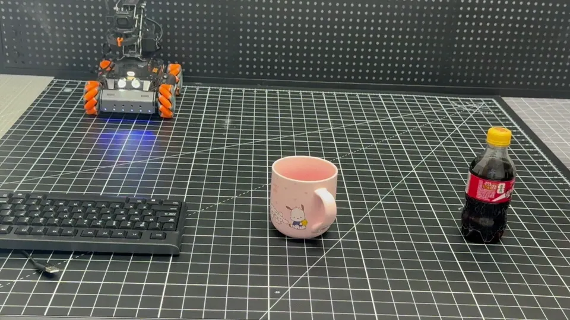
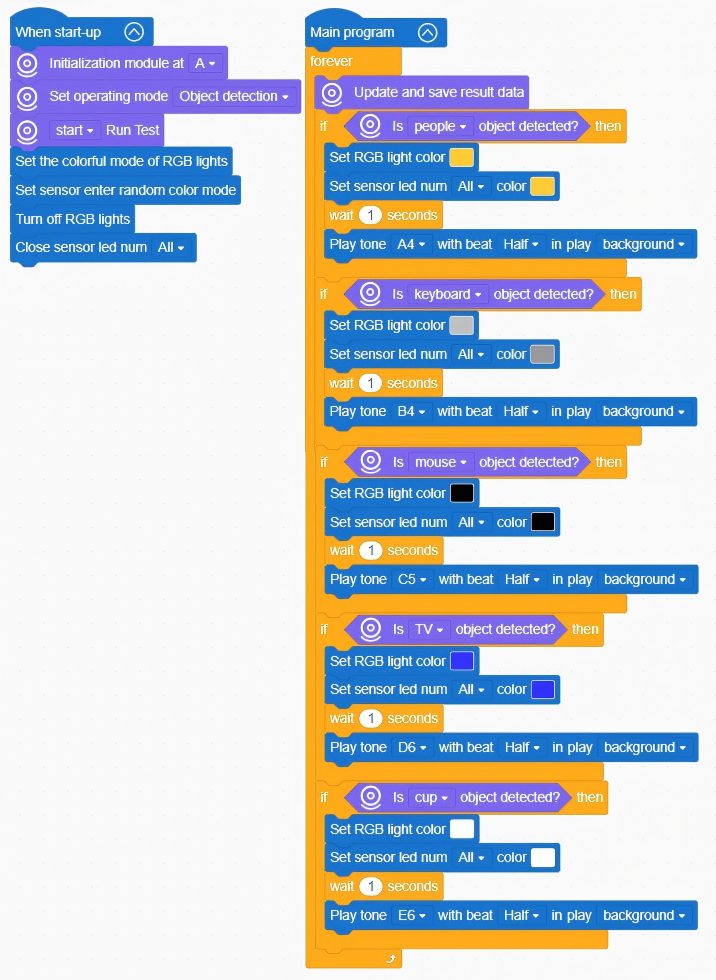

# 3.24 Lesson 24: Massive Object Detection

## 3.24.1 Lesson Introduction

Focusing on K230 massive object detection, this lesson explores general object recognition. Taking inspiration from smart warehouse sorting and autonomous driving perception, this section demonstrates the industrial value of general object detection. Covering the core of object detection, recognizing both "what an object is" and "where it is located", it explains how models scan images to generate candidate regions and annotate bounding boxes with confidence scores. Using classroom items as targets, the project implements multi-object sound and light feedback where detecting people, keyboards, and mice triggers distinct lights and musical pitches. Introducing large-scale models capable of recognizing over 80 categories for the first time highlights the distinction between general AI and specialized recognition, laying the foundation for vertical detection tasks such as traffic sign detection.

## 3.24.2 Learning Objectives

**1.** Understand the dual tasks of object detection, master the basic principles of deep learning object detection, learn the coverage scope of general 80-category object detection models, and comprehend the meanings and roles of confidence scores and bounding boxes.

**2.** Launch the object detection mode on the K230 module and verify its functionality. Proficiently master programming commands related to object detection and read parameters such as the name, confidence score, coordinates, and dimensions of the object closest to the center.

**3.** Establish a dual mindset of classification and localization to understand the dual-output characteristics of object detection. Cultivate systems thinking for parallel multi-class processing, and enhance logical design skills for multi-branch conditional judgments.

**4.** Connect smart warehouse sorting, autonomous driving environmental perception, smart retail shelf inventory, industrial quality inspection, and security surveillance to real-world application scenarios, understanding the broad value of general object detection technology across industries.

## 3.24.3 Preparation

**Hardware Preparation**:

- AiMecha M1 Mecanum-Wheel Car Advanced Kit

- Type-C data cable

- Computer × 1

- Remote controller

**Software Preparation**:

- WonderLab graphical programming software

**Core Concept Description**:

- **Object Detection**: A vision technology that simultaneously recognizes object categories, indicating what an object is, and locations, indicating where it is, outputting annotated results with bounding boxes.

- **Classification**: Determines which category a detected object belongs to, such as a person, car, or cup.

- **Localization**: Marks the position of an object in the frame using a rectangular bounding box containing center coordinates, width, and height.

- **Confidence Score**: The reliability level of a detection result ranging from 0 to 1, where higher values indicate greater certainty.

- **General 80-Category Detection**: A model capable of recognizing over 80 common objects, covering people, animals, vehicles, and everyday items.

**Wiring Instructions**:

- Connect the K230 screen module to **port A** of the controller.

- Connect the RGB LEDs to the corresponding lighting effect ports.

- Connect the buzzer to the buzzer port.

- Connect the ultrasonic sensor to **port K**.

**Menu Navigation Path**:

- Recognition Mode  → Image Recognition  → Object Detection.

**Factors Influencing Detection Performance**:

- Keep objects fully visible within the frame, as partial occlusion reduces the recognition rate.

- Provide sufficient and uniform lighting, as small objects are easily missed in dim environments.

- Maintain an appropriate object size relative to the frame, as distant or tiny objects are difficult to detect.

- Choose objects with distinct features for easier recognition, as visually similar objects may cause confusion.

## 3.24.4 Hands-On Project

**1. Program Logic**

This project builds a multi-object classified sound and light response system, centered around single-input multi-branch classification decision-making. The K230 deep learning detector outputs multiple bounding boxes, confidence scores, and categories, selecting the central object as the primary response target. The decision-making layer evaluates multiple branches sequentially for people, keyboards, mice, TVs, and cups. The execution layer maps each object to a distinct light color and musical pitch: yellow lights and note A4 for a person, gray lights and note B4 for a keyboard, black lights and note C5 for a mouse, blue lights and note D6 for a TV, and white lights and note E6 for a cup, providing dual audio-visual channel feedback. The system simulates general perception → classification → differentiated responses, demonstrating how object detection empowers diverse interactions.

💡**Complete Program Preview:**

**2. Core Commands**

|  Command Category  |                         Core Command                         | Functional Description                                       |
| :----------------: | :----------------------------------------------------------: | :----------------------------------------------------------- |
| Category detection |  | Determines whether an object of a specified category, such as a person or keyboard, is present in the frame. |
| Quantity counting  |  | Counts the total number of objects detected in the current frame. |
|   Name retrieval   |  | Reads the category name of the object closest to the center of the frame. |
|   Sound feedback   |  | Controls the buzzer to play specified musical notes, mapping different objects to different pitches. |

**3. Complete Program Description**

**Task: Detecting Different Objects to Trigger Distinct Light and Sound Feedback**

- Initialization settings: At startup, initialize port A, set the running mode to object detection, start detection, turn off the onboard RGB LEDs, and turn off all ultrasonic sensor RGB lights to establish an initial all-off state.

- Main loop structure: Execute `Update and save result data` as the first step inside the repeat forever loop to synchronize the latest object detection data.

- Branch 1 upon detecting a person: If `Is people object detected?`, set the onboard RGB LED color to yellow, set all ultrasonic sensor RGB lights to yellow, wait 1 s, and play note A4 for a 1/2 beat in background mode.

- Branch 2 upon detecting a keyboard: If `Is keyboard object detected?`, set the onboard RGB LED color to gray, set all ultrasonic sensor RGB lights to gray, wait 1 s, and play note B4 for a 1/2 beat in background mode.

- Branch 3 upon detecting a mouse: If `Is mouse object detected?`, set the onboard RGB LED color to black, set all ultrasonic sensor RGB lights to black, wait 1 s, and play note C5 for a 1/2 beat in background mode.

- Branch 4 upon detecting a TV: If `Is TV object detected?`, set the onboard RGB LED color to blue, set all ultrasonic sensor RGB lights to blue, wait 1 s, and play note D6 for a 1/2 beat in background mode.

- Branch 5 upon detecting a cup: If `Is cup object detected?`, set the onboard RGB LED color to white, set all ultrasonic sensor RGB lights to white, wait 1 s, and play note E6 for a 1/2 beat in background mode.

- Parallel execution: The five branches are arranged in parallel, triggering their respective actions sequentially when multiple objects appear in the frame simultaneously.

**Program Design Key Points**

- Parallel multi-branching: Evaluate each object independently without mutual interference, allowing simultaneous responses to multiple objects.

- Sound-light combination: Map each object to a unique color and pitch combination for clear distinction of recognition results.

- Background playback: Set the buzzer to background playback mode so that sound output does not block the main program from continuing detection.

- 1 s wait time: Keep the lights illuminated for 1 s to make state changes clearly visible, and adjust the duration as needed.

- Scalability: Add new if branches to expand responses to additional objects within this flexible framework.

**Object Detection Tips**

- Center priority: Use the `Object Nearest Center` command to retrieve the primary target and avoid interference from multiple objects.

- Category selection: Select from over 80 object categories in the drop-down menu, spanning everyday items, vehicles, animals, and food.

- Confidence filtering: Read confidence parameters to set thresholds, responding only to high-confidence results to reduce false positives.

- Position evaluation: Combine center x and y coordinates to determine the object's direction within the frame for directional control.

- Size estimation: Estimate object distance roughly using the width and height parameters, where larger dimensions indicate closer proximity.

  > [!NOTE]
  >
  > **The program source files can be downloaded from [Program Files/Massive Object Detection](https://drive.google.com/drive/folders/1qESIR7n_mxv3oQTrZhNbBTnPKVOk-yT4?usp=sharing).**

**Program Upload Procedure:**

- Step 1: Power on the mecha controller and insert the Type-C data cable into the data port located above the power switch on the controller.

- Step 2: Connect the other end of the data cable to a USB port on the computer.

- Step 3: Click the **Connect device** button at the top of the software interface and select the COM port corresponding to CH340 from the port list.

- Step 4: Click the upload button in the upper-right corner to upload the compiled program to the mecha controller for execution.

## 3.24.5 Expansion and Advancement

**Expansion Project 1: Intelligent Classroom Inventory System**

Design an automated classroom inventory program to sequentially count the quantities of people, chairs, tables, books, and cups in the frame, and display or announce the counts. Simulate the asset inventory function of a smart classroom, explore object counting methods, and understand how object detection advances from "presence detection" to "quantity statistics" in smart space management.

**Expansion Project 2: Vision-Guided Robotic Arm Sorting System**

Combine robotic arm functionality to design a vision sorting system: detecting a cup → grasping and placing it into Zone A with the robotic arm, detecting a bottle → grasping and placing it into Zone B, and detecting a mouse → grasping and placing it into Zone C. Use object center coordinates to guide the robotic arm to align with targets for automated visual sorting. Simulate the workflow of industrial logistics sorting robots to understand how general object detection empowers flexible automation.

## 3.24.6 Q&A

**Q1: What is the term for classification without localization versus classification + localization?**

**Answer**: Classification without localization is called **image classification**, whereas classification + localization is called **object detection**.

**Q2: How does the K230 module acquire the capability to recognize over 80 types of objects?**

**Answer**: The K230 recognizes over 80 types of objects because it incorporates a **deep learning detection model pre-trained on a large-scale dataset**, meaning the model "completes training" prior to factory release rather than being trained locally on the compact module.

## 3.24.7 Technical Support and Discussion

Join the forum for sharing questions, ideas, or suggestions, and answers will be provided promptly. Click the hyperlink [Hiwonder Forum](http://forum.hiwonder.com) or enter the URL in a browser: http://forum.hiwonder.com