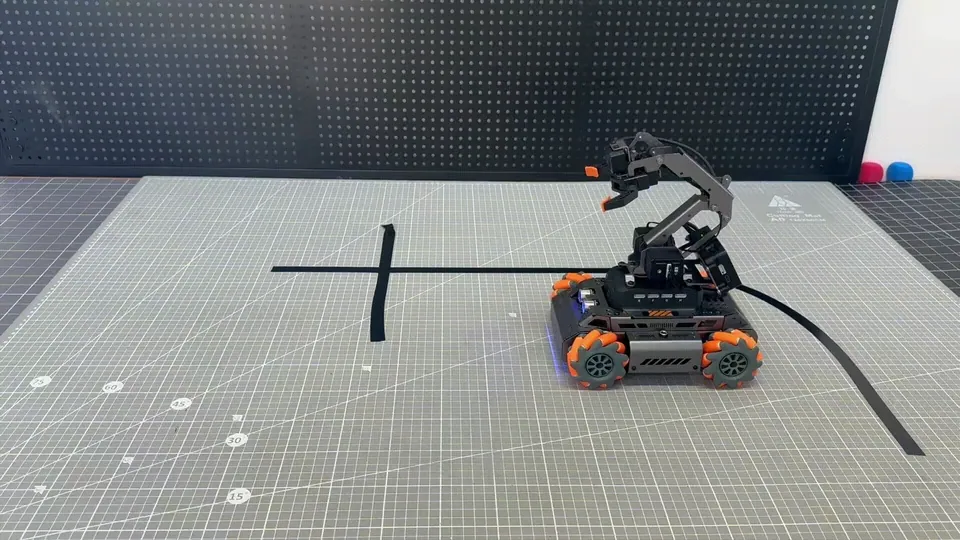
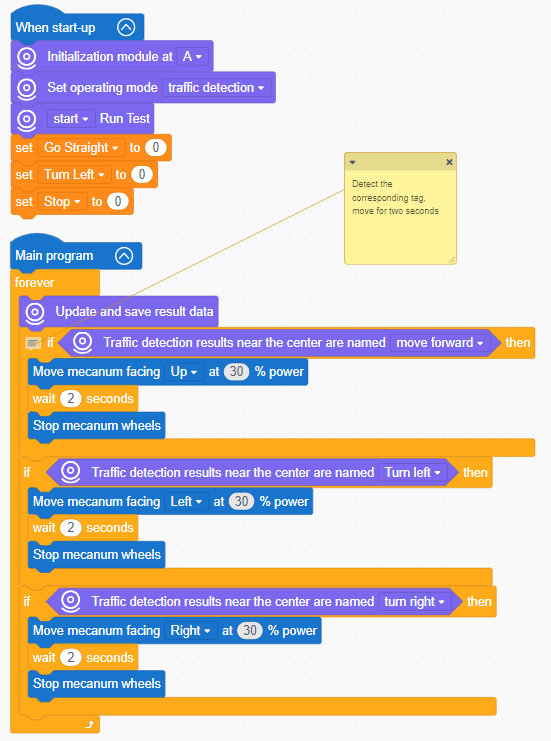
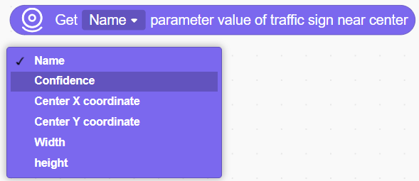
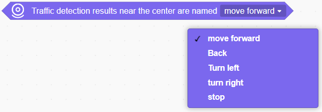

# 3.25 Lesson 25: Traffic Sign Detection

## 3.25.1 Lesson Introduction

Focusing on K230 traffic sign detection, this lesson explores autonomous driving applications. Taking inspiration from self-driving cars recognizing road signs and unmanned delivery vehicles reading street markers, this section covers dedicated model recognition for signs such as go straight, turn left, turn right, and stop. Centered around "sign-guided automated driving", this lesson designs an intelligent driving simulation where recognizing signs triggers forward movement, left turns, or right turns for 2 s. Combining visual detection with traffic scenarios establishes a clear understanding of the "perception → decision → execution" autonomous driving pipeline. Incorporating line following alongside traffic sign detection introduces advanced gameplay, expanding real-world driving scenarios and inspiring further exploration into intelligent transportation.

## 3.25.2 Learning Objectives

**1.** Understand the technical principles and application scenarios of traffic sign detection. Master the characteristics and advantages of dedicated object detection models, learn the core functions of the autonomous driving perception layer, and comprehend the decision-guiding role of traffic signs in intelligent driving.

**2.** Enable the traffic sign detection mode on the K230 module and verify its functionality. Master the programming commands for traffic sign detection, and retrieve the name and parameters of the traffic sign closest to the center of the frame.

**3.** Establish a systems mindset for autonomous driving based on the perception-decision-execution framework. Cultivate rule-driven behavioral decision-making capabilities, and enhance design skills in scenario-based programming and task abstraction.

**4.** Relate these concepts to real-world application scenarios, such as autonomous driving, advanced driver assistance systems, also known as ADAS, unmanned delivery vehicles, smart traffic management, and campus logistics vehicles, to understand the core value of traffic sign detection in intelligent mobility.

## 3.25.3 Preparation

**Hardware Preparation**:

- AiMecha M1 Mecanum-Wheel Car Advanced Kit

- Type-C data cable

- Computer × 1

- Remote controller

**Software Preparation**:

- WonderLab graphical programming software

**Core Concept Description**:

- **Traffic Sign Detection**: Specialized object detection optimized for traffic scenarios that recognizes various traffic signs and outputs their categories and locations.

- **Recognizable Signs**: Go straight, turn left, turn right, stop, U-turn, traffic lights, crosswalk, and speed limit sign cards.

- **Autonomous Driving Perception Layer**: Acts as the "eyes" of the autonomous driving system to identify all road traffic elements.

**Wiring Instructions**:

- Connect the K230 screen module to **port A** of the controller.

**Menu Navigation Path**:

- Recognition Mode → AI Application → Traffic Detection.

**Factors Influencing Recognition Performance**:

- Face sign cards directly toward the camera for optimal results, as excessive tilt angles reduce the recognition rate.

- Ensure uniform and sufficient lighting, as glare or shadows may reduce accuracy.

- Keep the sign at a moderate size within the frame, ensuring it remains clear, intact, and unobstructed.

- Use a clean background with minimal clutter for better recognition performance.

**Three-Layer Autonomous Driving Architecture**:

- **Perception Layer**: Uses sensors such as cameras and LiDARs to perceive the environment, with traffic sign detection in this lesson belonging to the perception layer.

- **Decision Layer**: Evaluates perceptual information to determine appropriate actions such as going straight, turning, or stopping.

- **Execution Layer**: Controls actuators such as motors and servos to complete physical movements.

## 3.25.4 Hands-On Project

**1. Program Logic**

This project builds a vision-guided intelligent driving simulation system, reproducing the three-layer autonomous driving architecture of perception, decision-making, and execution. The perception layer relies on the K230 camera to capture frames, recognizing traffic signs via models to output categories, confidence scores, and positional information. The decision-making layer adopts sign-driven rule logic, triggering forward movement, left turns, or right turns upon recognizing corresponding signs. The execution layer drives the Mecanum-wheel car to complete actions, automatically stopping and waiting for new commands after each execution. Building this system provides an intuitive understanding of autonomous driving principles and establishes system-level architecture cognition.

💡**Complete Program Preview:**

**2. Core Commands**

|  Command Category   |                         Core Command                         | Functional Description                                       |
| :-----------------: | :----------------------------------------------------------: | :----------------------------------------------------------- |
| Presence detection  |  | Determines whether any traffic sign is present in the frame and returns a boolean value. |
|  Quantity counting  |  | Counts the number of traffic signs detected in the frame.    |
| Detailed parameters |  | Reads parameters such as the name, confidence, coordinates, and dimensions of the central sign. |
|    Name matching    |  | Directly evaluates whether a sign matches a specified category to simplify conditional logic. |

**3. Complete Program Description**

**Task: Recognizing Different Traffic Signs to Execute Corresponding Driving Actions**

- Initialization settings: At startup, initialize port A, set the running mode to traffic detection, and start detection.

- Main loop structure: Execute `Update and save result data` as the first step inside the repeat forever loop to synchronize the latest traffic sign detection data.

- Go straight branch: If `Traffic detection results near the center are named move forward`, drive the Mecanum-wheel car forward at the specified power, wait 2 s, and stop the car so that it moves forward for 2 s and stops upon detecting a straight sign.

- Turn left branch: If `Traffic detection results near the center are named Turn left`, spin the Mecanum-wheel car left in place at the specified power, wait 2 s, and stop the car so that it turns left for 2 s and stops upon detecting a left-turn sign.

- Turn right branch: If `Traffic detection results near the center are named turn Right`, spin the Mecanum-wheel car right in place at the specified power, wait 2 s, and stop the car so that it turns right for 2 s and stops upon detecting a right-turn sign.

- Stop sign branch: Expand the program with a stop sign branch to bring the car to an immediate halt upon detection.

- Sign trigger mechanism: Trigger one complete action sequence per sign and ignore new signs during execution to ensure each action completes fully.

**Program Design Key Points**

- Direct name evaluation: Use the `Traffic detection results are named XX` command to evaluate sign categories directly and simplify programming.

- Action duration: Adjust the 2 s action duration according to actual performance to achieve appropriate turning angles or forward distances.

- Center priority: Default to the sign closest to the center to prevent confusion when multiple signs appear near the edges of the frame.

- Stop and reset: Stop the car after each action completes to ensure a single sign triggers a single action.

- High scalability: Add a new if branch to incorporate additional sign types within the unified framework.

**Advanced Challenge: Line Following + Autonomous Driving with Traffic Sign Recognition**

- Combine the 6-channel line follower sensor to guide the car along black tape tracks.

- Execute corresponding actions upon encountering traffic sign cards along the route: stop for 3 s at a stop sign before proceeding, and spin in place to return at a U-turn sign.

- Simulate real road scenarios to build a comprehensive autonomous driving experience.

- Multi-sensor fusion: Use line following for lane keeping and visual sign recognition for traffic rule decision-making so both systems work in coordination.

  > [!NOTE]
  >
  > **The program source files can be downloaded from [Program Files/Traffic Sign Detection](https://drive.google.com/drive/folders/1qESIR7n_mxv3oQTrZhNbBTnPKVOk-yT4?usp=sharing).**

**Program Upload:**

- Step 1: Power on the mecha controller and insert the Type-C data cable into the data port located above the power switch on the controller.

- Step 2: Connect the other end of the data cable to a USB port on the computer.

- Step 3: Click the **Connect device** button at the top of the software interface and select the COM port corresponding to CH340 from the port list.

- Step 4: Click the upload button in the upper-right corner to download the compiled program to the mecha controller for execution.

## 3.25.5 Expansion and Advancement

**Expansion Project 1: Complete Traffic Rules Autonomous Driving System**

Expand traffic sign categories to over eight types and design a comprehensive traffic rule system: stop at red lights, proceed at green lights, slow down at yellow lights, decelerate and yield at crosswalks, reduce speed at speed limit signs, stop for 3 s at stop signs, and perform a 180° turn at U-turn signs. Construct a simulated road with multiple traffic signs and program the car to autonomously recognize signs and follow traffic rules throughout the route, building a miniature autonomous driving demonstration system that reproduces smart vehicle driving logic.

**Expansion Project 2: Traffic Sign Voice Announcement Assistant**

Combine the buzzer or voice module to design a traffic sign announcement system: play a reminder tone upon recognizing a "School Ahead" sign, announce the speed limit value upon recognizing a "Speed Limit" sign, and sound an alarm upon recognizing a "Danger" sign. Simulate the voice prompt functions of advanced driver assistance systems to understand how ADAS provides timely road condition alerts and explore human-vehicle collaborative driving interaction modes.

## 3.25.6 Q&A

**Q1: What makes traffic sign recognition indispensable in autonomous driving perception?**

**Answer**: Traffic sign recognition represents one component of the autonomous driving perception layer, working alongside lane line detection, vehicle detection, traffic light recognition, and obstacle detection to build a complete understanding of the environment.

**Q2: What is the difference between traffic sign detection and general object detection?**

**Answer**: Traffic sign detection uses a **specialized detection model tailored for a vertical domain**, delivering significantly higher accuracy in specific traffic scenarios compared to general object detection and illustrating the difference between "specialized precision" and "general breadth".

## 3.25.7 Technical Support and Discussion

Join the forum for sharing questions, ideas, or suggestions, and answers will be provided promptly. Click the hyperlink [Hiwonder Forum](http://forum.hiwonder.com) or enter the URL in a browser: http://forum.hiwonder.com