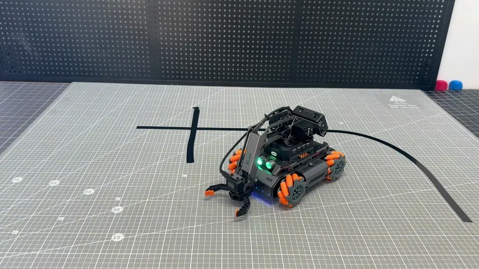
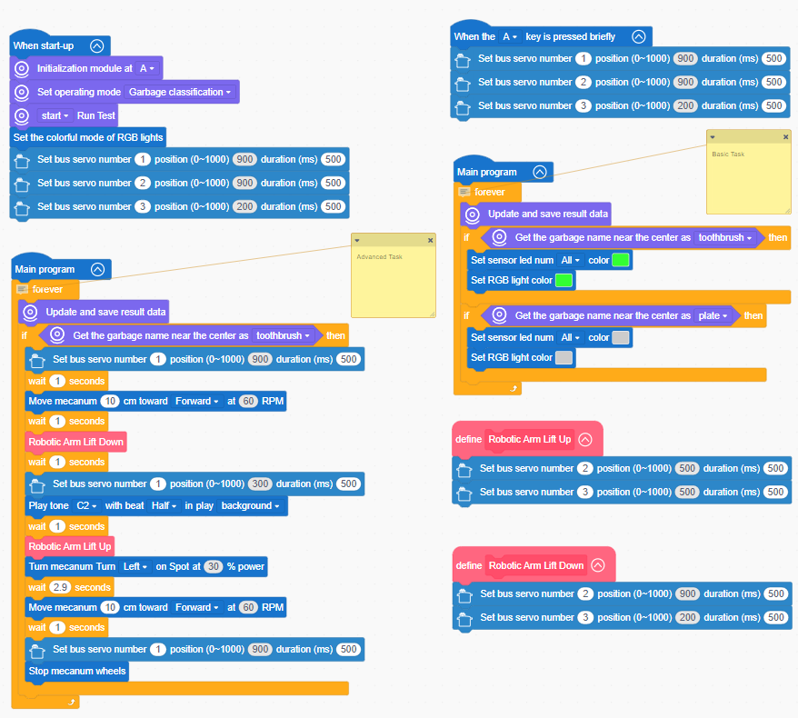
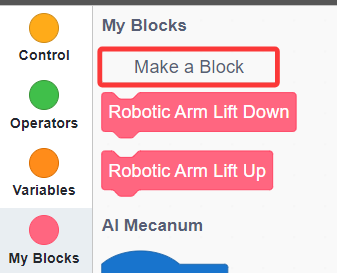
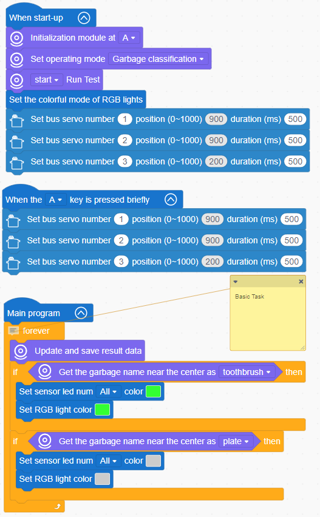
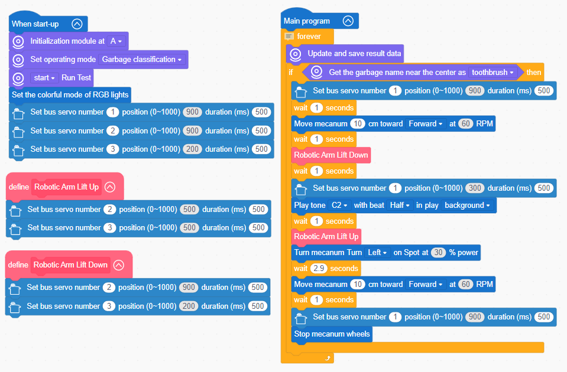

# 3.26 Lesson 26: Garbage Sorting and Handling

## 3.26.1 Lesson Introduction

Focusing on K230 garbage sorting detection, this lesson combines the robotic arm to achieve intelligent waste sorting and handling. Starting from the importance of environmental protection and comparing manual sorting with AI sorting, this section covers the principles of garbage detection by extracting color, texture, and shape features to match four waste categories. Two progressive tasks are featured: a basic task that illuminates corresponding indicator lights upon recognizing waste, and an advanced task that completes the full workflow of recognition → grasping → transport → disposal. Integrating the vision module, robotic arm, and Mecanum-wheel car for the first time, this lesson introduces function encapsulation to advance modular programming, synthesizes previous knowledge into a complete intelligent robotics workflow, and lays the foundation for advanced large model applications.

## 3.26.2 Learning Objectives

1. Understand the technical principles of garbage sorting detection, master the four major waste sorting standards, learn the role of deep learning feature extraction in classification tasks, and comprehend the full-process perception-decision-execution architecture of intelligent sorting systems.

2. Launch the garbage sorting mode on the K226 module and verify its functionality. Proficiently master programming commands related to garbage sorting detection and write custom functions for robotic arm actions.

3. Establish system integration thinking to understand systems engineering methodologies for multi-module collaboration. Cultivate modular programming mindsets by using functions to encapsulate repetitive actions.

4. Connect smart trash cans, waste sorting robots, community smart recycling stations, and environmental big data management to real-world application scenarios, understanding the value of AI technology in environmental protection and sustainable development.

## 3.26.3 Preparation

**Hardware Preparation**:

- AiMecha M1 Mecanum-Wheel Car Advanced Kit
- Type-C data cable
- Computer × 1
- Remote controller

**Software Preparation**:

- WonderLab graphical programming software

**Four Waste Categories Standards**:

- **Recyclables**: Household waste suitable for recycling and resource recovery, such as paper, plastic bottles, glass bottles, metals, and old clothing.

- **Kitchen Waste**: Perishable biomass waste, such as leftovers, fruit peels, vegetable leaves, bones, and eggshells.

- **Hazardous Waste**: Waste posing direct or potential hazards to human health or the natural environment, such as batteries, fluorescent tubes, expired medicines, and paint.

- **Other Waste**: Household waste outside the three categories above, such as cigarette butts, ceramics, tissue paper, and dust.

**Wiring Instructions**:

- Connect the K226 screen module to **port A** of the controller.

- Connect the three bus servos in series to bus ports S1 or S2, where ID 1 = gripper, ID 2 = forearm, and ID 3 = upper arm.

- Connect the RGB LEDs to the corresponding lighting effect ports.

- Connect the buzzer to the buzzer port.

**Menu Navigation Path**:

- Recognition Mode → AI Application → Garbage Sorting.

**Robotic Arm Key Positional Parameters**:

- **Raised Position**: Set Servo ID 2 to 500 and Servo ID 3 to 500 to place the robotic arm in a lifted transport state.

- **Lowered Position**: Set Servo ID 2 to 900 and Servo ID 3 to 200 to place the robotic arm in a lowered grasping state.

- **Gripper Open**: Set Servo ID 1 to position 900 with a running time of 500 ms.

- **Gripper Closed**: Set Servo ID 1 to position 200 with a running time of 500 ms.

**Function Encapsulation Description**:

- `Arm Raise` function: Encapsulate Servo ID 2 at 500 + Servo ID 3 at 500 into a single function for convenient calling.

- `Arm Lower` function: Encapsulate Servo ID 2 at 900 + Servo ID 3 at 200 into a single function for convenient calling.

- Function-based modular programming keeps the main program concise and reduces errors in repetitive code.

## 3.26.4 Hands-On Project

**1. Program Logic**

This project builds an intelligent garbage sorting and handling system that coordinates visual perception + mechanical manipulation + motion navigation. The K226 recognizes garbage cards, outputs categories and coordinates, and selects the central target. The decision-making layer schedules tasks by waste category to trigger the workflow of recognition → grasping → transport → disposal → reset. The execution layer coordinates robotic arm grasping and placement, a 2.9 s in-place left turn for car navigation, and audio-visual status feedback. Encapsulating robotic arm actions into functions reproduces an industrial sorting pipeline: visual classification → robotic arm grasping → sorted disposal → standby, establishing a holistic understanding of robotics system integration.

💡**Complete Program Preview:**

**2. Core Commands**

|   Command Category    |                         Core Command                         | Functional Description                                       |
| :-------------------: | :----------------------------------------------------------: | :----------------------------------------------------------- |
|  Presence detection   |  | Determines whether any garbage card is present in the frame and returns a boolean value. |
|   Quantity counting   |  | Counts the number of garbage cards detected in the frame.    |
|    Name retrieval     |  | Reads the specific item name of the garbage closest to the center, such as banana peel or toothbrush. |
|    Text parameters    |  | Reads text information indicating the waste category.        |
| Coordinate parameters |  | Reads the bounding box coordinates of the detected garbage for positional evaluation. |
|  Function definition  |  | Defines custom functions encapsulating robotic arm actions for modular programming. |

**3. Complete Program Description**

**Task 1 Basic Version: Recognizing Different Garbage and Illuminating Corresponding Colored Lights**

- Initialization settings: At startup, initialize port A, set the running mode to garbage sorting, start detection, turn off the onboard RGB LEDs, and turn off all ultrasonic sensor RGB lights.

- Main loop structure: Execute `Update and save result data` as the first step inside the repeat forever loop to synchronize the latest garbage sorting detection data.

- Toothbrush branch: If `Get the garbage name near the center as toothbrush `, set all ultrasonic sensor RGB lights to green, and set the onboard RGB LED color to green to indicate recyclables.

- Battery branch: If `Get the garbage name near the center as storage battery`, set all ultrasonic sensor RGB lights to gray, and set the onboard RGB LED color to gray to indicate hazardous waste.

- Expansion branches: Add branches for additional waste items, such as illuminating yellow lights for banana peels representing kitchen waste and red lights for cigarette butts representing other waste.

- Program outcome: Match different garbage cards to distinct indicator light colors to display sorting results intuitively.

**Task 2 Advanced Version: Full Workflow of Intelligent Classified Handling**

- Function definition 1: Define the `Robotic Arm Lift Up` function by setting bus servo ID 2 to position 500 for 500 ms and bus servo ID 3 to position 500 for 500 ms for the lifted posture.

- Function definition 2: Define the `Robotic Arm Lift Down` function by setting bus servo ID 2 to position 900 for 500 ms and bus servo ID 3 to position 260 for 500 ms for the lowered posture.

- Initialization settings: Reset all three servos to their initial positions, with the robotic arm defaulting to the raised state.

- Recognition trigger: Initiate the handling sequence when the main loop detects a toothbrush representing recyclable waste.

- Grasping stage: Set bus servo ID 1 to position 900 to open the gripper → call the `Robotic Arm Lift Down` function → wait 1 s to stabilize, set bus servo ID 1 to position 260 to clamp the object → play note C2 to signal a successful grasp.

- Transport stage: Wait 1 s, call the `Robotic Arm Lift Up` function to lift the object → spin the Mecanum-wheel car left in place at 26% power → wait 2.9 s to face the sorting zone.

- Disposal stage: Set bus servo ID 1 to position 900 to release the object → stop the Mecanum-wheel car to complete disposal.

- Reset and wait: Complete the single handling cycle and wait for the next garbage recognition event.

**Program Design Key Points**

- Function encapsulation: Encapsulate arm raising and lowering into functions to keep the main program concise and allow parameter adjustments directly within each function.

- Timing control: Insert wait intervals between actions to ensure each movement completes before the next begins, preventing mechanical conflicts.

- Gripper timing: Lower the arm into position before closing the gripper, and open the gripper before raising the arm to avoid knocking over the target object.

- Steering angle: Spin left in place for 2.9 s to achieve an approximate 180° turn, and adjust the duration according to the actual sorting zone layout.

- Sound-light feedback: Use the buzzer to signal successful grasping and lights to indicate the waste category for intuitive interaction feedback.

  > [!NOTE]
  >
  > **The program source files can be downloaded from [Program Files/Garbage Sorting and Handling](https://drive.google.com/drive/folders/1qESIR7n_mxv3oQTrZhNbBTnPKVOk-yT4?usp=sharing).**

**Program Upload:**

- Step 1: Power on the mecha controller and insert the Type-C data cable into the data port located above the power switch on the controller.

- Step 2: Connect the other end of the data cable to a USB port on the computer.

- Step 3: Click the **Connect device** button at the top of the software interface and select the COM port corresponding to CH340 from the port list.

- Step 4: Click the upload button in the upper-right corner to download the compiled program to the mecha controller for execution.

## 3.26.5 Expansion and Advancement

**Expansion Project 1: Four-Category Fully Automated Sorting System**

Expand sorting to cover all four waste categories: recyclables → turn left to the green zone, kitchen waste → move forward to the yellow zone, hazardous waste → turn right to the red zone, other waste → reverse to the gray zone. Set up four disposal zones and program the car to automatically recognize waste types and transport them to their corresponding zones for a complete four-category sorting system. Simulate an automated sorting line in a waste treatment plant to understand how AI improves waste sorting efficiency and supports environmental sustainability.

**Expansion Project 2: Multi-Garbage Continuous Sorting Assembly Line**

Design a continuous operation mode: place multiple garbage cards in front of the car so that it recognizes, grasps, transports, and disposes of one item before automatically returning to its starting position to process the next in a loop until all items are sorted. Add a counting function to tally each waste category and announce the final sorting totals. Simulate the continuous operation of industrial sorting robots to explore task queuing and cyclic programming patterns.

## 3.26.6 Q&A

**Q1: Which programming command sequence illuminates a blue light representing recyclables when the Mecanum-wheel car detects a beverage can card?**
 A. If battery detected, then set RGB LEDs to red. 
B. If a beverage can is detected, then set RGB LEDs to blue. 
C. If temperature is greater than  20, then turn on the fan. 
D. Set the car's speed to 50.

**Answer B**

**Q2: Once the robotic arm clamps a block representing a waste battery to transport and place it into the hazardous waste zone on the map, what additional commands are required besides controlling the robotic arm and gripper?**

**Answer**: Add commands directing the robot to **move to the target location** and **open the gripper to release the block**.

## 3.26.7 Technical Support and Discussion

Join the forum for sharing questions, ideas, or suggestions, and answers will be provided promptly. Click the hyperlink [Hiwonder Forum](http://forum.hiwonder.com) or enter the URL in a browser: http://forum.hiwonder.com