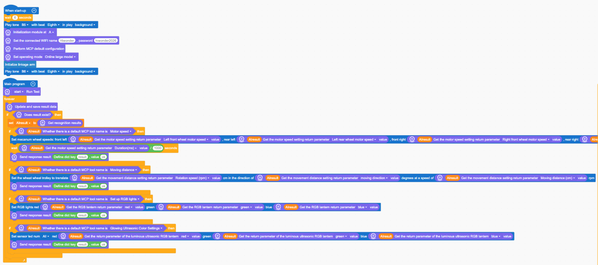

# 3.28 Lesson 28: Intelligent Control and Machine Execution

## 3.28.1 Lesson Introduction

This lesson focuses on integrating large speech models with robot control to explore natural language-driven hardware execution. Starting from everyday scenarios such as "feeling cold and turning on lights or closing curtains", the curriculum contrasts traditional voice control with intelligent comprehension powered by large models. Core topics cover three essential technologies: automatic speech recognition known as ASR, text-to-speech synthesis known as TTS, and large model semantic parsing, alongside the Model Context Protocol tool configuration mechanism that enables large models to control hardware, including lights, motors, and robotic arms. Practical exercises implement a voice control system supporting natural language control over lighting, robot movement, and robotic arm actions, introducing the AIresult variable and the "ok" feedback protocol. Moving from voice conversation to physical voice control upgrades large models into physical control portals, laying a solid foundation for embodied intelligence.

## 3.28.2 Learning Objectives

**1.** Understand the acoustic feature matching principles of automatic speech recognition, abbreviated as ASR. Master prosody modeling and vocoder technology in text-to-speech synthesis, abbreviated as TTS, alongside the working mechanism and role of the MCP tool-calling protocol.

**2.** Program the initialization and execution of the online large model mode. Use the AIresult variable to temporarily store large model recognition results. Write conditional branches for MCP tool evaluation and execution.

**3.** Establish an interactive mindset for natural language-driven hardware control. Cultivate system design capabilities for intent parsing and action mapping, and enhance logical programming skills for parallel multi-tool invocation.

**4.** Connect smart home voice control, intelligent in-vehicle voice assistants, industrial robot voice commands, and accessible assistive devices to real-world application scenarios, comprehending the transformative value of large speech models in human-robot interaction.

## 3.28.3 Preparation

**Hardware Preparation**:

- AiMecha M1 Mecanum-Wheel Car Advanced Kit
- Type-C data cable
- Computer × 1
- Remote controller

**Software Preparation**:

- WonderLab graphical programming software

**Three Speech Technology Principles**:

- **Automatic Speech Recognition or ASR**: Technology that converts audio signals into text. After capturing audio, the microphone decomposes the signal into acoustic features matched against phoneme and word patterns learned during large model training to ultimately output text. Powered by large models, the system adapts to diverse accents and background noise.

- **Text-to-Speech Synthesis or TTS**: Technology that converts text into natural speech. Large models analyze text semantics and prosody to predict pronunciation, pitch, pauses, and emotion for every word, generating highly lifelike audio waveforms via vocoders.

- **Speech Interaction**: A comprehensive framework integrating speech recognition, large language models, and speech synthesis: capturing spoken audio → converting audio into text → analyzing semantics and generating a response via the large model → synthesizing the response into speech → playing the audio aloud to achieve end-to-end natural conversation.

**MCP Tool-Calling Mechanism**:

- **Definition**: Model Context Protocol, abbreviated as MCP, is a standardized protocol enabling large models to invoke external tools, control hardware, query data, and execute operations.

- **Workflow**: Receiving a spoken voice command → parsing intent via the large model → determining the required tools → returning tool-calling commands → executing hardware operations locally → sending execution feedback to the large model → generating a final voice response.

- **Default Tool Set**: RGB LED control, ultrasonic RGB light control, buzzer playback, battery voltage query, motor speed control, movement distance control, robotic arm motion control, and gripper angle control.

**Wiring Instructions**:

- Connect the K230 screen module to **port A** of the controller.

- Connect the three bus servos in series to bus ports S1 or S2, where ID 1 controls the gripper, ID 2 controls the forearm, and ID 3 controls the upper arm.

- Connect the RGB LEDs to the corresponding lighting effect ports.

- Connect the ultrasonic sensor to **port K**.

**Key Programming Concepts**:

- **AIresult Variable**: Temporarily stores large model recognition results to prevent data discrepancies caused by repeated reads, ensuring data consistency within a single frame.

- **Send Response Result**: Feeds back "result: ok" to the large model after executing a tool, completing the closed loop of request, execution, and feedback.

- **Tool Name Evaluation**: `Whether the default MCP tool name XX exists` block to determine which tool the large model intends to invoke.

## 3.28.4 Practical Implementation

**1. Program Logic**

This project builds a natural language-driven machine control system powered by large models, centered around a voice-driven MCP tool-calling closed loop. The K230 microphone captures voice commands and uploads them to the cloud via Wi-Fi, where cloud ASR transcribes the audio into text, and the large model parses semantic intent and sentiment to determine the required MCP tools. The decision-making layer receives structured tool commands, caches them in the AIresult variable, and dispatches them sequentially: setting color values for the RGB LEDs, rotational speeds for the motors, directions and distances for chassis movement, and target coordinates and durations for the robotic arm. Once each hardware module in the execution layer completes its action, it returns "result: ok" so the large model can generate voice feedback. Program Logic: The entire system forms a closed loop encompassing voice input → semantic parsing → tool invocation → hardware execution → result feedback → voice reply, mapping natural language directly to physical actions and illustrating the embodied intelligence concept where "the large model acts as the brain and MCP acts as the nervous system."

<video controls playsinline preload="metadata" src="../../_static/media/chapter_3/section_16/video1.mp4"></video>

**2. Core Commands**

|   Command Category   |                         Core Command                         | Functional Description                                       |
| :------------------: | :----------------------------------------------------------: | :----------------------------------------------------------- |
|  Mode configuration  |  | Switches to the online large model mode to enable cloud AI and MCP tool capabilities. |
|  MCP configuration   |  | Loads the default MCP tool set and registers all controllable hardware tools. |
|  Detection control   |  | Starts the large model voice interaction and tool-calling engine. |
| Data synchronization |  | Synchronizes the latest large model recognition results and tool-calling requests. |
|   Result detection   |  | Determines whether the large model has returned new tool-calling commands. |
|   Result retrieval   |  | Reads the complete recognition results and stores them in the `AIresult` variable. |
|   Tool evaluation    |  | Evaluates whether the large model has invoked a specified tool, such as RGB LEDs or motor speed. |
| Parameter retrieval  |  | Extracts specific tool parameter values from the recognition results, such as RGB values, motor speed, or distance. |
|   Result feedback    |  | Sends tool execution success feedback to the large model to complete the invocation closed loop. |

**3. Complete Program Description**

**Task: Complete Voice Control System for Lighting and Car Movement**

- Startup initialization: Upon startup, wait 6 seconds and play note B5 for a 1/8 beat as the initial startup tone. Initialize port A, configure the Wi-Fi SSID and password, load the default MCP configuration, set the operating mode to online large model, initialize the linkage robotic arm, and play note B6 for a 1/8 beat as the readiness prompt tone.

- Main loop structure: Start detection execution, and repeatedly update and save result data.

- Result retrieval branch: If `Does result exist?` returns true, assign the retrieved recognition result to the AIresult variable to cache data and maintain consistency across the frame.

- RGB LED control branch: If AIresult contains the default MCP tool name for setting the RGB LED, set the red, green, and blue channels of the RGB LED to the corresponding red, green, and blue parameter values extracted from AIresult, then send a response result with dictionary key `result` and value `ok`.

- Ultrasonic RGB light branch: If AIresult contains the default MCP tool name for the glowing ultrasonic RGB light, set the ultrasonic sensor RGB light to the extracted RGB values and send the response result `ok`, following the same principle as the onboard RGB LED.

- Buzzer control branch: If AIresult contains the default MCP tool name for the buzzer, extract the buzzer frequency and duration in milliseconds, activate the buzzer accordingly, and send the response result `ok`.

- Motor speed branch: If AIresult contains the default MCP tool name for motor speed, set the front-left, rear-left, front-right, and rear-right wheel speeds of the Mecanum-wheel car to the respective motor speed parameters extracted from AIresult, and send the response result `ok`.

- Movement distance branch: If AIresult contains the default MCP tool name for movement distance, command the Mecanum-wheel car to translate at the rotational speed in rpm, toward the directional angle in degrees, and for the distance in centimeters extracted from AIresult, then send the response result `ok`.

- Robotic arm control branch: If AIresult contains the default MCP tool name for robotic arm motion, move the robotic arm end effector to the forward-backward Y-axis coordinate in millimeters and vertical Z-axis coordinate in millimeters extracted from AIresult over the specified duration in milliseconds, and send the response result `ok`.

- Gripper control branch: If AIresult contains the default MCP tool name for the mechanical gripper, set bus servo ID 1 to the target angle in degrees over the duration in milliseconds extracted from AIresult, and send the response result `ok`.

**Program Design Key Points**

- Variable caching: Store the recognition result in the AIresult variable first and read from this variable across all conditional branches. Never call the direct retrieval block repeatedly across branches, as doing so causes data inconsistency.

- Parallel multi-tool execution: Place multiple tool evaluation branches in parallel so a single composite command can invoke several tools concurrently, such as turning on lights while moving.

- Feedback closed loop: Send a `result: ok` response immediately after each tool finishes executing. The large model waits for this confirmation before generating a voice reply and treats the task as failed if no confirmation arrives.

- Natural language command examples: `Hello Hiwonder, turn the lights blue`, `Move forward for one second`, `Turn left 10 centimeters`, `Raise the robotic arm`, and `Open the gripper`.

- Intent parsing: The large model comprehends implicit or casual expressions, for example, automatically increasing brightness when hearing `Make it brighter` or spinning in place when hearing `Spin around`.

**Voice Control Sample Phrases**

- Lighting Control: `Turn the lights red`, `Make the lights brighter`, `Turn off the RGB lights`, `Turn the ultrasonic lights blue`.

- Movement Control: `Move forward for one second`, `Turn left 10 centimeters`, `Move backward 5 centimeters`, `Spin right in place`.

- Robotic Arm Control: `Raise the robotic arm`, `Open the gripper`, `Extend the robotic arm forward`.

- Composite Commands: `Turn on the green light, then move forward 20 centimeters`.

  > [!NOTE]
  >
  > **The program source files can be downloaded from [Program Files/Intelligent Control Execution](https://drive.google.com/drive/folders/1qESIR7n_mxv3oQTrZhNbBTnPKVOk-yT4?usp=sharing).**

**Program Upload**:

- Step 1: Power on the mecha controller and plug the Type-C data cable into the data port located above the power switch on the controller.

- Step 2: Connect the other end of the data cable to a USB port on the computer.

- Step 3: Click the **Connect device** button on the top toolbar of the software and select the COM port corresponding to CH340 from the dropdown list.

- Step 4: Click the upload button in the upper-right corner to compile and upload the program to the mecha controller.

## 3.28.5 Expansion and Advancement

**Expansion Project 1: Affective Voice Interaction System**

Design an emotional response mode: when receiving the command "In a hurry, move faster", the car recognizes the urgency keyword and automatically increases movement speed. When receiving "Take it slow, be careful", the system reduces speed and enables obstacle avoidance mode. When receiving "Great job", the controller plays cheerful music and flashes colored lights. Explore how large models comprehend emotional semantics to make robot responses more lifelike, demonstrating the value of affective computing in natural language interaction and creating a warmer human-robot interaction experience.

**Expansion Project 2: Multi-Step Task Voice Orchestration System**

Design a composite task voice command system, such as "First, turn the lights red, then move forward 30 centimeters, turn left, and finally raise the robotic arm". Verify whether the large model can accurately parse multiple action steps within a single long command and execute them sequentially. Explore the long-command parsing capabilities of large models, master the technical principles of task planning and action sequence orchestration, and lay the groundwork for subsequent embodied intelligence collaboration lessons.

## 3.28.6 Q&A

**Q1: What are the differences and connections among automatic speech recognition, text-to-speech synthesis, and speech interaction?**

**Answer**: These three concepts form a **progressive hierarchy**, where each preceding technology serves as the foundation for the next, and the latter integrates and upgrades the former.

**Q2: What is MCP tool calling?**

**Answer**: MCP is a standardized interface protocol that enables large models to **invoke external tools and hardware**, functioning as both a "translator" and a "switchboard" operator between AI models and physical hardware.

## 3.28.7 Technical Support and Discussion

Join the forum for sharing questions, ideas, or suggestions, and answers will be provided promptly. Click the hyperlink [Hiwonder Forum](http://forum.hiwonder.com) or enter the URL in a browser: http://forum.hiwonder.com