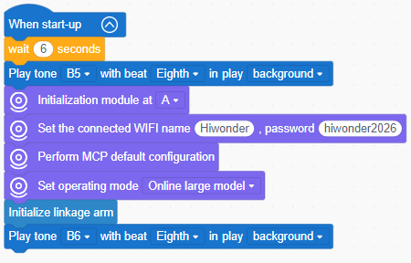
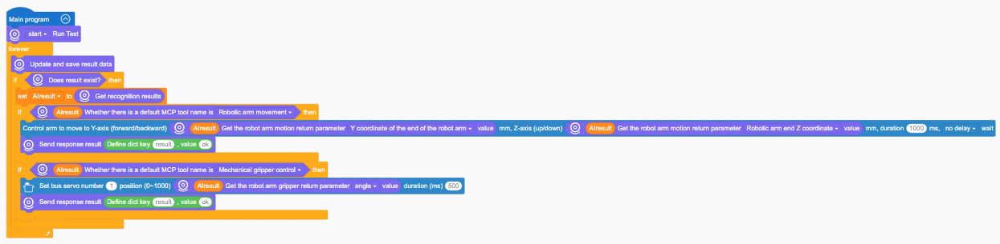

# 3.29 Lesson 29: Introduction and Application of Large Vision Models

## 3.29.1 Lesson Introduction

This lesson focuses on large vision models, exploring the paradigm shift from "specialized recognition" to "general visual comprehension". Inspired by multidimensional human visual perception, the curriculum introduces the capability of "comprehending everything in sight". Core concepts cover the operating principles of large vision models, contrasting specialized traditional computer vision with generalized cross-modal comprehension, and illustrating how the Contrastive Language-Image Pre-training model known as CLIP bridges semantic and pixel spaces. Four major application scenarios spanning security, healthcare, autonomous driving, and retail are examined. Practical exercises feature two progressive tasks: using voice commands to invoke the vision model for broadcasting object features, and linking face detection with robotic arm swaying. Upgrading from specialized detection to general vision lays the foundation for deep perception and embodied intelligence.

## 3.29.2 Learning Objectives

1. Understand the core definition and technical principles of large vision models. Master the fundamental differences between traditional computer vision and large vision models. Learn the image-text contrastive learning approach and zero-shot recognition capabilities of the CLIP model.

2. Implement online large-model-based visual recognition calls through programming. Trigger vision model recognition and voice announcements via voice commands, and develop control programs that link visual recognition results to robotic arm movements. 

3. Establish a cross-modal understanding mindset by recognizing the semantic associations between images and natural language. Develop an awareness of the technological evolution from "specialized AI" to "general AI", and enhance system design capabilities for multimodal fusion.

4. Relate these concepts to industry scenarios, such as smart security, medical imaging, autonomous driving, and smart retail, to understand the transformative value of large vision models across industries and spark interest in exploring general vision AI and multimodal large models.

## 3.29.3 Preparation

**Hardware Preparation**:

- AiMecha M1 Mecanum-Wheel Car Advanced Kit
- Type-C data cable
- Computer × 1
- Remote controller

**Software Preparation**:

- WonderLab graphical programming software

**Core Concept Description**:

- **Traditional Computer Vision or CV**: Task-specific "specialist" models where a single model performs only one designated task and recognizes only pre-trained categories—for instance, a facial recognition model only identifies faces, and an object detection model only detects 80 preset object classes.

- **Large Vision Models**: General-purpose vision models pre-trained on massive image-text datasets, possessing strong generalization and cross-modal comprehension capabilities to link visual features with linguistic concepts and achieve instant comprehension upon sight.

- **Zero-Shot Recognition**: The capability of a model to directly identify novel objects without prior training samples of those classes, relying on semantic comprehension rather than rote memorization.

- **Cross-Modal Understanding**: The capability of AI to simultaneously comprehend visual and linguistic modalities while establishing semantic associations between them.

**Four Real-World Application Scenarios**:

- **Smart Security**: Surveillance cameras not only detect human presence, but also analyze whether "a person is running" or "exhibiting violent or abnormal behavior", upgrading from basic presence detection to behavioral comprehension.

- **Medical Diagnosis**: Medical imaging AI surpasses senior physicians in pulmonary nodule detection rates, while large models support open-ended diagnostic consultations to provide auxiliary assessments, upgrading from lesion detection to "medical record analysis" and "clinical recommendations".

- **Autonomous Driving**: Systems detect fine-grained road details in real time, such as locating damaged road markings, and interpret pedestrian intentions in complex traffic, upgrading from "object detection" to "scene comprehension".

- **Smart Retail**: Uploading a product photo allows the system to rapidly match exact inventory items via semantic search, upgrading from "barcode lookup" to "image-based retrieval".

**Wiring Instructions**:

- Connect the K230 screen module to **port A** of the controller via UART serial communication.

- Connect the camera to the dedicated camera port on the K230 screen module.

- Connect the three bus servos in series to bus ports S1 or S2.

**Large Vision Models vs. Traditional CV Comparison**:

- Traditional CV: One model per task, recognizes only pre-trained categories, outputs structured data such as bounding boxes, class labels, and coordinates, and requires retraining for new tasks.

- Large Vision Models: One model for multiple tasks, performs zero-shot recognition on unseen categories, outputs natural language descriptions, and offers strong general capabilities supporting open-ended visual question answering.

## 3.29.4 Practical Implementation

**1. Program Logic**

This project builds a voice-triggered large vision model recognition and actuation system centered around a multimodal perception, comprehension, and response closed loop. The K230 camera and microphone perform dual-channel capture and upload data via Wi-Fi to the cloud multimodal large model. After cloud ASR transcribes the audio into text and the large model interprets the command intent, the model deeply analyzes the visual frame to output semantic descriptions including object names, quantities, and states. The intent-driven decision layer invokes the robotic arm MCP tool to output target coordinates and durations when motion is required, or generates speech when broadcasting is requested. The execution layer synthesizes speech to read results aloud and drives servos to sway, salute, or grasp with the robotic arm. Forming a complete chain from voice trigger → visual perception → large model comprehension → voice or physical response, the system demonstrates how multimodal AI simultaneously sees, hears, speaks, and acts.

<video controls playsinline preload="metadata" src="../../_static/media/chapter_3/section_17/video1.mp4"></video>

**2. Core Commands**

|   Command Category    |                         Core Command                         | Functional Description                                       |
| :-------------------: | :----------------------------------------------------------: | :----------------------------------------------------------- |
| Module initialization |  | Configures UART serial communication for the K230 module to establish a connection with the controller. |
| Network configuration |  | Configures the Wi-Fi network to connect to cloud multimodal large model services. |
|  Mode configuration   |  | Switches to the online large model mode to enable vision and speech multimodal capabilities. |
|   MCP configuration   |  | Loads the default MCP tool set, including visual recognition and robotic arm control tools. |
|   Detection control   |  | Starts the large model multimodal interaction engine to monitor voice commands and capture camera frames. |
| Data synchronization  |  | Synchronizes the latest large model recognition results and tool-calling commands. |
|   Result detection    |  | Determines whether the large model has returned new recognition results or tool calls. |
|   Result retrieval    |  | Reads the complete recognition results.                      |
|    Tool evaluation    |  | Evaluates whether the large model has invoked the robotic arm motion control tool. |
|    Result feedback    |  | Sends tool execution success feedback to the large model to complete the invocation closed loop. |

**3. Complete Program Description**

**Task 1: Recognizing Objects and Intelligently Broadcasting Information**

- Initialization settings: Upon startup, wait 6 seconds and play note B5 for a 1/8 beat as the startup prompt tone. Initialize port A, configure the Wi-Fi SSID and password, load the default MCP configuration, set the operating mode to online large model, initialize the linkage robotic arm, and play note B6 for a 1/8 beat as the readiness prompt tone.

- Voice trigger: Speak the wake word `Hello Hiwonder`, followed by a voice command such as `Recognize the objects and broadcast relevant information` or `See what is in front`.

- Cloud processing: Upon receiving the command, the large model triggers the camera to capture an image, analyzes the scene using the large vision model, and generates a natural language description such as `Detected three types of fruit ahead: a peach, an apple, and grapes`.

- Voice broadcast: Text-to-speech synthesis converts the generated description into audio played back through the K230 module, "describing exactly what the camera sees".

- Key takeaway: Unlike traditional object detection that only outputs class labels, a large vision model provides rich semantic descriptions covering quantities, colors, relative positions, and object states.

**Task 2: Face Detection Linked with Robotic Arm Swaying**

- Main program framework: Uses the exact same initialization sequence and main loop structure as Task 1.

- Result retrieval: If `Does result exist?` returns true, store the retrieved recognition result in the AIresult variable.

- Robotic arm motion evaluation: If AIresult contains the default MCP tool name for robotic arm motion, command the robotic arm end effector to move to the forward-backward Y-axis coordinate in millimeters and vertical Z-axis coordinate in millimeters extracted from AIresult over the specified duration in milliseconds.

- Gripper control evaluation: If AIresult contains the default MCP tool name for the mechanical gripper, set bus servo ID 1 to the target angle in degrees over the duration in milliseconds extracted from AIresult.

- Send feedback: Send a response result with dictionary key `result` and value `ok` after each tool execution completes.

- Voice command examples: `Hello Hiwonder, sway the robotic arm if someone is ahead`, or `salute upon detecting a face`.

- Execution outcome: When the camera detects a human face, the robotic arm automatically sways up and down or performs a saluting gesture, directly translating visual perception into physical action.

**Program Design Key Points**

- Variable caching: Read all tool parameters from the AIresult variable to guarantee data consistency throughout each processing cycle.

- Voice-driven execution: Trigger all visual functions via natural language commands without hard-coding fixed routines, executing whatever task is requested by voice.

- Large model parsing: The large model automatically interprets command intent to determine whether to merely broadcast results or control hardware, eliminating the need to manually manage low-level technical details.

- Natural language output: Visual recognition outputs fluent natural language descriptions rather than rigid structured data, creating a much more natural human-robot interaction experience.

**Typical Experience Phrases**

- `Hello Hiwonder, see what fruits are ahead`

- `Hello Hiwonder, identify what this object is`

- `Hello Hiwonder, nod upon detecting a face`

- `Hello Hiwonder, check the fruits ahead and recommend which one is best when feeling sick.`

  > [!NOTE]
  >
  > **The program source files can be downloaded from [Program Files/Visual Model Application](https://drive.google.com/drive/folders/1qESIR7n_mxv3oQTrZhNbBTnPKVOk-yT4?usp=sharing).**

**Program Upload**:

- Step 1: Power on the mecha controller and plug the Type-C data cable into the data port located above the power switch on the controller.

- Step 2: Connect the other end of the data cable to a USB port on the computer.

- Step 3: Click the **Connect device** button on the top toolbar of the software and select the COM port corresponding to CH340 from the dropdown list.

- Step 4: Click the upload button in the upper-right corner to compile and download the program to the mecha controller.

## 3.29.5 Expansion and Advancement

**Expansion Project 1: Intelligent Tour Guide Robot**

Design a visual tour guide robot task: program the car to move slowly through a classroom, automatically identifying objects at each stop and introducing them via voice broadcast. For instance, upon detecting a blackboard, broadcast "This is a blackboard, used for writing instructional content", and upon detecting a desk, broadcast "This is a desk, designed for reading and studying". Explore the scene description capabilities of large vision models to build an intelligent tour guide robot that "narrates while navigating", demonstrating how general vision empowers autonomous guided tours.

**Expansion Project 2: Interactive Visual Question Answering System**

Implement open-ended visual question answering: show any object to the camera and ask voice questions such as "What color is this?", "How many of these are there?", or "What is this used for?", prompting the large model to analyze the visual frame and provide targeted answers. Explore multi-turn dialogue and reasoning in large vision models, upgrading from "recognizing objects" to "answering any questions about the image". Understand the Visual Question Answering, or VQA, capabilities of vision-language models, and experience the power of knowledge fusion in multimodal large models.

## 3.29.6 Q&A

**Q1: What is the most prominent advantage of large vision models compared to traditional vision models? **

A. Recognizing traffic lights. 
B. Recognizing human faces. 
C. Recognizing objects ahead and announcing their detailed information. 
D. Recognizing animals.

**Answer: C**

**Q2: To make the robot perform a waving motion with its robotic arm upon detecting a person ahead, what additional programming commands must be included besides visual recognition to drive the robotic arm?**

**Answer**: Include commands that **control the motion of each robotic arm joint** so the robotic arm follows a waving trajectory.

## 3.29.7 Technical Support and Discussion

Join the forum for sharing questions, ideas, or suggestions, and answers will be provided promptly. Click the hyperlink [Hiwonder Forum](http://forum.hiwonder.com) or enter the URL in a browser: http://forum.hiwonder.com