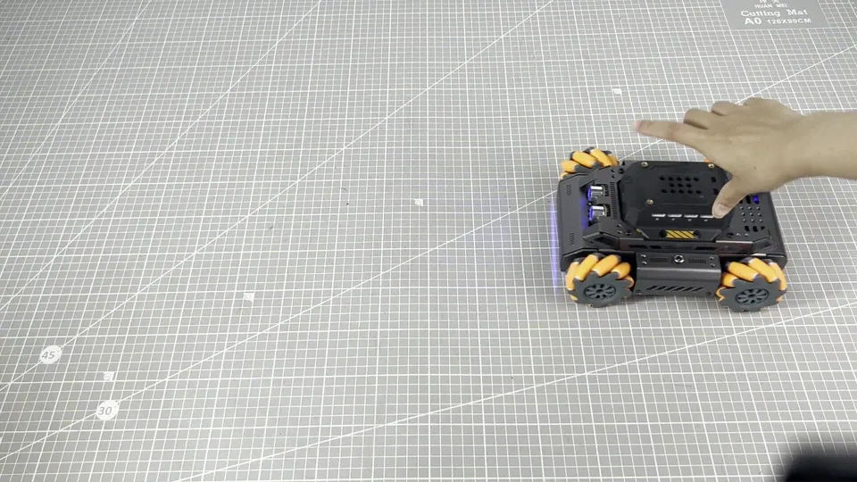
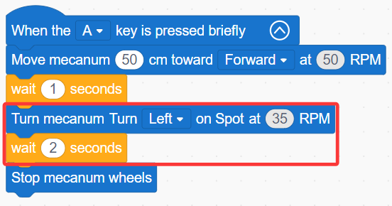
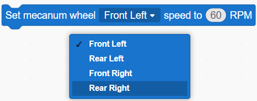
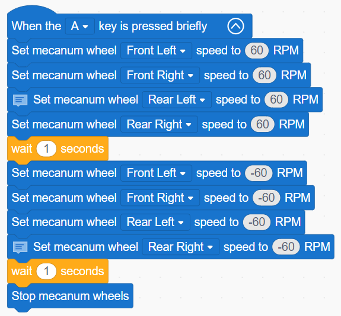
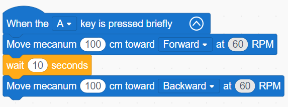
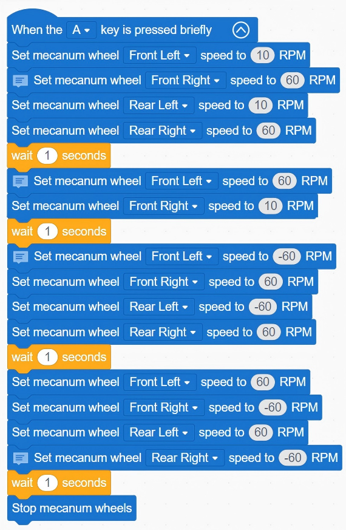
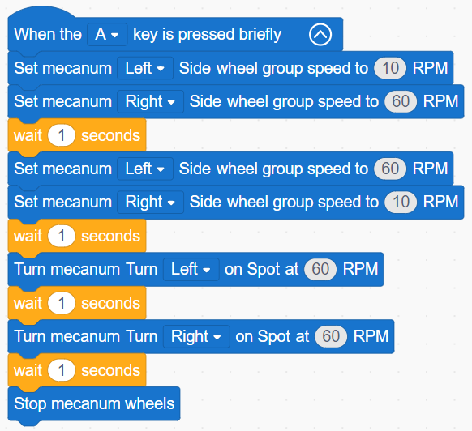
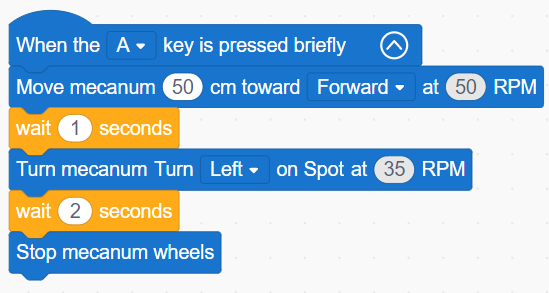

# 3.3 Lesson 3: Steering and Fixed-Point Control

## 3.3.1 Lesson Introduction

As the third introductory lesson for the AiMecha M1, this module serves as the core of the hardware overview and motion fundamentals unit. Building on the previous two lessons, it looks into the principles of Mecanum wheel turning and its programming implementation.  Starting with force analysis, the lesson systematically covers three motion modes: forward/backward movement, differential turning, and in-place rotation. Through three progressive tasks advancing from single-wheel control to encapsulated command invocation, this lesson completes a practical example of "moving forward for 0.5 meters followed by rotating 90 degrees in place and stopping", helping establish a speed-differential control mindset and hierarchical encapsulated programming concepts.

## 3.3.2 Learning Objectives

**1.** Understand the principles of differential speed control and the mechanics behind how a Mecanum-wheel robot executes left/right turns and in-place rotations. Identify the wheel speed ratios for the three basic motion modes, as well as the inverse relationship between turning radius and speed differential.

**2.** Control the rotation direction and speed of all four wheels independently using single-wheel commands, and apply wheel-group controls and encapsulated motion commands to achieve various turning modes.

**3.** Develop a layered programming mindset, "low-level control, mid-level encapsulation, and high-level invocation", while cultivating an engineering approach to parameter tuning and iterative optimization.

**4.** Connect omnidirectional mobility to real-world industrial applications such as warehouse logistics and pipeline inspection, and recognize the technical advantages of zero-radius turning in confined spaces.

## 3.3.3 Preparation

**Hardware Preparation:**

* AiMecha M1 Mecanum-wheel robot base × 1

- Type-C USB data cable × 1
- Computer running Windows or macOS × 1

**Software Preparation:**

- WonderLab graphical programming platform installed and running normally

## 3.3.4 Hands-On Project

**1. Project Analysis**

This lesson program adopts a sequential execution structure, achieving various steering maneuvers by regulating the chassis power output and wheel speed ratios of the Mecanum wheel car. The system is divided into a decision-making layer and an execution layer: the decision-making layer plans motion sequences and sets parameters, controlling action durations using "motion settings + delay waits". The execution layer issues speed commands to the chassis controller, driving the four Mecanum wheels according to different direction and speed combinations to synthesize the corresponding resultant motion forces. Starting from underlying single-wheel control and advancing to wheel group control and encapsulated command invocation, this process demonstrates the programming efficiency improvements brought by program abstraction and encapsulation.

💡**Complete Program Preview:**

**2. Core Commands**

|    Command Category     |                         Core Command                         | Functional Description                                       |
| :---------------------: | :----------------------------------------------------------: | :----------------------------------------------------------- |
|  Single-wheel control   |  | Independently controls the rotation speed of each wheel, with positive values for forward rotation and negative values for reverse rotation. |
|   Wheel group control   |  | Simultaneously controls two wheels on the same side, suitable for differential steering scenarios. |
| Fixed-distance movement |  | Sets movement distance while configuring forward or backward movement, automatically stopping upon arrival. |
|    In-place steering    |  | Drives two motors with speed differentials to achieve in-place rotation. |
|       Motion stop       |  | Sets the car to stop moving and applies an immediate brake.  |
|     Timing control      |  | Regulates motion switching intervals to prevent actions from transitioning too quickly. |
|      Event trigger      |  | Program startup trigger condition.                           |

**3. Complete Program Description**

**Task 1: Independently Control the Rotation Speed of Each Wheel to Implement Simple Forward and Backward Movements of the Mecanum-Wheel Car.**

- Trigger condition: Start the program when the A key is pressed briefly.

- Forward phase: Set the speeds of all four wheels, front-left, front-right, rear-left, and rear-right, to 60 rpm.

- Wait 1 s to maintain the forward state.

- Backward phase: Set the speeds of all four wheels to -60 rpm.

- Wait 1 s to maintain the backward state.

- Set the Mecanum-wheel car to stop.

**Task 2: Configure Forward and Backward Distances to Move the Mecanum-Wheel Car Forward by 1 Meter Followed by Backward by 1 Meter.**

- Set the Mecanum-wheel car to move forward by 100 cm at a speed of 60 rpm.

- Wait 10 s.

- Set the Mecanum-wheel car to move backward by 100 cm at a speed of 60 rpm.

**Task 3: Independently Control the Rotation Speed of Each Wheel to Implement Left Turns, Right Turns, In-Place Left Turns, and In-Place Right Turns.**

- Left and right turns are achieved via wheel speed differentials between the left and right Mecanum wheels, where a smaller differential results in a smaller turning angle.

- Left turn: Set the two wheels on the left side to 10 rpm and the two wheels on the right side to 60 rpm, and wait 1 s.

- Right turn: Set the two wheels on the left side to 60 rpm and the two wheels on the right side to 10 rpm, and wait 1 s.

- In-place left turn: Set the two wheels on the left side to -60 rpm and the two wheels on the right side to 60 rpm, and wait 1 s.

- In-place right turn: Set the two wheels on the left side to 60 rpm and the two wheels on the right side to -60 rpm, and wait 1 s.

- Finally, set the Mecanum-wheel car to stop.

**Task 4: Simplify Code Blocks and Optimize the Above Program Using Encapsulated Blocks.**

- Use wheel group commands to replace single-wheel settings: set left wheel group speed and set right wheel group speed.

- Use in-place steering encapsulated commands: in-place left turn and in-place right turn.

- Pair each action with corresponding wait seconds, and finally set the car to stop.

**Comprehensive Case: Fully Implementing Path Combination Functions**

- Objective: Move forward 0.5 m → rotate 90° clockwise in place → stop.
- Set the Mecanum-wheel car to move forward by 50 cm at a rotational speed of 50 rpm.
- Wait 1 s.
- Set the Mecanum-wheel car to turn left in place at a rotational speed of 35 rpm.
- Wait 2 s, and adjust the wheel speed and wait time to optimal parameters to achieve a 90° clockwise rotation in place.
- Set the Mecanum-wheel car to stop.
- Upload the program to the mecha controller to run and verify.

> [!NOTE]
>
> **The program source files can be downloaded from [Program Files/Fixed-Point Steering Control](https://drive.google.com/drive/folders/1vQnjkHE58XJU_cquYayobwkfJD5ZQ1KT?usp=sharing).**

**Program Upload:**

- Step 1: Power on the mecha controller and insert the Type-C data cable into the data port located above the power switch on the controller.

- Step 2: Connect the other end of the data cable to the computer's USB port.

- Step 3: Click the **Connect device** button at the top of the software interface and select the COM port corresponding to CH340 from the port list.

- Step 4: Click the upload button in the upper-right corner to upload the compiled program to the mecha controller for execution.

## 3.3.5 Expansion and Advancement

**Project 1: Square Closed-Loop Path Planning**

Write a program to make the car autonomously trace a square trajectory with a side length of 80 cm, eventually returning to the starting position and stopping.

**Project 2: Custom Complex Path Driving**

Write a program to implement a custom path: move forward 2 m → turn left for 1 m → rotate 180° counterclockwise in place → stop.

## 3.3.6 Q&A

**Q1: What is the principle behind left and right turns on the Mecanum-wheel car?**

**Answer**: Differential steering is utilized to generate a speed differential between the left and right wheels: the right side is faster, and the left side is slower during left turns, while the left side is faster and the right side is slower during right turns. A larger speed differential yields a smaller turning radius, whereas equal speeds result in straight driving.

**Q2: What is the fundamental difference between in-place rotation and standard differential turns?**

**Answer**: Rotating the left and right wheels in opposite directions forms a rotational torque to achieve in-place rotation: the left wheels rotate forward, and the right wheels rotate in reverse for clockwise rotation, while the opposite applies for counterclockwise rotation. Unlike differential turns, in-place rotation sets the left and right wheels to rotate at equal speeds in opposite directions, resulting in a turning radius of zero.

## 3.3.7 Technical Support and Discussion

Join the forum for sharing questions, ideas, or suggestions, and answers will be provided promptly. Click the hyperlink [Hiwonder Forum](http://forum.hiwonder.com) or enter the URL in a browser: http://forum.hiwonder.com.