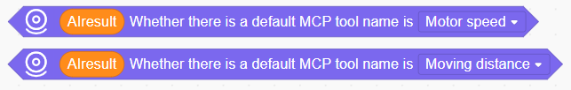
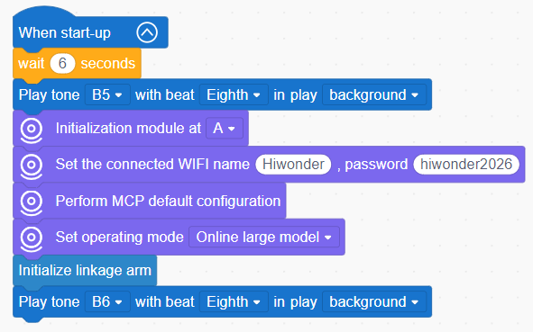
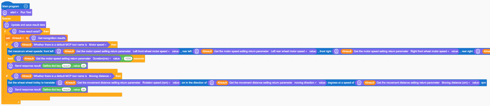

# 3.30 Lesson 30: Deep Visual Perception and Control Integration

## 3.30.1 Lesson Introduction

Focusing on advanced scenario applications of large vision models, this lesson establishes a closed loop from "visual comprehension → action control". Starting from the scenario of an intelligent logistics robot reading floor numbers to reach designated shelves, the curriculum contrasts traditional card recognition, which requires extensive training data, with zero-shot recognition powered by large vision models. Standard methods often fail when encountering handwritten digits, whereas large vision models recognize arbitrary numbered road signs through semantic associations. Practical exercises feature two progressive tasks: recognizing cards with voice broadcasting to verify zero-shot performance, and linking card recognition to Mecanum-wheel car left turns or specific travel distances. Exploring industrial scenarios such as logistics sorting illustrates how large models free robots from specialized fiducial markers, enabling interaction via universal symbols and completing the leap from visual comprehension to physical control.

## 3.30.2 Learning Objectives

**1.** Understand the technical principles and limitations of classic card recognition. Grasp the core mechanisms of zero-shot recognition in large vision models, and comprehend the closed-loop recognition → control system architecture.

**2.** Implement vision-model-based recognition for numbered cards and road signs. Develop programs for voice announcement of recognition results, and integrate card recognition with the motion control of a Mecanum-wheeled robot.

**3.** Develop a control mindset where visual perception drives physical action. Build a conceptual understanding of zero-shot learning, and enhance engineering design skills spanning from scenario requirements to system implementation.

**4.** Relate the learned concepts to real-world applications such as smart logistics sorting, warehouse AGV navigation, autonomous driving road sign recognition, and indoor service robot navigation, and appreciate the revolutionary value of large vision models in the robotics industry.

## 3.30.3 Preparation

**Hardware Preparation**:

- AiMecha M1 Mecanum-Wheel Car Advanced Kit
- Type-C data cable
- Computer × 1
- Remote controller

**Software Preparation**:

- WonderLab graphical programming software

**Core Concept Comparison**:

- **Traditional Card Recognition**: Requires collecting massive datasets of numbered cards and road signs in advance to train a classification model. Such models only recognize fixed, pre-trained classes and frequently fail when encountering handwritten digits, color variations, or tilted angles. Three major limitations include reliance on extensive annotated data, restriction to preset categories, and inability to comprehend underlying card semantics.

- **Large Vision Model Recognition**: Pre-trained on massive image-text pair datasets to establish associations between visual features and semantic concepts. Inputting a card image enables direct zero-shot output of natural language descriptions such as "This is a card with the number 3" or "This is a left-turn arrow sign", while even comprehending implied instructional meanings. Three main advantages include out-of-the-box readiness without training, recognition of arbitrary numbered road signs or handwritten digits, and natural language outputs that can be directly parsed into control commands.

**Application Scenario Description**:

- **Smart Logistics Sorting**: Warehouse automated guided vehicles use vision to read floor numbers and autonomously drive to corresponding shelves for item pickup without relying on magnetic strips or QR codes.

- **Indoor Visual Navigation**: Service robots recognize directional arrows and room numbers along hallways to navigate autonomously to target destinations.

- **Autonomous Driving Road Sign Recognition**: Autonomous vehicles identify traffic signs and lane markings in real time to assist driving decisions.

- **Flexible Production Lines**: Industrial robots read numbered labels on workpieces to automatically switch process parameters, adapting seamlessly to high-mix, low-volume manufacturing.

**Wiring Guidelines**:

- Connect the K230 screen module to **port A** of the controller via UART serial communication.

- Connect the camera module to the dedicated camera port on the K230 screen module.

**Programming Framework Key Points**:

- Initialization Workflow: Wait 6 seconds → play the B5 prompt tone → initialize port A → configure Wi-Fi settings → load default MCP configuration → switch to online large model mode → initialize the robotic arm → play the B6 readiness tone.

- Main Loop Structure: Start detection execution → repeatedly update data → check for recognition results → store results in AIresult → evaluate the motor speed branch → evaluate the movement distance branch → send ok feedback.

- Key Variable: Use AIresult to temporarily cache recognition results and maintain data consistency.

## 3.30.4 Practical Implementation

**1. Program Logic**

This project builds a card recognition and motion control system driven by a large vision model, centered around a closed loop that translates visual semantics into motion commands. The K230 module captures images of numbered cards and road signs, while the cloud-based large model performs zero-shot semantic comprehension to output natural language descriptions. The decision-making layer parses rules defined via voice commands and invokes MCP tools upon recognizing target cards to generate motor speeds, movement directions, and travel distances. The execution layer independently drives the four Mecanum wheels for omnidirectional movement or precise displacement before stopping. Forming a complete pipeline from visual capture → cloud comprehension → rule matching → tool invocation → motion execution, the system supports arbitrary card categories without prior training, demonstrating the disruptive advantages of general AI in robot perception and serving as a miniature prototype of intelligent AGV navigation.

<video controls playsinline preload="metadata" src="../../_static/media/chapter_3/section_18/video1.mp4"></video>

**2. Core Commands**

| Command Category |                         Core Command                         | Functional Description                                       |
| :--------------: | :----------------------------------------------------------: | :----------------------------------------------------------- |
|  Motor control   |  | Independently sets the rotational speeds of the four Mecanum wheel motors to achieve omnidirectional motion control. |
| Movement control |  | Precisely controls the car to move at a specified speed and direction for a target distance before stopping. |
| Tool evaluation  |  | Evaluates whether the large model has invoked the corresponding motion control tool. |

**3. Complete Program Description**

**Task 1: Recognizing Cards and Broadcasting Content**

- Initialization settings: Upon startup, wait 6 seconds and play note B5 for a 1/8 beat as the startup prompt tone. Initialize port A, configure the Wi-Fi SSID and password, load the default MCP configuration, set the operating mode to online large model, initialize the linkage robotic arm, and play note B6 for a 1/8 beat as the readiness prompt tone.

- Voice trigger: Speak the wake word `Hello Hiwonder`, followed by the command "recognize the card and broadcast its content".

- Visual recognition: The large model triggers the camera to capture a frame, analyzes the card content using the large vision model, and generates a natural language description such as "this is a card with the number 7" or "detected a right-turn arrow sign".

- Voice broadcast: Text-to-speech synthesis converts the recognition result into audio and automatically broadcasts the card content aloud.

- Testing and verification: Sequentially present numbered cards from 0 to 9 and road sign cards including turn left, turn right, go straight, and stop to observe recognition accuracy.

- Advanced testing: Test the robustness of the large vision model using handwritten digits, tilted cards, and varying lighting conditions.

**Task 2: Recognizing Cards to Control Mecanum-Wheel Car Actions**

- Program framework: Uses the exact same initialization sequence and main loop structure as Task 1.

- Result retrieval: If `Does result exist?` returns true, store the retrieved recognition result in the `AIresult` variable.

- Motor speed branch: If AIresult contains the default MCP tool name for motor speed, set the front-left, rear-left, front-right, and rear-right wheel speeds of the Mecanum-wheel car to the respective motor speed parameters extracted from AIresult, and send a response result with dictionary key `result` and value `ok`.

- Movement distance branch: If AIresult contains the default MCP tool name for movement distance, command the Mecanum-wheel car to translate at the rotational speed in rpm, toward the directional angle in degrees, and for the distance in centimeters extracted from AIresult, then send the response result `ok`.

- Voice command example: "Recognize the card ahead, and if it is a left-turn card, turn left in place for one second".

- Execution outcome: Placing a left-turn card in front of the car causes it to automatically turn left in place upon recognition; replacing it with a right-turn card triggers a right turn, and presenting a stop card brings the car to a halt.

**Program Design Key Points**

- Variable caching mechanism: Store recognition results uniformly in AIresult so all tool evaluation branches read from the same variable, ensuring data consistency.

- Parallel multi-tool structure: Place the motor speed and movement distance branches in parallel, allowing the large model to select the appropriate control method based on the voice command.

- Natural language rules: Define control rules dynamically via spoken commands rather than hard-coded logic; changing the spoken rule immediately alters the response behavior with high flexibility.

- Zero-shot adaptation: Eliminate the need to train separate models for each card type—any novel card containing letters, symbols, or text can be recognized directly, showcasing the generalization strength of large models.

**Typical Control Phrases**

- `Recognize the numbered card ahead, and move forward by the corresponding number of centimeters`

- `Turn left upon seeing a left-turn arrow, and turn right upon seeing a right-turn arrow`

- `Stop immediately upon detecting a stop sign`

- `Recognize the number on the card, and drive faster for larger numbers`

  > [!NOTE]
  >
  > **The program source files can be downloaded from [Program Files/Visual Perception Joint Control](https://drive.google.com/drive/folders/1qESIR7n_mxv3oQTrZhNbBTnPKVOk-yT4?usp=sharing).**

**Program Upload**:

- Step 1: Power on the mecha controller and plug the Type-C data cable into the data port located above the power switch on the controller.

- Step 2: Connect the other end of the data cable to a USB port on the computer.

- Step 3: Click the **Connect device** button on the top toolbar of the software and select the COM port corresponding to CH340 from the dropdown list.

- Step 4: Click the upload button in the upper-right corner to compile and download the program to the mecha controller.

## 3.30.5 Expansion and Advancement

**Expansion Project 1: Intelligent Warehouse Sorting Robot**

Set up a simulated warehouse environment by placing floor markers for shelves 1, 2, and 3 alongside directional arrows. Design an intelligent sorting program where the car departs from the starting area, navigates autonomously by following floor directional arrows, identifies shelf numbers upon reaching the storage zone, and drives to the target shelf based on voice commands such as "Deliver the cargo to Shelf 3". Simulate a real-world logistics AGV workflow to explore how large vision models enable robots to navigate using universal symbols and master the technical principles of flexible logistics.

**Expansion Project 2: Custom Card Instruction System**

Design a custom "card instruction" set by creating various functional cards, such as moving forward, moving backward, spinning in place, illuminating red lights, and sounding the buzzer, where each card corresponds to a specific robot action. Verify whether the large vision model can accurately recognize custom-made cards and execute the matching actions. Test the system with hand-drawn cards in varying colors and sizes to explore the recognition boundaries and generalization capabilities of large vision models, creating a fully customized visual command interaction system.

## 3.30.6 Q&A

**Q1: To control the car using an unseen, hand-drawn right-turn symbol card based on the methods covered in this lesson, which of the following approaches is most appropriate? **

A. Shine a flashlight on the card. 
B. Invoke the zero-shot recognition capability of the large vision model. 
C. Measure the distance using the ultrasonic sensor. 
D. Capture hundreds of photos of right-turn arrows in different styles to train a dedicated model first.

**Answer: B**

**Q2: In the card recognition and motion control program, the recognition result retrieved from the online large model is stored in a variable such as AI_result. Why not evaluate the retrieval block directly inside the conditional loop, and what is the purpose of caching it in a variable?**

**Answer**: Evaluating the retrieval block directly inside the loop **repeatedly fetches results**, causing program lag or slow responsiveness; caching the output in a variable **retrieves the result once for reuse across multiple branches**, making program execution faster and more stable.

## 3.30.7 Technical Support and Discussion

Join the forum for sharing questions, ideas, or suggestions, and answers will be provided promptly. Click the hyperlink [Hiwonder Forum](http://forum.hiwonder.com) or enter the URL in a browser: http://forum.hiwonder.com