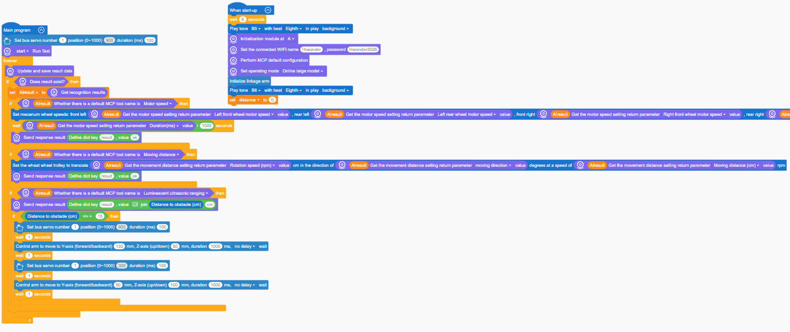

# 3.32 Lesson 32: Embodied Intelligence Collaborative Application

## 3.32.1 Lesson Introduction

This lesson focuses on multi-action collaborative composite commands, achieving the transition from single-step responses to multi-step task execution. Starting from everyday scenarios such as issuing a single command for "opening windows, adjusting air conditioning, and playing music", the curriculum covers the long-command parsing workflow: speech-to-text transcription, intent analysis, action decomposition and sequencing, and sequential execution with feedback. Practical exercises coordinate ultrasonic ranging with robotic arm grasping to program a complete task chain, from moving forward → measuring distance → confirming the target → grasping → lifting the arm, integrating movement, perception, robotic arm manipulation, and gripper control. Design custom composite commands to explore multi-tool collaboration paradigms. This progression marks the evolution from isolated skills to system integration, upgrading the robot into an autonomous task executor and serving as both a comprehensive capstone and a launchpad for advanced exploration.

## 3.32.2 Learning Objectives

1. Understand the definition and characteristics of long or composite commands, master the five-step processing workflow for long-command parsing in large models, comprehend the system architecture of multi-tool temporal coordination, and learn the principles of action decomposition and atomic action sequencing.

2. Program and implement collaborative invocation across multiple MCP tools, design a complete task chain under composite commands integrating chassis movement + environmental perception + robotic arm grasping, and manage the temporal coordination between ultrasonic ranging and robotic arm actuation.

3. Establish a systems mindset for task decomposition and temporal orchestration, cultivate engineering integration skills for multi-module collaboration, reinforce the cognitive leap from single-step response to multi-step execution, and strengthen problem decomposition and planning capabilities for complex tasks.

4. Relate the concepts to real-world application scenarios such as smart speaker multi-device control, in-vehicle voice assistant multi-action execution, and service robot composite tasks to understand how long-command parsing elevates the human-robot interaction experience.

## 3.32.3 Preparation

**Hardware Preparation**:

- AiMecha M1 Mecanum-Wheel Car Advanced Kit
- Type-C data cable
- Computer × 1
- Remote controller

**Software Preparation**:

- WonderLab graphical programming software

**Long-Command Core Concepts**:

- **Definition**: A long command is a natural language instruction containing multiple actions or intents, such as "Open the car window and turn off the air conditioner". Whereas traditional voice assistants only recognize single-intent commands, large models comprehend composite semantics and decompose them into sequential steps for execution.

- **Five-Step Processing Workflow**:

  1. Speech Recognition: Transcribes spoken audio into text.

  2. Intent Parsing: Analyzes the multiple action intents and logical relationships contained within the transcribed text.

  3. Action Decomposition and Sequencing: Breaks the long command down into individual atomic actions and orders them into a sequential execution pipeline.

  4. Execution and Feedback: Invokes the corresponding hardware control interfaces step by step, providing voice progress feedback after each completed action.

  5. Exception Handling: Halts subsequent actions and reports the cause of failure if any atomic action fails during execution.

**Atomic Actions and Collaboration**:

- **Atomic Action**: A fundamental operation that cannot be subdivided further, such as "Move forward 10 centimeters", "Open the gripper", or "Measure distance once".

- **Action Orchestration**: Combining multiple atomic actions into a complex task according to temporal order and conditional logic.

- **Multi-Tool Collaboration**: Invoking multiple MCP tools, including motors + the ultrasonic sensor + the robotic arm + the gripper, within a single task to achieve an objective through sequential coordination.

**Application Cases**:

- Xiaomi Auto Voice Assistant: Executes three distinct actions, opening the window + adjusting the air conditioner + playing music, from a single spoken sentence.

- Smart Speaker Whole-Home Control: Speaking the phrase "Back home now" automatically turns on the lights + activates the air conditioner + closes the curtains + plays music.

- Industrial Robot Task Orchestration: Executing "Grasp the workpiece and place it on the conveyor belt" coordinates multiple steps, including localization, grasping, transfer, and placement.

- Service Robot Delivery: Executing "Deliver a cola to Table 3" completes an end-to-end workflow encompassing navigation, item pickup, table delivery, and return.

**Wiring Instructions**:

- Connect the K230 screen module to **port A** of the controller.

- Connect the glowing ultrasonic sensor to **port K**.

- Connect the three bus servos in series to bus ports S1 or S2, where ID 1 = gripper, ID 2 = forearm, and ID 3 = upper arm.

**Involved MCP Tool List**:

- Motor Speed: Controls the rotational speeds of all four wheels for chassis movement.

- Move Distance: Precisely controls movement direction, rotational speed, and travel distance.

- Glowing Ultrasonic: Measures the distance to obstacles ahead.

- Robotic Arm Motion: Controls the Y and Z end-effector coordinates and movement duration of the robotic arm.

- Gripper: Controls the opening and closing angle of the mechanical gripper via bus servo ID 1.

## 3.32.4 Practical Implementation

**1. Program Logic**

This project builds a multi-tool collaborative embodied intelligence system driven by large model long commands, centered on composite command parsing and temporal orchestration. The K230 microphone captures natural language instructions while the ultrasonic sensor measures obstacle distances in real time. The cloud large model parses the multi-step logical relationships within the composite command and decomposes them into an atomic action sequence. Acting as a scheduler, the decision-making layer sequentially invokes the motor, ultrasonic, robotic arm, and gripper MCP tools, advancing to the next step only after receiving "ok" feedback from the current action. The execution layer coordinates four-wheel Mecanum omnidirectional movement, ultrasonic distance evaluation, and three-servo robotic arm grasping and lifting. A complete task chain, moving forward → stopping when the obstacle distance reaches 14 cm or less → confirming position → opening the gripper → extending the arm to grasp → clamping the gripper → lifting the arm, seamlessly integrates mobility, perception, and manipulation. Under long-command mode, the robot plans and executes tasks autonomously, progressing from simple command "obedience" to "autonomous task comprehension and completion".

<video controls playsinline preload="metadata" src="../../_static/media/chapter_3/section_20/video1.mp4"></video>

**2. Core Commands**

|  Command Category  |                         Core Command                         | Functional Description                                       |
| :----------------: | :----------------------------------------------------------: | :----------------------------------------------------------- |
|  Result retrieval  |  | Reads the large model output and stores it in a variable to ensure data consistency. |
|  Movement control  |  | Evaluates whether the motor speed tool is invoked to control the rotational speeds of all four wheels. |
| Precision movement |  | Evaluates whether the movement distance tool is invoked to precisely control direction, speed, and travel distance. |
|    Ranging tool    |  | Evaluates whether the ultrasonic ranging tool is invoked to obtain the distance to obstacles ahead. |
|  Gripper control   |  | Controls the angle of bus servo ID 1 to open and clamp the mechanical gripper. |
|  Result feedback   |  | Sends tool execution results back to the large model to trigger the next scheduled action. |

**3. Complete Program Description**

**Task: Forward Movement, Ranging, and Grasping Collaborative Task Under Composite Commands**

- Initialization settings: Upon startup, wait 6 seconds and play note B5 for a 1/8 beat as the startup prompt tone. Initialize port A, configure the Wi-Fi SSID as `Hiwonder` and the password as `hiwonder2026`, load the default MCP configuration, set the operating mode to online large model, initialize the linkage robotic arm, and play note B6 for a 1/8 beat as the readiness prompt tone.

- Main loop structure: Start detection execution and repeatedly update and save result data.

- Result retrieval branch: If `Does result exist?` returns true, store the retrieved recognition result in the AIresult variable.

- Motor speed branch: If AIresult contains the default MCP tool name for motor speed, set the front-left, rear-left, front-right, and rear-right wheel speeds of the Mecanum-wheel car to the respective motor speed parameters extracted from AIresult, and send a response result with dictionary key `result` and value `ok`.

- Movement distance branch: If AIresult contains the default MCP tool name for movement distance, command the Mecanum-wheel car to translate at the rotational speed in rpm, toward the directional angle in degrees, and for the distance in centimeters extracted from AIresult, then send the response result `ok`.

- Ultrasonic ranging branch: If AIresult contains the default MCP tool name for glowing ultrasonic distance measurement, send a response result with dictionary key `result` and a value concatenating the obstacle distance in centimeters measured by the ultrasonic sensor with the unit string `cm`, returning the distance data to the large model for decision-making.

- Robotic arm motion branch: If AIresult contains the default MCP tool name for robotic arm motion, move the robotic arm end effector to the forward-backward Y-axis coordinate in millimeters and vertical Z-axis coordinate in millimeters extracted from AIresult over the specified duration in milliseconds, and send the response result `ok`.

- Mechanical gripper branch: If AIresult contains the default MCP tool name for the mechanical gripper, set bus servo ID 1 to the target angle in degrees over the duration in milliseconds extracted from AIresult, and send the response result `ok`.

> [!NOTE]
>
> **The program source files can be downloaded from [Program Files/Embodied AI Collaboration](https://drive.google.com/drive/folders/1qESIR7n_mxv3oQTrZhNbBTnPKVOk-yT4?usp=sharing).**

**Program Upload**:

- Step 1: Power on the mecha controller and plug the Type-C data cable into the data port above the power switch on the controller.

- Step 2: Connect the other end of the data cable to a USB port on the computer.

- Step 3: Click the **Connect device** button at the top of the software and select the CH340 COM port from the port list.

- Step 4: Click the upload button in the upper-right corner to upload and run the compiled program on the mecha controller.

## 3.32.5 Expansion and Advancement

**Expansion Project 1: Multi-Step Material Handling Robot** 

Design a complete material handling composite task: "Start from the starting point, move to the front of the block, pick up the block, turn left 90 degrees, move forward to the target zone, put the block down, and then return to the starting point." Express the entire task in a single natural language command to verify whether the large model can accurately decompose it into multiple action steps and execute them sequentially. Explore the depth of long-command task orchestration, understand how embodied intelligence upgrades from single-step operations to complete task execution, and simulate the workflow of an industrial material handling robot.

**Expansion Project 2: Vision and Ultrasonic Dual-Perception Collaborative Grasping**. Integrate the two perception capabilities of large vision model recognition and ultrasonic ranging to design an intelligent grasping task: first use the vision foundation model to identify the category and position of an object ahead, then confirm the distance through precise ultrasonic ranging, and finally control the robotic arm to complete the grasp. Explore multi-perception fusion in embodied intelligence systems and understand how different sensors complement each other: vision identifies what the object is while ultrasonic ranging precisely measures the distance, working in tandem to improve grasping success rates and build a smarter robotic perception system.

## 3.32.6 Q&A

**Q1: What is long-command parsing?**

**Answer**: Long-command parsing enables AI to **comprehend composite instructions containing multiple action intents** and automatically decompose them into sequential steps for execution. Traditional voice assistants cannot accomplish this, whereas large models succeed due to the fundamental technological leap from rigid "keyword matching" to "deep semantic comprehension".

**Q2: In the composite task of this lesson, the local program does not explicitly hard-code the sequential logic of moving forward first, measuring distance second, and grasping third. Why is the robot still able to execute these steps in the proper order?**

**Answer**: This highlights the most critical takeaway of the lesson: **the action sequence is orchestrated by the cloud-based large model rather than hard-coded in the local program**. The local program functions as an "actuator", while the large model acts as the "commander".

## 3.32.7 Technical Support and Discussion

Join the forum for sharing questions, ideas, or suggestions, and answers will be provided promptly. Click the hyperlink [Hiwonder Forum](http://forum.hiwonder.com) or enter the URL in a browser: http://forum.hiwonder.com