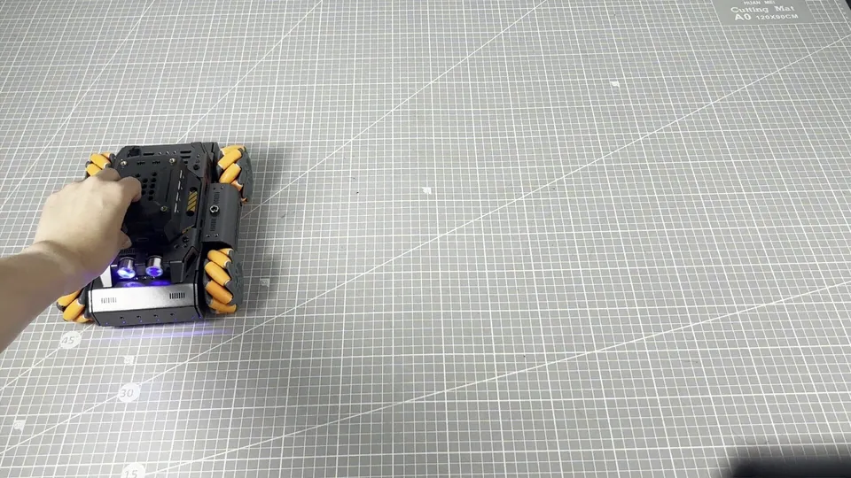
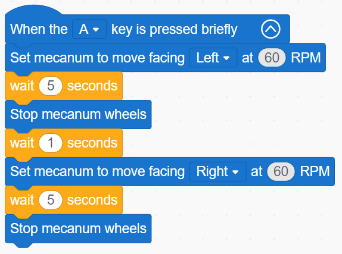
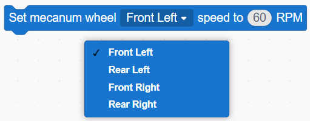
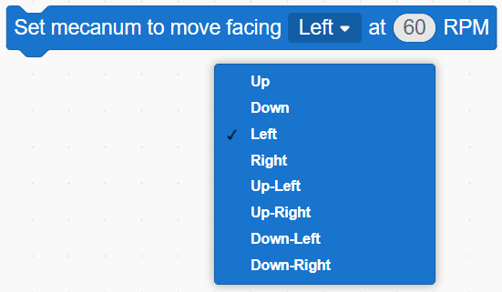
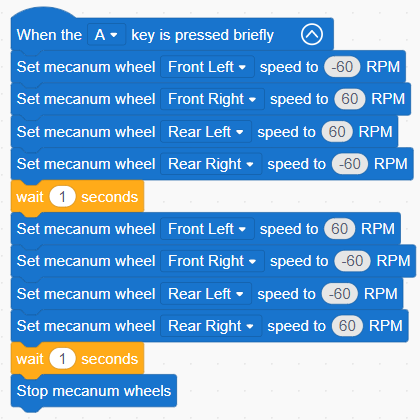
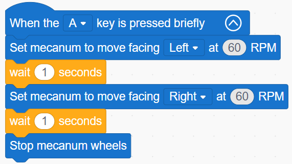
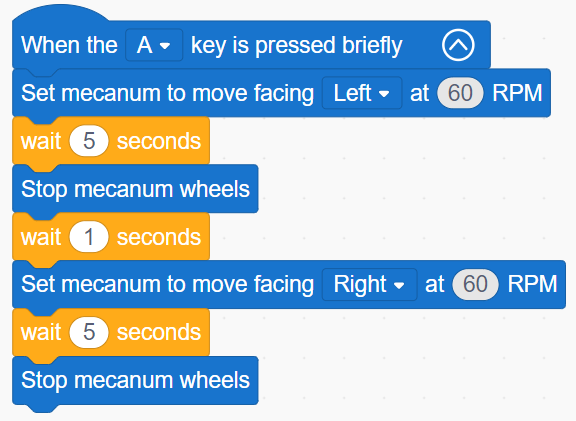

# 3.4 Lesson 4: Translational Motion and Timed Control

## 3.4.1 Lesson Introduction

Building upon the programming and lighting control foundations from the previous three lessons, this lesson officially enters the core of Mecanum-wheel motion control. Taking inspiration from "crab sideways movement", the concept of crab walking is introduced to explore the principles of Mecanum-wheel translation. Following the learning path of "mechanical analysis → single-wheel control → encapsulated commands → timed combinations", this lesson explains how diagonal wheel speed ratios generate lateral resultant forces based on force analysis. The control method transitions from underlying four-wheel rotational speed control to encapsulated commands for timed translation. Mastering lateral movement and timed control lays a solid foundation for diagonal motion and path planning.

## 3.4.2 Learning Objectives

**1.** Understand the dynamic principles of lateral translation with Mecanum wheels. Master the kinematic laws of generating resultant forces through diagonal wheel speed ratios. Learn the force analysis method of canceling vertical force components and superimposing horizontal force components.

**2.** Independently set the individual rotational speeds and directions of the four Mecanum wheels. Master the usage of encapsulated commands for directional movement. Independently write programs for left translation, right translation, and timed combination movements.

**3.** Establish a physical thinking framework for force component synthesis. Cultivate the ability to decompose complex movements into single-wheel controls. Develop abstract thinking from underlying principles to upper-layer encapsulation.

**4.** Connect translational motion to narrow-aisle operation scenarios in daily life. Understand the industry value of omnidirectional movement technology in logistics warehousing and smart manufacturing. Stimulate interest in exploring mobile robotics and automation technologies.

## 3.4.3 Preparation

**Hardware Preparation:**

- AiMecha M1 Mecanum-wheel robot base × 1
- Type-C USB data cable × 1
- Computer running Windows or macOS × 1

**Software Preparation:**

- WonderLab graphical programming platform installed and running normally

**Wheel Speed Parameter Description**: The unit of Mecanum wheel rotational speed is revolutions per minute, abbreviated as rpm, where positive values indicate forward rotation and negative values indicate backward rotation. Setting the standard teaching demonstration rotational speed to 60 rpm is recommended for smooth movement and clear observation.

**Device Connection Description**: Connect the mecha controller to the computer using a Type-C data cable. After successful connection, select the corresponding COM port to upload the program. The four motors on the car are pre-wired at the factory, requiring no additional wiring.

## 3.4.4 Hands-On Project

**1. Project Analysis**

This project focuses on the timed left and right translation of the Mecanum-wheel car, adopting a two-layer control logic consisting of a "decision-making layer → an execution layer". The decision-making layer relies on sequential structures and wait commands to schedule motion states according to preset timing. The execution layer outputs four independent rotational speed signals to drive the Mecanum wheels. Car translation relies on diagonal wheel speed ratios. During left and right movement, diagonal wheels rotate in opposite directions to cancel vertical force components and superimpose horizontal force components, keeping the car body orientation unchanged. Combined with wait commands to precisely control the duration, the car completes the entire timed sequence of "moving left for 5 s → stopping for 1 s → moving right for 5 s".

💡**Complete Program Preview:**

**2. Core Commands**

|   Command Category   |                         Core Command                         | Functional Description                                       |
| :------------------: | :----------------------------------------------------------: | :----------------------------------------------------------- |
| Single-wheel control |  | Sets the rotation speed and direction of an individual wheel, where positive values indicate forward rotation and negative values indicate backward rotation. |
| Encapsulated motion  |  | Encapsulated command that directly sets the car to move in eight directions at a specified speed. |
|    Motion control    |  | Immediately stops all motors and brakes the car in place.    |

**3. Complete Program Description**

**Task 1: Single-Wheel Independent Control for Left and Right Translation**

- Use the `When the A key is pressed briefly` block as the program trigger entry.

- Left translation configuration: Set the front-left wheel to -60 rpm + the front-right wheel to 60 rpm + the rear-left wheel to 60 rpm + the rear-right wheel to -60 rpm, so that diagonal counter-rotation generates a leftward resultant force.

- Add a `wait 1 seconds` command to maintain the left translation state for 1 s.

- Right translation configuration: Set the front-left wheel to 60 rpm + the front-right wheel to -60 rpm + the rear-left wheel to -60 rpm + the rear-right wheel to 60 rpm, so that diagonal opposite rotation generates a rightward resultant force.

- Add a `wait 1 seconds` command to maintain the right translation state for 1 s.

- Finally, execute the `Stop mecanum wheels` command to end the motion.

**Task 2: Encapsulated Commands to Simplify Translation Control**

- Use the encapsulated command `set Mecanum-wheel car to move in a direction at a speed of X rpm`.

- Select from eight directions directly via the direction parameter, including move left, move right, move forward, and move backward, without manually configuring the speeds of all four wheels.

- Combine with wait commands and stop commands to build a concise timed translation program.

**Task 3: Complete Timed Translation Task Moving Left for 5 s → Stopping for 1 s → Moving Right for 5 s**

- Program entry: When the A key is pressed briefly.

- Step 1: Set the Mecanum-wheel car to move left at a speed of 60 rpm.

- Step 2: Wait 5 s to maintain the left translational motion for 5 s.

- Step 3: Set the Mecanum-wheel car to stop in place.

- Step 4: Wait 1 s to maintain the stationary state for 1 s.

- Step 5: Set the Mecanum-wheel car to move right at a speed of 60 rpm.

- Step 6: Wait 5 s to maintain the right translational motion for 5 s.

- Step 7: Set the Mecanum-wheel car to stop, completing the program execution.

- Key parameters: The standard speed is 60 rpm, and the duration of each segment can be flexibly adjusted by modifying the wait time.

> [!NOTE]
>
> **The program source files can be downloaded from [Program Files/Timed Translation Control](https://drive.google.com/drive/folders/1vQnjkHE58XJU_cquYayobwkfJD5ZQ1KT?usp=sharing).**

**Program Upload**:

- Step 1: Power on the mecha controller and insert the Type-C data cable into the data port above the power switch on the controller.

- Step 2: Connect the other end of the data cable to a USB port on the computer.

- Step 3: Click the **Connect device** button at the top of the software interface and select the COM port corresponding to CH340 from the port list.

- Step 4: Click the upload button in the upper-right corner to upload the compiled program to the mecha controller for execution.

## 3.4.5 Expansion and Advancement

**Project 1: Variable-Speed Translation Effect Experiment**

Design a comparative experiment by setting the translation speed to three levels: 10 rpm, 50 rpm, and 80 rpm. Observe and record the smoothness, straightness, and noise changes of the car movement at different speeds. Summarize the optimal speed range for teaching demonstrations, analyze the issues caused by excessively high or low speeds, and further understand the relationship between motor characteristics and motion performance.

**Project 2: Square Translation Trajectory**

Write a program using a combination of forward, backward, left, and right translational movements to make the car follow a square trajectory. Ensure the car moves sequentially along the four sides of the square with an identical duration for each side, eventually returning near the starting point. Comprehensively apply the four directional commands of forward, backward, left, and right along with timed control to practice arranging multi-segment motion sequences.

## 3.4.6 Q&A

**Q1: Why is a Mecanum-wheel robot able to achieve lateral translation?**

**Answer**: The core reason a Mecanum wheel achieves translation lies in its specialized wheel surface design and the principle of force component synthesis.

**Q2: What are the rotation directions of the four wheels during left translation and right translation?**

**Answer**: The wheel speed configurations for left translation and right translation have a diagonal image relationship.

## 3.4.7 Technical Support and Discussion

Join the forum for sharing questions, ideas, or suggestions, and answers will be provided promptly. Click the hyperlink [Hiwonder Forum](http://forum.hiwonder.com) or enter the URL in a browser: http://forum.hiwonder.com