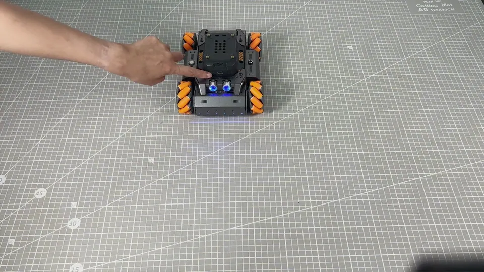
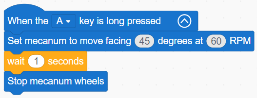
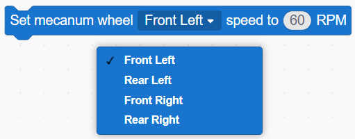
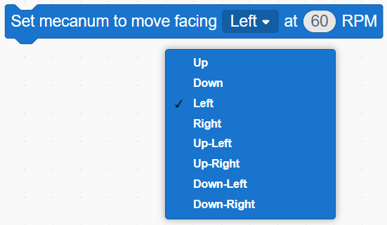
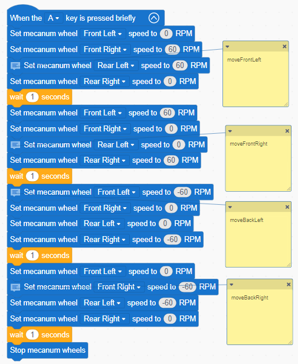
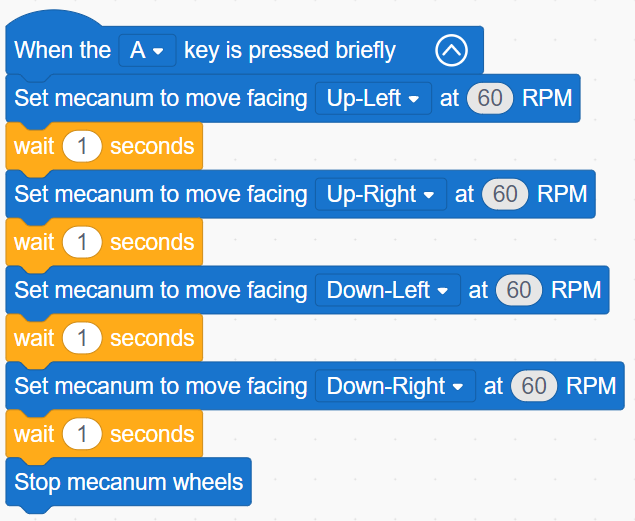
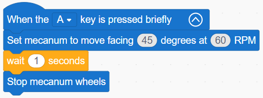

# 3.5 Lesson 5: Diagonal Trajectory Control

## 3.5.1 Lesson Introduction

Building upon the previous lesson, this lesson expands into diagonal motion and angular control. Taking inspiration from vector concepts and playground slides, the vector decomposition method is introduced to explain diagonal motion as the synthesis of lateral and longitudinal movements. Following the path of "vector principles → four-direction diagonal movement → arbitrary angle control", this lesson uses force analysis to explain how diagonal wheels generate diagonal resultant forces. Through hands-on practice in four standard diagonal directions, the control method advances to arbitrary angle control ranging from -180° to 180°. Mastering eight-directional motion and angular trajectory control lays a vector thinking foundation for drifting rotation and path planning.

## 3.5.2 Learning Objectives

**1.** Understand the physical concept of vector decomposition. Master the analytical method of decomposing diagonal motion into lateral and longitudinal force components. Learn the structural principle of inclined rollers on Mecanum wheels generating diagonal driving forces.

**2.** Implement diagonal movement in four diagonal directions through single-wheel rotational speed control. Master the usage of encapsulated eight-directional movement commands. Proficiently apply angle parameters to control the car moving along any angular direction.

**3.** Establish a physical thinking framework for vector decomposition and synthesis. Cultivate the analytical ability to break down complex motions into simple component motions. Strengthen logical awareness of angular quantification and parameterized control.

**4.** Connect diagonal motion to operation scenarios in narrow spaces. Understand the application value of omnidirectional movement technology in smart manufacturing and agricultural automation. Stimulate interest in exploring motion control and robot navigation technologies.

## 3.5.3 Preparation

**Hardware Preparation:**

- AiMecha M1 Mecanum-wheel robot base × 1

- Type-C USB data cable × 1

- Computer running Windows or macOS  × 1

**Software Preparation:**

- WonderLab graphical programming platform installed and running normally

**Angular Coordinate System Description**: A polar coordinate system is adopted to define movement directions, ranging from -180° to 180°. Specifically, 0° represents straight ahead, 90° represents straight right, -90° represents straight left, and both 180° and -180° represent straight backward. Furthermore, 45° corresponds to front-right, -45° corresponds to front-left, 135° corresponds to rear-right, and -135° corresponds to rear-left.

**Device Connection Description**: Connect the mecha controller to the computer using a Type-C data cable. The four motors are pre-wired at the factory, requiring no additional wiring. Testing with a standard angle such as 45° is recommended when using the angular movement command for the first time to verify whether the movement direction matches expectations.

## 3.5.4 Hands-On Project

**1. Project Analysis**

This project focuses on the diagonal fixed-point movement of the Mecanum-wheel car, adopting a three-layer logic of "vector decomposition → wheel speed ratio → timing control". The vector decomposition layer splits diagonal motion into longitudinal and lateral components and calculates their ratio. The wheel speed ratio layer adjusts the rotational speeds and directions of the four Mecanum wheels to synthesize a driving force at a specified angle. The timing control layer relies on wait commands to regulate movement duration and limit displacement. Based on the diagonal wheel driving principle and rotational speed ratio adjustments, any movement direction from -180° to 180° can be synthesized to achieve precise trajectory control of the car.

💡**Complete Program Preview:**

**2. Core Commands**

|     Command Category     |                         Core Command                         | Functional Description                                       |
| :----------------------: | :----------------------------------------------------------: | :----------------------------------------------------------- |
|   Single-wheel control   |  | Independently sets the rotational speed and direction of each wheel to achieve various diagonal motions through speed ratios. |
| Eight-direction movement |  | Encapsulated command supporting eight standard directions, including forward, backward, left, right, and four diagonal directions. |
|     Angular movement     |  | Advanced encapsulated command that controls movement in any direction using angle parameters from -180° to 180°. |

**3. Complete Program Description**

**Task 1: Single-Wheel Control for Four-Direction Diagonal Movement**

- Use the `When the A key is pressed briefly` block as the program trigger entry.

- Front-left movement: Set the front-left wheel to 0 rpm + the front-right wheel to 60 rpm + the rear-left wheel to 60 rpm + the rear-right wheel to 0 rpm, so that forward rotation of the right diagonal wheels generates a front-left 45° resultant force.

- Wait 1 s to maintain the front-left movement state.

- Front-right movement: Set the front-left wheel to 60 rpm + the front-right wheel to 0 rpm + the rear-left wheel to 0 rpm + the rear-right wheel to 60 rpm, so that forward rotation of the left diagonal wheels generates a front-right 45° resultant force.

- Wait 1 s to maintain the front-right movement state.

- Rear-left movement: Set the front-left wheel to -60 rpm + the front-right wheel to 0 rpm + the rear-left wheel to 0 rpm + the rear-right wheel to -60 rpm, so that backward rotation of the left diagonal wheels generates a rear-left 45° resultant force.

- Wait 1 s to maintain the rear-left movement state.

- Rear-right movement: Set the front-left wheel to 0 rpm + the front-right wheel to -60 rpm + the rear-left wheel to -60 rpm + the rear-right wheel to 0 rpm, so that backward rotation of the right diagonal wheels generates a rear-right 45° resultant force.

- Wait 1 s and then execute the stop command.

**Task 2: Eight-Direction Encapsulated Commands to Simplify Diagonal Movement**

- Use the encapsulated command `set Mecanum-wheel car to move toward a direction at a speed of X rpm`.

- Select the four diagonal directions, front-left, front-right, rear-left, and rear-right, directly from the direction drop-down menu.

- Set the car to move in each of the four diagonal directions sequentially for 1 s each, and finally stop.

- Program features: No need to memorize complex wheel speed ratios, making the code concise and intuitive while significantly reducing error rates.

**Task 3: Angular Control for 45° Diagonal Fixed-Point Movement**

- Program entry: Triggered when the A key is pressed briefly.
- Use the `Set mecanum to move facing 45 degrees at 60 RPM`.
- Add a wait command to control the movement duration, precisely controlling the diagonal movement distance by adjusting the wait time in seconds.
- Execute the ` Stop mecanum wheels` command after the movement ends.
- Extended practice: Modify the angle to different values such as -45°, 135°, and -135° to observe changes in movement direction.
- Key parameters: The angle ranges from -180° to 180°, where higher angular precision yields more accurate movement direction control.

> [!NOTE]
>
> **The program source files can be downloaded from [Program Files/Diagonal Trajectory Control](https://drive.google.com/drive/folders/1vQnjkHE58XJU_cquYayobwkfJD5ZQ1KT?usp=sharing).**

**Program Upload**:

- Step 1: Power on the mecha controller and insert the Type-C data cable into the data port above the power switch on the controller.

- Step 2: Connect the other end of the data cable to a USB port on the computer.

- Step 3: Click the **Connect device** button at the top of the software interface and select the COM port corresponding to CH340 from the port list.

- Step 4: Click the upload button in the upper-right corner to upload the compiled program to the mecha controller for execution.

## 3.5.5 Expansion and Advancement

**Project 1: Diamond Trajectory Cruising**

Write a program using a combination of movements in four diagonal directions to make the car follow a diamond trajectory. Ensure the car moves sequentially along the four 45° diagonal directions, front-right, rear-right, rear-left, and front-left, for an identical duration each, eventually returning near the starting point to form a closed diamond. Precisely control the duration of each movement segment to be consistent, practicing comprehensive skills in angular direction control and trajectory arrangement.

**Project 2: Arbitrary Angle Aiming Movement**

Set a target point in the test field, measure the angle of the line connecting the starting point to the target point, and write a program to make the car move in a straight line along the calculated angle to observe whether it accurately reaches the target position. Set multiple target points at different angles for further challenges to understand the correspondence between angle parameters and actual movement directions, cultivating the ability to combine spatial geometry with engineering practice.

## 3.5.6 Q&A

**Q1: What is the vector decomposition method?**

**Answer**: The vector decomposition method is a fundamental approach in physics for analyzing complex motions and forces. It refers to breaking down a vector with both magnitude and direction into two or more component vectors along mutually perpendicular directions according to the parallelogram law, studying the variation patterns of each component vector individually, and then synthesizing them to obtain the overall effect.

**Q2: During front-left movement, why do only the front-right and rear-left wheels rotate while the front-left and rear-right wheels remain stationary? Does driving with only two wheels cause imbalance?**

**Answer**: This is precisely the ingenious design of Mecanum wheels. Driving with two diagonal wheels produces a pure 45° diagonal motion without causing any imbalance.

## 3.5.7 Technical Support and Discussion

Join the forum for sharing questions, ideas, or suggestions, and answers will be provided promptly. Click the hyperlink [Hiwonder Forum](http://forum.hiwonder.com) or enter the URL in a browser: http://forum.hiwonder.com