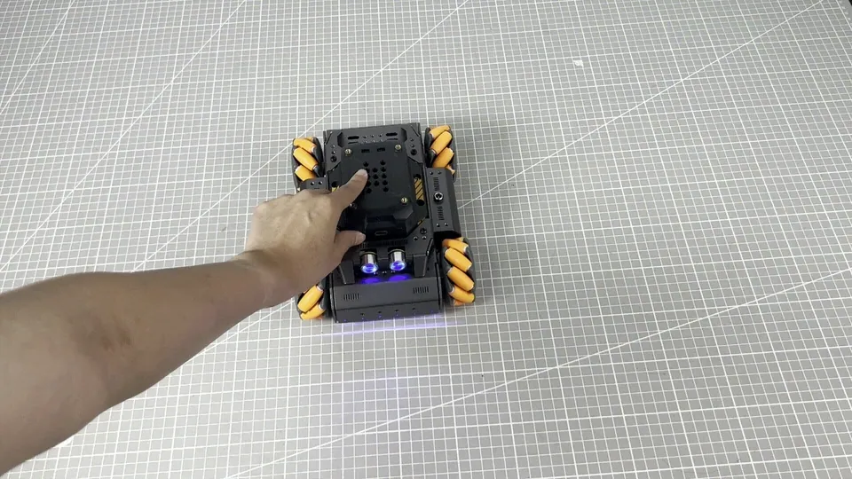
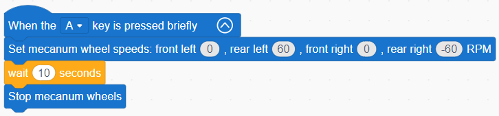
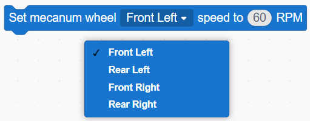
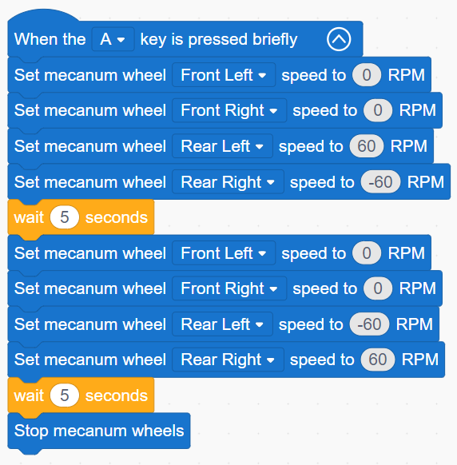
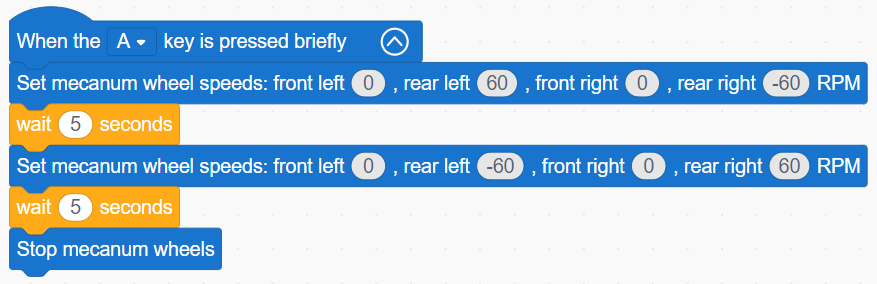
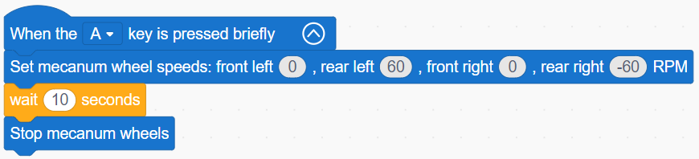

# 3.6 Lesson 6: Drifting and Distance Control

## 3.6.1 Lesson Introduction

Building upon translational and diagonal motion, this lesson enters the advanced domain of drifting motion and distance control. Taking inspiration from automotive drifting competitions, traditional racing drifting is compared with Mecanum wheel drifting to illustrate the core role of friction. Following the path of "friction principles → single-wheel configuration → encapsulated commands → distance control," this lesson explains the physical essence of drifting from the perspective of friction. Clockwise and counterclockwise drifting are achieved by controlling the front and rear wheel speeds, and precise drifting distance is regulated in combination with timed control. Mastering in-place drifting and time-based distance estimation lays a solid foundation for path planning and autonomous navigation.

## 3.6.2 Learning Objectives

**1.** Understand the physical essence of drifting motion and the mechanism of friction. Master the differences and transition conditions between static friction and sliding friction. Learn the drifting principle of a Mecanum-wheel car, actively synthesizing sideslip forces through wheel speed differentials.

**2.** Achieve two-directional in-place drifting by independently setting the rotational speeds of the four wheels. Master the usage of encapsulated commands for setting all four wheel rotational speeds simultaneously. Proficiently apply wait commands to control the drifting duration and thereby regulate the drifting distance.

**3.** Establish a physical thinking framework for friction regulation. Cultivate the analytical ability to control motion patterns via wheel speed differentials. Strengthen parameterized control awareness of estimating distance through time, and form an initial engineering mindset for open-loop control and error source analysis.

**4.** Connect drifting sideslip to narrow-space operation scenarios. Understand the practical value of controllable sideslip technology in specialized vehicles and industrial logistics. Stimulate interest in exploring vehicle dynamics and motion control technologies.

## 3.6.3 Preparation

**Hardware Preparation:**

- AiMecha M1 Mecanum-wheel robot base × 1

- Type-C USB data cable × 1

- Computer running Windows or macOS × 1

**Software Preparation:**

- WonderLab graphical programming platform installed and running normally

**Drifting Wheel Speed Configuration**: During clockwise drifting, keep the front wheels stationary at 0 rpm while setting the rear-left wheel to rotate in reverse and the rear-right wheel to rotate forward. During counterclockwise drifting, keep the front wheels stationary while setting the rear-left wheel to rotate forward and the rear-right wheel to rotate in reverse. Setting the standard demonstration speed to 60 rpm is recommended for smooth drifting and easy observation.

**Device Connection Description**: Connect the mecha controller to the computer using a Type-C data cable. The four motors are pre-wired at the factory, requiring no additional wiring. Testing on a floor with moderate smoothness is recommended, as an overly smooth surface causes uncontrolled drifting while excessive friction makes initiating sideslip difficult.

## 3.6.4 Hands-On Project

**1. Project Analysis**

This project focuses on the in-place drifting of the Mecanum-wheel car, adopting a three-layer logic of "friction synthesis → differential drive → timed control". The friction synthesis layer utilizes the angled roller structure of the Mecanum wheels, relying on rear-wheel speed differentials to generate lateral friction and create a sideslip tendency. The differential drive layer uses the stationary front wheels as a pivot point and drives the rear wheels in opposite directions to generate a rotational torque, achieving lateral drifting while keeping the front orientation of the car virtually unchanged. The timed control layer regulates the drifting duration via wait commands to control lateral displacement. This drifting is an active programmed control method that precisely adjusts friction vectors. Switching the drifting direction only requires reversing the rotation directions of the rear wheels, yielding stable and reproducible results.

💡**Complete Program Preview:**

**2. Core Commands**

|        Command Category         |                         Core Command                         | Functional Description                                       |
| :-----------------------------: | :----------------------------------------------------------: | :----------------------------------------------------------- |
|      Single-wheel control       |  | Independently sets the rotation speed and direction of each wheel to flexibly configure various drifting modes. |
| Simultaneous four-wheel setting |  | Sets the rotation speeds of all four wheels simultaneously with a single command, simplifying multi-wheel configuration code. |
|         Motion control          |  | Immediately stops all motors and brakes the car to end the drifting state. |
|         Timing control          |  | Sets the drifting duration to indirectly control the lateral drifting distance through time. |
|          Event trigger          |  | Event-triggered program entry that starts drifting when the A key on the controller board is pressed. |

**3. Complete Program Description**

**Task 1: Single-Wheel Independent Control for Bidirectional Drifting**

- Use the `When the A key is pressed briefly` block as the program trigger entry.
- Clockwise drifting configuration: Set the front-left wheel to 0 rpm + the front-right wheel to 0 rpm + the rear-left wheel to 60 rpm + the rear-right wheel to -60 rpm, using the stationary front wheels as a pivot and driving the rear wheels in opposite directions to generate clockwise sideslip.
- Add a `wait 5 seconds` command block to maintain the clockwise drifting state for 5 s.
- Counterclockwise drifting configuration: Set the front-left wheel to 0 rpm + the front-right wheel to 0 rpm + the rear-left wheel to -60 rpm + the rear-right wheel to 60 rpm, using the stationary front wheels as a pivot and driving the rear wheels in opposite directions to generate counterclockwise sideslip.
- Add a `wait 5 seconds` command block to maintain the counterclockwise drifting state for 5 s.
- Finally, execute the `Stop mecanum wheels` command to end the drifting motion.
- Key learning point: Keeping the front wheels stationary while driving the rear wheels in opposite directions is the critical configuration for generating in-place drifting.

**Task 2: Four-Wheel Simultaneous Control Command to Simplify Drifting Control**

- Use the encapsulated command `set mecanum-wheel car front-left X, rear-left X, front-right X, rear-right X rpm`.
- Enter the speed parameters for all four wheels simultaneously in a single command, replacing four individual single-wheel setting commands.
- Clockwise drifting parameters: Set front-left to 0, rear-left to 60, front-right to 0, and rear-right to -60.
- Counterclockwise drifting parameters: Set front-left to 0, rear-left to -60, front-right to 0, and rear-right to 60.
- Program features: Cuts the code volume in half, makes the logic more compact, and provides a clear and intuitive parameter comparison.

**Task 3: Timed Control for Specified-Distance Drifting**

- Program entry: Triggered when the A key is pressed briefly.

- Set four-wheel rotational speeds: Set the front-left wheel to 0, the rear-left wheel to 60, the front-right wheel to 0, and the rear-right wheel to -60 to start clockwise drifting.

- Add a `wait 10 seconds` command block to maintain the drifting motion for 10 s.

- Execute the `Stop mecanum wheels` command block to end the drifting motion.

- Distance estimation method: First calibrate the lateral drifting distance per second at 60 rpm, and then calculate the required wait time based on the target distance.

- Key parameters: Drifting speed is closely related to the ground friction coefficient and wheel rotational speed, requiring calibration of the time parameter according to actual field conditions.

> [!NOTE]
>
> **The program source files can be downloaded from [Program Files/Drift Distance Control](https://drive.google.com/drive/folders/1vQnjkHE58XJU_cquYayobwkfJD5ZQ1KT?usp=sharing).**

**Program Upload**:

- Step 1: Power on the mecha controller and insert the Type-C data cable into the data port above the power switch on the controller.

- Step 2: Connect the other end of the data cable to a USB port on the computer.

- Step 3: Click the **Connect device** button at the top of the software interface and select the COM port corresponding to CH340 from the port list.

- Step 4: Click the upload button in the upper-right corner to upload the compiled program to the mecha controller for execution.

## 3.6.5 Expansion and Advancement

**Project 1: Variable-Speed Drifting Stability Experiment**

Design a comparative experiment by setting the drifting rotational speed to three levels: 30 rpm, 60 rpm, and 90 rpm. Observe and record the startup response, motion smoothness, and stopping accuracy of drifting at different rotational speeds. Summarize the optimal drifting rotational speed range for teaching demonstrations, analyze the physical reasons why excessive rotational speed causes loss of control and insufficient rotational speed fails to overcome static friction, and deepen the understanding of the relationship between friction and motion.

**Project 2: S-Shaped Drifting Maneuver**

Write a program that alternates between clockwise drifting and counterclockwise drifting to make the car follow an S-shaped lateral trajectory. Ensure the car first drifts a certain distance to the right and then drifts a certain distance to the left, alternating back and forth to form an S-shaped route. Precisely control the duration of each drifting segment and the timing of direction switching to practice comprehensive skills in timing control and motion sequence arrangement.

## 3.6.6 Q&A

**Q1: What is the difference in principle between traditional automotive drifting and Mecanum-wheel car drifting?**

**Answer**: Traditional automotive drifting involves causing "the vehicle to skid and barely maintaining control", whereas Mecanum-wheel car drifting involves "precise calculation to drive the car sideways", making the controllability and practicality of the latter far superior to the former.

**Q2: Why must the front wheels be set to 0 rpm and kept stationary when performing in-place drifting?**

**Answer**: Keeping the front wheels stationary is the key condition for achieving "in-place drifting", which produces pure lateral sideslip while keeping the front orientation of the car unchanged.

## 3.6.7 Technical Support and Discussion

Join the forum for sharing questions, ideas, or suggestions, and answers will be provided promptly. Click the hyperlink [Hiwonder Forum](http://forum.hiwonder.com) or enter the URL in a browser: http://forum.hiwonder.com