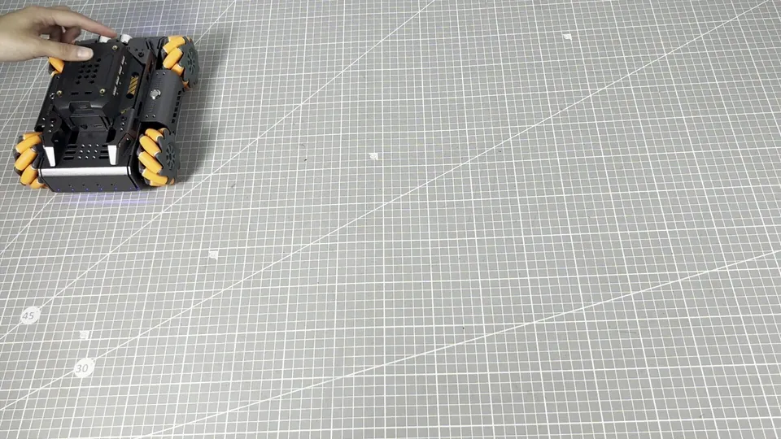
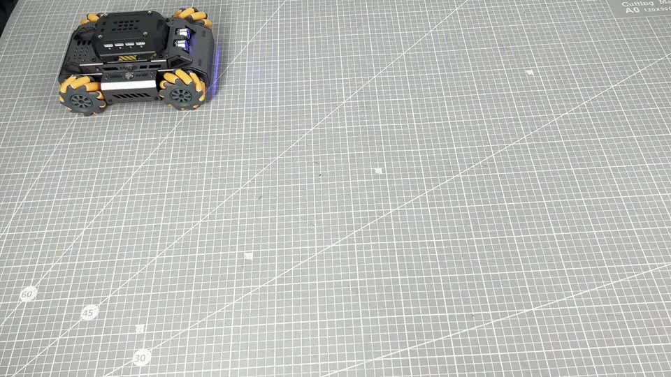
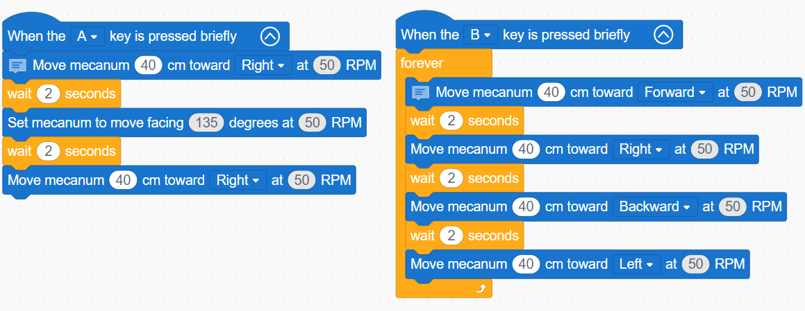
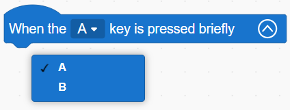
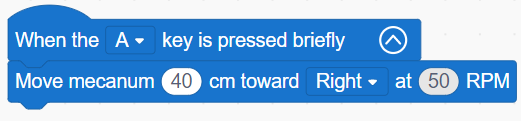
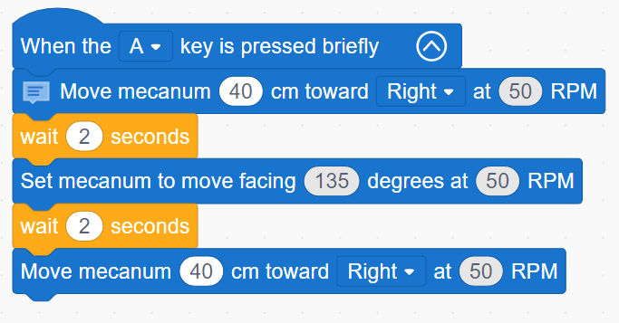
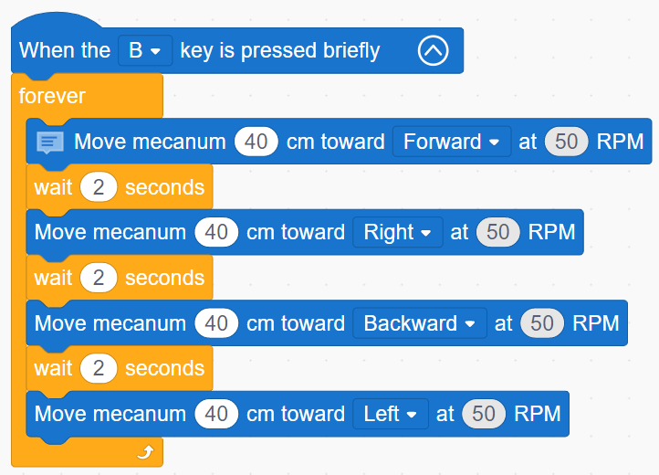

# 3.7 Lesson 7: Basic Path Planning

## 3.7.1 Lesson Introduction

Building upon single-direction motion control, this lesson introduces fundamental path planning. Taking inspiration from Z-turn skiing, a Z-shaped trajectory is simulated to illustrate multi-segment motion combinations. Following the progression of "single segments → two-segment connections → multi-segment combinations → loop paths", translational and diagonal movement commands are reviewed to complete a Z-turn by connecting straight and diagonal segments, which is then expanded to closed square trajectories and continuous loop motion. Movement commands with distance parameters are introduced to advance from time-based control to distance-based control. Mastering basic path planning establishes sequential arrangement thinking for advanced autonomous navigation.

## 3.7.2 Learning Objectives

**1.** Understand the basic concepts of path planning and the principles of connecting multi-segment movements. Master the mechanism of how distance parameters affect path accuracy. Learn the kinematic relationship among rotational speed, time, and distance.

**2.** Precisely control single-segment displacement length using movement commands with distance parameters. Master the combination and connection methods of angular diagonal movement and translational movement commands. Independently complete the full path program for a Z-shaped turn.

**3.** Cultivate the ability to decompose complex trajectories into simple straight-line segments. Strengthen engineering awareness of parameterized design and precision control. Form an initial practical mindset for closed-loop debugging and parameter calibration.

**4.** Connect path planning to industrial logistics and warehousing scenarios. Understand the core value of trajectory planning technology in smart manufacturing and unmanned warehousing. Stimulate interest in exploring robot navigation and motion planning technologies.

## 3.7.3 Preparation

**Hardware Preparation:**

- AiMecha M1 Mecanum-wheel robot base × 1
- Type-C USB data cable × 1
- Computer running Windows or macOS × 1

**Software Preparation:**

- WonderLab graphical programming platform installed and running normally

**Z-Shaped Path Parameter Table**: Segment ① is a 40 cm straight translation to the right. Segment ② is a diagonal connecting movement in the 135° direction. Segment ③ is a 40 cm straight translation to the right. Setting the standard teaching demonstration rotational speed to 50 rpm is recommended to balance motion smoothness and path accuracy.

**Device Connection Description**: Connect the mecha controller to the computer using a Type-C data cable. The four motors are pre-wired at the factory. Movement commands with distance parameters incorporate built-in encoder feedback, providing higher distance accuracy than pure timed control, though actual performance is still affected by ground friction conditions, so fine-tuning parameters after field testing is recommended.

## 3.7.4 Hands-On Project

**1. Project Analysis**

This project focuses on Z-shaped path planning for the Mecanum-wheel car, adopting a three-layer control logic of "path decomposition → segmented execution → sequential connection". Path decomposition splits the Z-shaped trajectory into two lateral translations and one diagonal connection. Segmented execution calls parameterized movement commands to precisely control the direction and displacement of each segment. Sequential connection relies on a sequential structure to execute each segment in order with smooth transitions. Leveraging the omnidirectional movement characteristics of the Mecanum-wheel car, the front orientation of the car remains unchanged throughout the entire process, completing the Z-shaped maneuver without turning the chassis. This demonstrates the path planning advantages of an omnidirectional platform, where complex geometric trajectories such as squares can also be achieved by combining multiple basic motion segments.

💡**Complete Program Preview:**

**2. Core Commands**

| Command Category  |                         Core Command                         | Functional Description                                       |
| :---------------: | :----------------------------------------------------------: | :----------------------------------------------------------- |
| Distance movement |  | Translational movement command with a distance parameter to precisely control movement direction and displacement length. |
| Angular movement  |  | Controls diagonal movement in any direction via an angle parameter, used for connecting path segments. |
|   Loop control    |  | Infinite loop structure used to achieve continuous reciprocating motion along a path trajectory. |
|  Timing control   |  | Sets the pause duration between segments for brief stops at path turning points. |
|   Event trigger   |  | Triggers the program via button events, allowing different buttons to launch different paths. |

**3. Complete Program Description**

**Task 1: Single-Segment Straight Translational Path**

- Use the `When the A key is pressed briefly` block as the program trigger entry.

- Add the ` Move mecanum 40 cm toward Right at 50 RPM` command.

**Task 2: Complete Z-Shaped Path**

- Program entry: When the A key is pressed briefly.

- Segment ① straight path: Set the Mecanum-wheel robot to move right for 40 cm at 50 rpm to complete the first lateral translation.

- Add a brief wait command as an optional pause at the turning point.

- Segment ② diagonal path: Set the Mecanum-wheel car to move in the 135° direction at 50 rpm to complete the diagonal cornering connection.

- Add a brief wait command as an optional pause.

- Segment ③ straight path: Set the Mecanum-wheel car to move right for 40 cm at 50 rpm to complete the second lateral translation.

- Overall outcome: The car moves along a Z-shaped trajectory while keeping its front orientation unchanged throughout the entire process, completing the cornering maneuver without chassis rotation.

- Key parameters: The 135° angle corresponds to rear-right diagonal movement, serving as the diagonal angle connecting the upper and lower parallel straight paths.

**Extended Task: Closed Square Path and Loop Motion**

- Path composition: Move forward 40 cm → move right 40 cm → move backward 40 cm → and move left 40 cm, connecting four equal-length translational segments end to end.

- Use the `set Mecanum-wheel car to move in the direction for 40 cm at 50 rpm` command for each segment.

- After executing the four segments sequentially, the car returns near the starting point, forming a closed square trajectory with a side length of 40 cm.

- Nest a `forever` loop block on the outer layer to achieve continuous loop motion along the square trajectory, making the car travel around the square repeatedly.

- Design key point: Pay attention to the correspondence between the initial orientation of the car and the movement directions, as different starting orientations require different directional commands.

> [!NOTE]
>
> **The program source files can be downloaded from [Program Files/Basic Path Planning](https://drive.google.com/drive/folders/1vQnjkHE58XJU_cquYayobwkfJD5ZQ1KT?usp=sharing).**

**Program Upload**:

- Step 1: Power on the mecha controller and insert the Type-C data cable into the data port above the power switch on the controller.

- Step 2: Connect the other end of the data cable to a USB port on the computer.

- Step 3: Click the **Connect device** button at the top of the software interface and select the COM port corresponding to CH340 from the port list.

- Step 4: Click the upload button in the upper-right corner to download the compiled program to the mecha controller for execution.

## 3.7.5 Expansion and Advancement

**Project 1: Figure-8 Path Planning**

Building upon the Z-shaped and square trajectories, design a complex figure-8 path. Utilize basic motion segments such as translation and diagonal movement to plan two interconnected loop trajectories so that the car traces the shape of the number "8". Carefully plan the direction, distance, and connecting angle of each segment to practice path decomposition and spatial geometric visualization, and optionally add a loop block to achieve continuous figure-8 movement.

**Project 2: Path Accuracy Calibration Experiment**

Design a comparative experiment to test the actual movement deviation when setting a 40 cm target distance at three different rotational speeds: 30 rpm, 50 rpm, and 70 rpm. Record the error data at different rotational speeds, analyze how rotational speed affects distance control accuracy, and identify the optimal rotational speed range with the highest precision. Cultivate scientific literacy in experimental measurement and data analysis, and understand the importance of parameter calibration in engineering.

## 3.7.6 Q&A

**Q1: What is path planning?**

**Answer**: Path planning is the process of pre-planning the motion trajectory a robot takes from a starting point to a target point according to task objectives, and breaking it down into a sequence of executable motion commands. Simply put, it means designing the route the robot needs to travel and translating it into a program so that it follows that route.

**Q2: Between movement blocks with distance parameters and controlling distance via wait time, which method is better?**

**Answer**: Movement commands with distance parameters are generally superior to time-based control, offering higher precision and reliability, though each method has its own applicable scenarios.

## 3.7.7 Technical Support and Discussion

Join the forum for sharing questions, ideas, or suggestions, and answers will be provided promptly. Click the hyperlink [Hiwonder Forum](http://forum.hiwonder.com) or enter the URL in a browser: http://forum.hiwonder.com