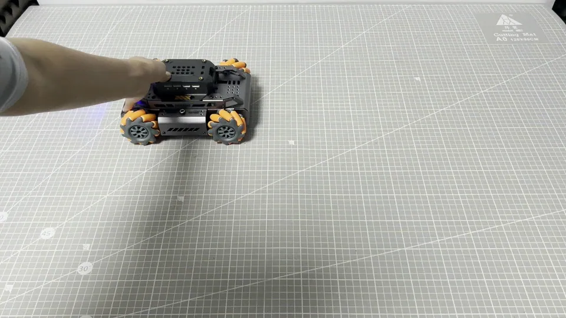
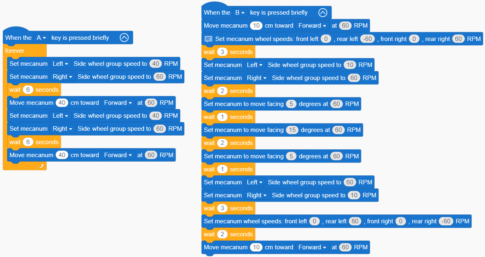
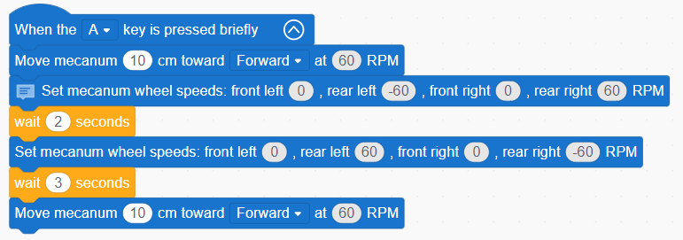
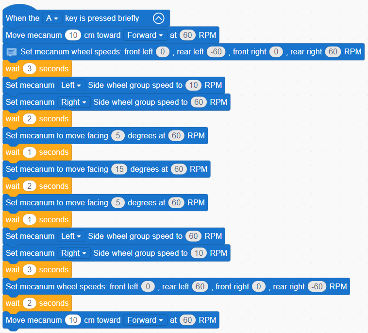
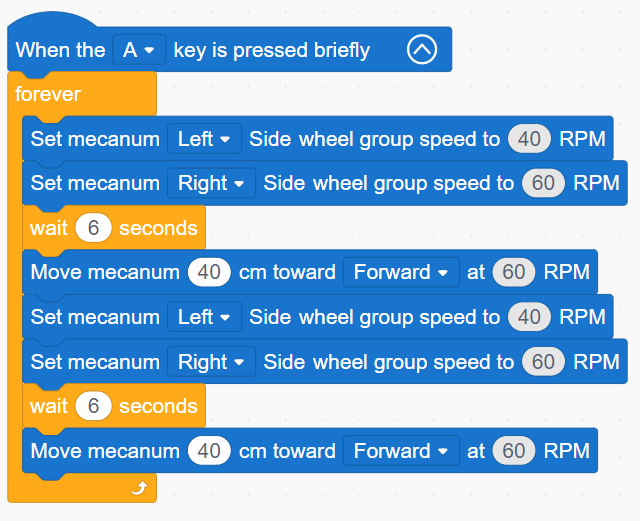

# 3.8 Lesson 8: Advanced Path Planning

## 3.8.1 Lesson Introduction

Building upon introductory path planning, this lesson enters the advanced domain of curved trajectories and multi-mode coordination. Taking inspiration from S-curve driving tests, curved driving scenarios are simulated. Following the progression of "straight-line drifting → diagonal transition → multi-segment combination → closed curves", forward movement, drifting, and multi-stage diagonal angles are combined to achieve an S-shaped trajectory, which is then expanded to closed oval paths and continuous loop motion. Translational, diagonal, and drifting modes are comprehensively applied alongside differential speed curvature control. Mastering complex curve planning and multi-mode collaborative programming completes the entire motion control curriculum.

## 3.8.2 Learning Objectives

**1.** Understand the principle of linear approximation for complex curves and the concept of smooth transitions across multi-segment connections. Master the kinematic mechanism by which speed differentials between the left and right wheels generate steering curvature. Learn the correspondence between drifting amplitude and wheel speed differentials.

**2.** Master the programming method of multi-stage angular gradients to achieve smooth arc transitions. Independently complete the full advanced path program for S-curve cornering. Expand the program to achieve closed curved trajectories such as ovals and incorporate loop motion.

**3.** Cultivate system design capabilities for coordinating multiple motion modes. Strengthen engineering optimization awareness for parameter tuning and trajectory refinement. Form an initial dynamic mindset connecting differential speed control with trajectory curvature.

**4.** Connect advanced path planning to service robot scenarios. Comprehend the application value of precise trajectory control technology in commercial services and smart logistics. Stimulate interest in exploring robot motion planning and autonomous navigation technologies.

## 3.8.3 Preparation

**Hardware Preparation**:

- AiMecha M1 Mecanum-wheel robot base × 1

- Type-C USB data cable × 1

- Computer running Windows or macOS × 1

**Software Preparation:**

- WonderLab graphical programming platform installed and running normally

**S-Shaped Path Structure Description**: The overall path consists of five parts: an entry straight segment, a first curve segment, a diagonal transition segment, a second curve segment, and an exit straight segment. The curve segments utilize left-right wheel speed differentials to generate drifting turns, while the transition segment uses a multi-stage angular gradient from 5° → 15° → 5° to achieve a smooth connection and avoid abrupt directional changes. Setting the standard teaching demonstration rotational speed to 60 rpm is recommended.

**Wheel Group Control Description**: The speeds of the left wheel group and right wheel group can be set separately to achieve steering with different curvatures via left-right wheel speed differentials. A larger wheel speed differential results in a smaller turning radius and a wider drifting amplitude, whereas a smaller wheel speed differential produces a larger turning radius and a gentler trajectory.

## 3.8.4 Hands-On Project

**1. Project Analysis**

This project focuses on the S-curve cornering function of the Mecanum-wheel car, adopting a three-layer control logic of "segmented approximation → mode switching → smooth transition". The continuous S-shaped curve is decomposed into multiple straight-line motion segments, utilizing forward mode for straight paths, drifting mode for high-curvature turns, and gentle diagonal turning mode for low-curvature sections. The system switches between various motion modes in chronological sequence while applying stepped angular gradients and progressive wheel speed differential adjustments to eliminate motion stuttering. By integrating straight driving, diagonal movement, and drifting through discretized approximation and multi-mode coordination, the car achieves a smooth curved trajectory that illustrates the core principles of advanced path planning.

💡**Complete Program Preview:**

**2. Core Commands**

|        Command Category         |                         Core Command                         | Functional Description                                       |
| :-----------------------------: | :----------------------------------------------------------: | :----------------------------------------------------------- |
|        Distance movement        |  | Forward movement command with a distance parameter for precise displacement on straight segments. |
|       Wheel group control       |  | Independently sets the overall rotational speed of the two left or right wheels for differential steering control. |
| Simultaneous four-wheel setting |  | Sets the rotational speeds of all four wheels simultaneously to configure drifting turn modes. |
|        Angular movement         |  | Angular diagonal movement command that achieves smooth transition segments via multi-stage angular gradients. |
|          Loop control           |  | Infinite loop structure used to achieve continuous loop motion along closed trajectories. |
|         Timing control          |  | Sets the duration of each motion segment to control the trajectory length of each section. |
|          Event trigger          |  | Triggers the program via button events, allowing different buttons to launch different path programs. |

**3. Complete Program Description**

**Task 1: Basic Trajectory Combining Straight and Drifting Segments**

- Use the `When the A key is pressed briefly` block as the program trigger entry.

- Entry straight segment: Set the Mecanum-wheel car to move forward for 10 cm at 60 rpm.

- Left-turn drifting: Set the front-left wheel to 0 + the rear-left wheel to -60 + the front-right wheel to 0 + the rear-right wheel to 60 to initiate counterclockwise drifting, and wait 5 s.

- Right-turn drifting: Set the front-left wheel to 0 + the rear-left wheel to 60 + the front-right wheel to 0 + the rear-right wheel to -60 to initiate clockwise drifting, and wait 5 s.

- Exit straight segment: Set the Mecanum-wheel car to move forward for 10 cm at 60 rpm.

**Task 2: Complete S-Curve Cornering with Diagonal Segments**

- Program entry: Triggered when the A key is pressed briefly.

- Entry straight segment: Move forward 10 cm to prepare for entering the curve.

- First curve drifting: Apply the counterclockwise drifting configuration and wait 3 s to complete the left turn.

- Differential transition segment: Set the left wheels to 10 rpm and the right wheels to 60 rpm, and wait 2 s to progressively adjust the curvature.

- Three-stage diagonal transition segment: Move in the 5° direction for 1 s →move in the 15° direction for 2 s → move in the 5° direction for 1 s → smoothly transition into the reverse curve.

- Reverse differential transition: Set the left wheels to 60 rpm and the right wheels to 10 rpm, and wait 3 s for a reverse curvature gradient.

- Second curve drifting: Apply the clockwise drifting configuration and wait 2 s to complete the right turn.

- Exit straight segment: Move forward 10 cm to exit the curve.

- Key technique: The multi-stage angular gradient makes directional switching smoother and prevents sharp angles along the trajectory.

**Extended Task: Closed Oval Path and Loop Motion**

- Oval structure: Combine two parallel straight segments + two semicircular curve segments to form a four-segment closed oval trajectory.

- Curve segment: Use left and right wheel group differential control by setting the left side to 40 rpm and the right side to 60 rpm to form a circular arc turn via wheel speed differentials, and wait 6 s.

- Straight segment: Use the forward movement command with a distance parameter and set the displacement to 40 cm.

- Curve segment: Use left and right wheel group differential control by setting the left side to 40 rpm and the right side to 60 rpm to form a circular arc turn via wheel speed differentials, and wait 6 s.

- Straight segment: Use the forward movement command with a distance parameter and set the displacement to 40 cm.

- Repeat this sequence in a continuous loop.

> [!NOTE]
>
> **The program source files can be downloaded from [Program Files/Advanced Path Planning](https://drive.google.com/drive/folders/1vQnjkHE58XJU_cquYayobwkfJD5ZQ1KT?usp=sharing).**

**Program Upload**:

- Step 1: Power on the mecha controller and insert the Type-C data cable into the data port above the power switch on the controller.

- Step 2: Connect the other end of the data cable to a USB port on the computer.

- Step 3: Click the **Connect device** button at the top of the software interface and select the COM port corresponding to CH340 from the port list.

- Step 4: Click the upload button in the upper-right corner to download the compiled program to the mecha controller for execution.

## 3.8.5 Expansion and Advancement 

**Project 1: Closed Figure-8 Curve**

Building upon the S-shaped and oval trajectories, design a complex closed figure-8 curve. Connect two S-shaped curves in opposite directions, combining straight transitions with drifting turns to make the car follow a looping figure-"8" trajectory. Carefully plan the mode-switching points and curvature parameters for each segment to practice advanced programming skills in complex path decomposition and multi-mode coordination, and optionally add a loop block for continuous figure-8 driving.

**Project 2: Curve Speed and Accuracy Comparison Experiment**

Design a comparative experiment to drive the car through the same S-curve at three different rotational speeds: 40 rpm, 60 rpm, and 80 rpm. Record the trajectory deviation, line-crossing occurrences, and completion time at each rotational speed. Summarize the relationship curve between driving speed and cornering accuracy to identify the optimal cornering speed range, cultivating scientific inquiry skills in experimental design and data analysis while understanding the trade-off between speed and accuracy in motion control.

## 3.8.6 Q&A

**Q1: Why must an S-curve be broken down into multiple motion segments instead of being executed with a single command?**

**Answer**: Basic motion control commands execute "uniform straight-line movements" rather than direct curved movements, requiring multiple short straight segments to approximate a continuous curve. In computer graphics and motion control, this method is known as "linear interpolation" or "discretized approximation".

**Q2: What is the relationship between the left-right wheel speed differential and turning curvature?**

**Answer**: The speed differential between the left and right wheels determines the turning radius, which in turn determines the curvature or degree of bending. A larger speed differential produces a smaller turning radius, a greater curvature, and a sharper turn.

## 3.8.7 Technical Support and Discussion

Join the forum for sharing questions, ideas, or suggestions, and answers will be provided promptly. Click the hyperlink [Hiwonder Forum](http://forum.hiwonder.com) or enter the URL in a browser: http://forum.hiwonder.com