

# 4. Deep Learning

## 4.1 AiMecha Controller

### 4.1.1 AiMecha Controller Overview

The controller serves as the "brain" of the robot. Its main function is to process programmed information and send commands to motors, servos, or other actuators. Meanwhile, the controller receives data from connected sensors, such as the ultrasonic sensor and the 6-channel line follower sensor, to expand its functionality.

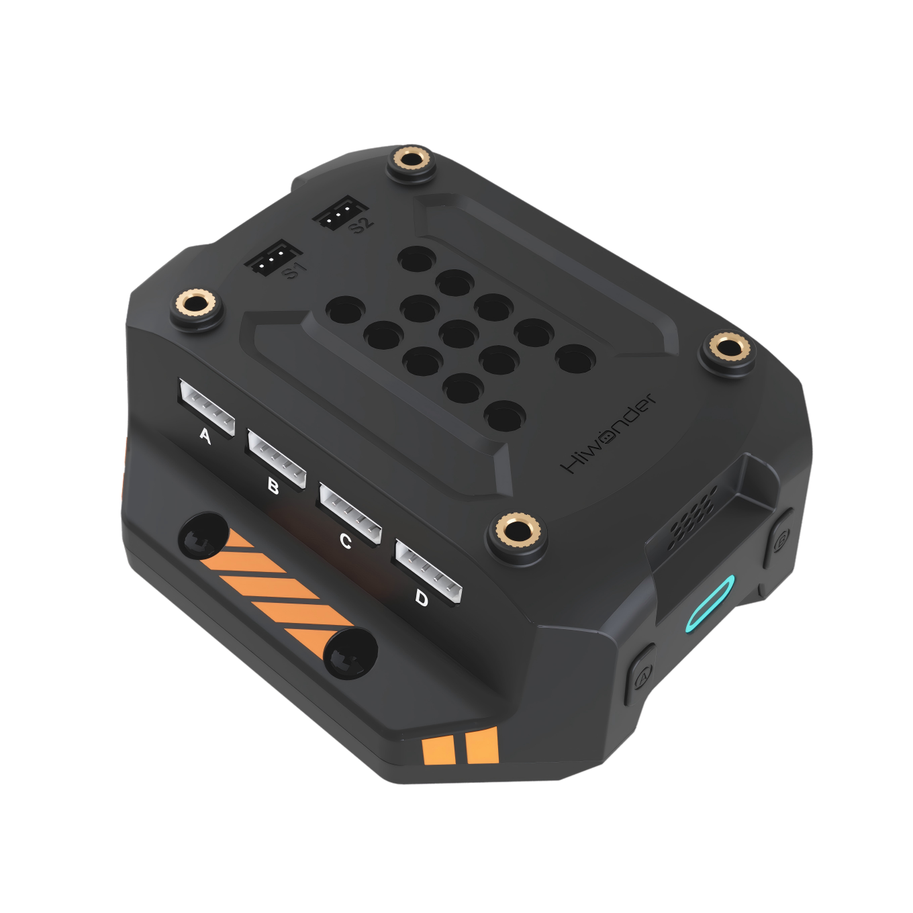

### 4.1.2 Technical Specifications

* Dimensions: Length × Width × Height ≥ 105 × 92 × 45 mm
* Core Chip: ESP32 + MM32F103RBT6
* Power Supply: Built-in lithium battery
* Modules: Built-in buzzer, 9-axis IMU, 2-channel programmable buttons, and RGB LEDs
* Bluetooth: V4.2 × BR/EDR/BLE
* Ports: Bus servo port × 4, multi-functional 4-pin motor port × 3, 4-pin I2C expansion port × 7, and Type-C port × 1
* Casing: ABS material with LEGO-compatible expansion holes
* Expansion: Supports expansion with additional sensors

### 4.1.3 Port Description

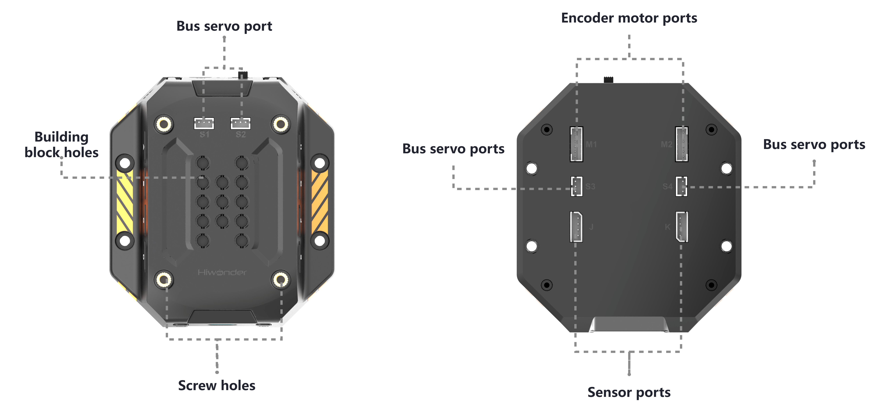

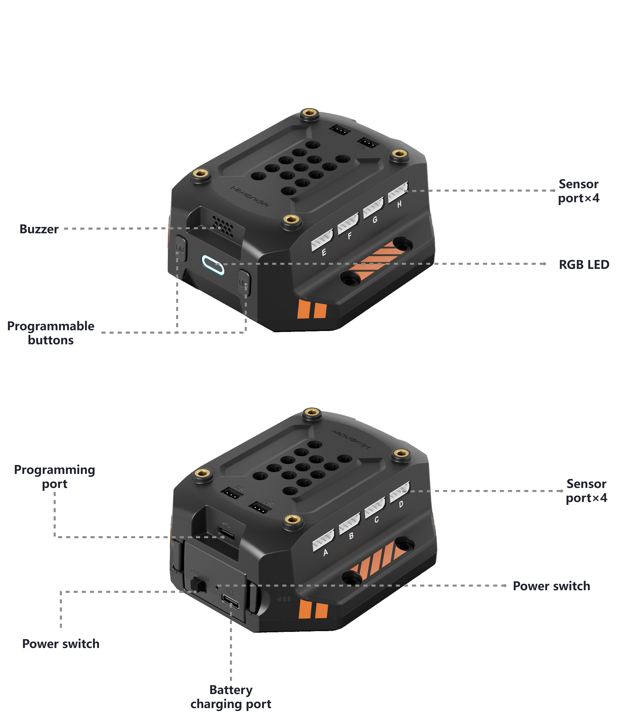

### 4.1.4 Quick Start

(1) Charging Instructions: Connect a 5 V/2 A power adapter and a Type-C data cable to the Type-C charging port located on the right side of the switch on the controller battery box.

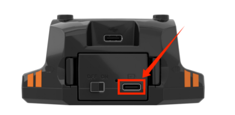

(2) Power-On Instructions: Turn on the switch on the controller battery box to power on the device.

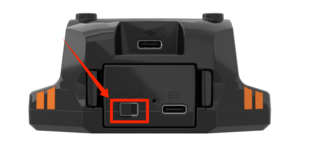

## 4.2 WonderLab Programming Platform

### 4.2.1 Overview

WonderLab is a graphical programming software designed for programming beginners. It uses drag-and-drop block operations covering motion, appearance, and other functions to control character behaviors. It is suitable for learning programming logic and creative practice.

**Supported Systems**: Windows 7, Windows 10, Windows 11

**Client Communication Method**: Serial communication

### 4.2.2 Download and Installation

Click the link to download the programming software: [Download WonderLab Programming Platform](https://k12.hiwonder.com.cn/download/pcSoftware?get_pc=1&os=windows)

**Installation Steps:**

**Step 1**: Open the **WonderLab setup.exe** software installer.

**Step 2**: Select the language, then click **OK**.

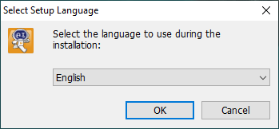

**Step 3**: Select the destination location, then click **Next**.

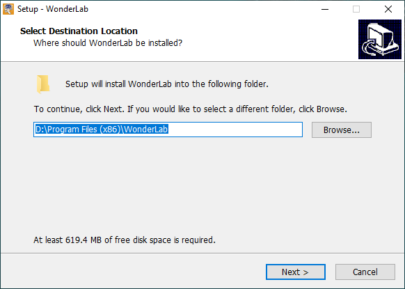

**Step 4**: Click **Next**.

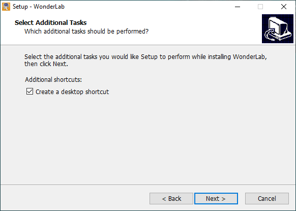

**Step 5**: Click **Install**.

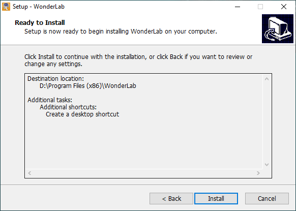

**Step 6**: Click **Finish** after the installation is complete.

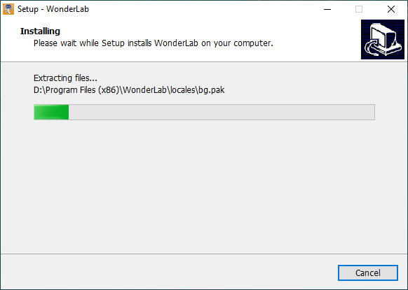

**Step 7**: Locate and double-click the **WonderLab** icon on the desktop to open it. Click the Extensions button in the lower-left corner, then add **AI Mecanum**.

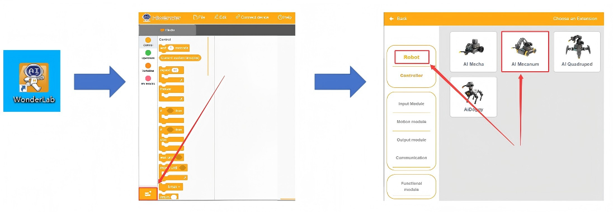

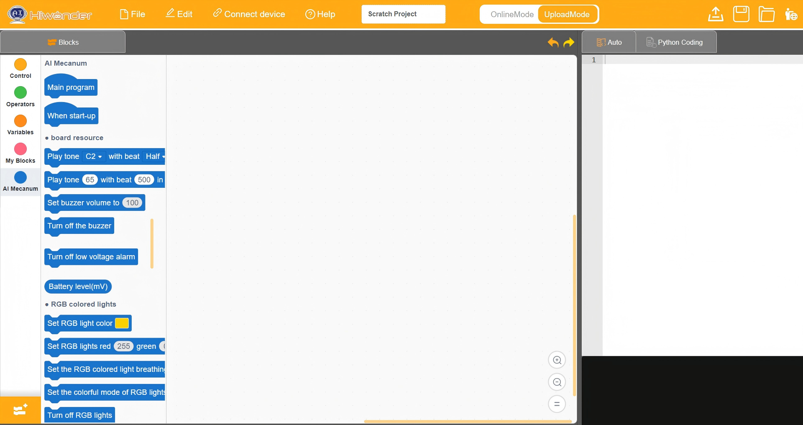

### 4.2.3 Interface Overview

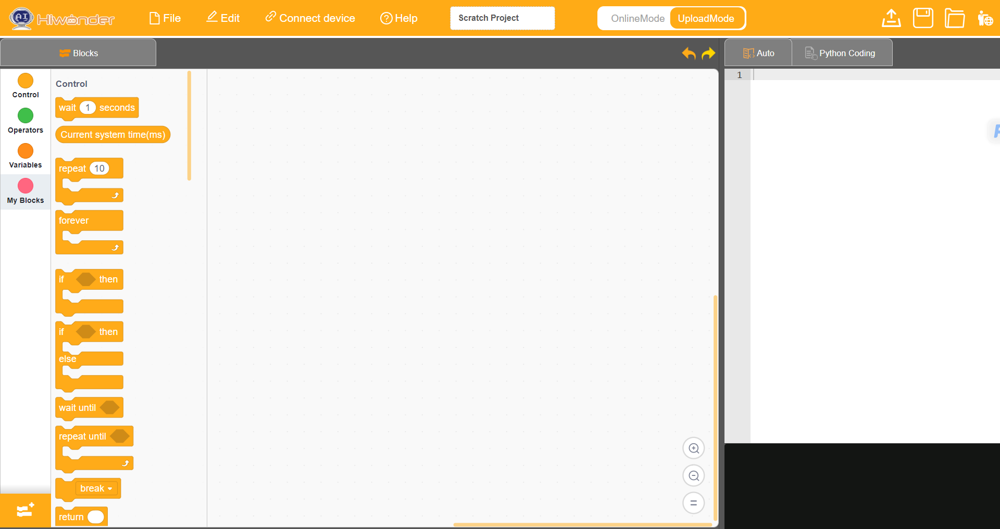

|                             Icon                             | Function                                                     |
| :----------------------------------------------------------: | :----------------------------------------------------------- |
|  | Creates, saves, and opens program files.                     |
|  | Used for online mode, for reference only.                    |
|  | Connects the device to the software and selects the connection port. |
|  | Finds help documentation, checks for updates, and installs drivers. |
|  | Displays the program file name.                              |
|  | Mode switch button, toggling between "OnlineMode" and "UploadMode". |
|  | Selects the interface display language, switching among English, Simplified Chinese, and Traditional Chinese. |
|  | Undoes or redoes operations during programming.              |
|  | Switches to edit mode. **Auto** converts instruction block programs into Python format. Switches to **Python Coding** allows direct editing of programs in Python. |
|  | 1. Interacts with the device to upload the program to the controller. 2. Saves the program as Python code. 3. Opens a saved Python file. |
|  | Adds device extension packages.                              |
|    | Controls zooming in, zooming out, and restoring the default size of the code editing interface from top to bottom. |

### 4.2.4 FAQ

Q: What should be done if the serial port does not appear under **Connect** when uploading a program?

A: 1. Check whether the data cable used is the official standard data cable.

​     2. Click **Help** and select **Install driver** to install the relevant driver software on the computer.

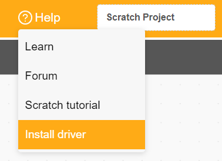

## 4.3 Electronic Modules Introduction

### (1) Ultrasonic Sensor

#### 4.3.1 Overview

The ultrasonic sensor module uses an I2C communication port. It not only detects the distance to obstacles ahead, but also emits RGB LEDs.

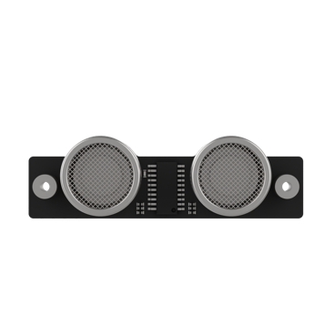

#### 4.3.2 Technical Specifications

(1) Detection distance: 2 to 400 cm

(2) Supports RGB LED color adjustment

(3) Measuring angle ≥ 15°

(4) Communication method: I2C

#### 4.3.3 Programming Command Description

|                  Ultrasonic Module Program                   | Program Description                                          |
| :----------------------------------------------------------: | :----------------------------------------------------------- |
| 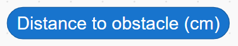 | Gets the obstacle distance detected by the ultrasonic sensor in cm. |
|  | Sets the color of the ultrasonic sensor RGB LEDs.            |
|  | Sets the red, green, and blue values of the ultrasonic sensor RGB LEDs. |
|  | Turns off the ultrasonic sensor RGB LEDs.                    |
|  | Sets the ultrasonic sensor RGB LEDs to rainbow mode.         |

#### 4.3.4 Hands-On Project

Project 1: Ultrasonic Distance Alarm

Project Analysis: When the obstacle distance detected by the ultrasonic sensor is less than 20 cm, the controller buzzer sounds an alarm, and the ultrasonic sensor flashes red light.

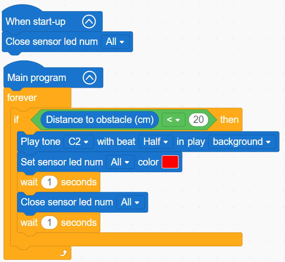

> [!NOTE]
>
> **The program source files can be downloaded from [Program Files/Ultrasonic](https://drive.google.com/drive/folders/1nSbM64pHo1P8oaKdCni9lIqaL96hW0rQ?usp=sharing).**

**Program Upload**:
Follow the animated images in order by clicking **Connect device**, selecting the serial port, and then clicking the upload button to complete the program upload. Once the upload is successful, place a hand near the ultrasonic sensor to test the program execution results.

### (2) 6-Channel Line Follower Sensor

#### 4.3.5 Introduction

The 6-channel line-following sensor enables infrared detection for four-wheel smart cars. One-key calibration quickly completes line detection. The rich detection probes not only achieve high-difficulty line following, such as acute-angle turns, but also accurately recognize intersections.

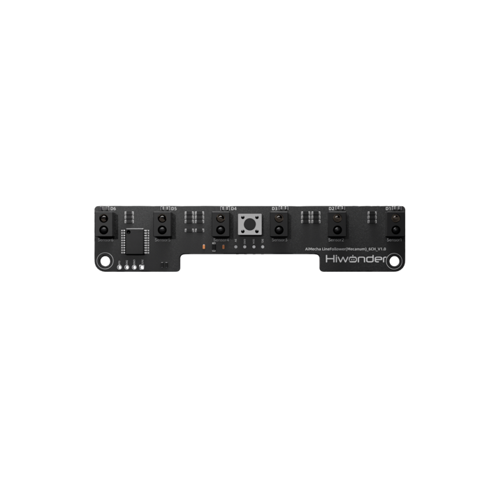

#### 4.3.6 Technical Specifications

(1)  ≥ 6-channel probes

(2) Supports one-key calibration

(3) Dimensions ≥ 87 × 23.5 × 13 mm

(4) Communication Method: I2C

#### 4.3.7 Programming Command Description

|            6-Channel Line Follower Sensor Program            | Program Description                                          |
| :----------------------------------------------------------: | :----------------------------------------------------------- |
|  | Determines whether the specified channel of the 6-channel line follower sensor detects a line or background. |
|  | Determines whether the 6-channel line follower sensor detects the specified state. |
| 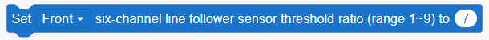 | Sets the threshold ratio of the 6-channel line follower sensor, with a default value of 7. |
|  | Gets the grayscale value from 0 to 100 of the specified channel on the 6-channel line follower sensor. |
|  | Gets the offset value of the 6-channel line follower sensor. |

#### 4.3.8 Hands-On Project

Project 1: Implementing Car Line Following with the 6-Channel Line Follower Sensor

Project Analysis: When the black line is directly beneath the center of the car and detected by probes 3 and 4, the car keeps moving straight ahead.

When the black line shifts to the left side of the car and is detected by probes 1 and 2, it indicates that the car has deviated to the right. The car corrects its direction by making a differential left turn, where the left wheels rotate slowly, and the right wheels rotate quickly, steering the car left back onto the black line.

When the black line shifts to the right side of the car and is detected by probes 5 and 6, it indicates that the car has deviated to the left. The car corrects its direction by making a differential right turn, where the right wheels rotate slowly, and the left wheels rotate quickly, steering the car right back onto the black line.

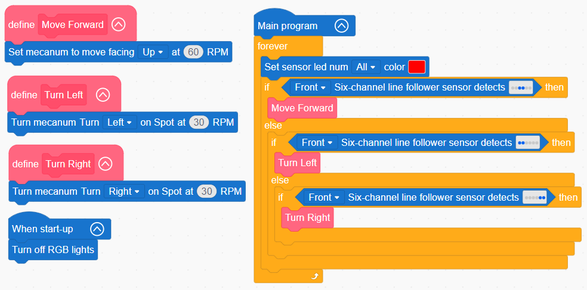

> [!NOTE]
>
> **The program source files can be downloaded from [Program Files/Line Following](https://drive.google.com/drive/folders/1nSbM64pHo1P8oaKdCni9lIqaL96hW0rQ?usp=sharing).**

**Program Upload**:
Follow the animated images in order by clicking **Connect device**, selecting the serial port, and then clicking the upload button to complete the program upload. Once the upload is successful, place a hand near the ultrasonic sensor to test the program execution results.

### (3) Encoder Motor

#### 4.3.9 Overview

The high-precision DC encoder motor features a metal gear reduction box for stable performance and high durability. Paired with food-grade silicone tires, it provides strong grip and precise movement.

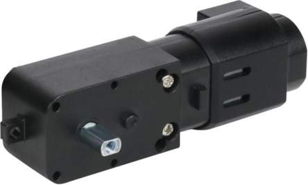

#### 4.3.10 Technical Specifications

(1) Operating voltage: DC 3 V to 12 V

(2) Reduction ratio ≥ 1:84

(3) Max stall current: 1.2 A

(4) Max no-load current: 100 mA

(5) Torque ≥ 2.1 kg·cm

(6) Weight ≥ 41 g

(7) Shaft type: metal shaft

#### 4.3.11 Programming Command Description

|                     Motor Module Program                     | Program Description                                          |
| :----------------------------------------------------------: | :----------------------------------------------------------- |
| 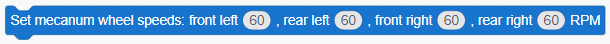 | Sets the rotation speeds of the four wheels individually.    |
| 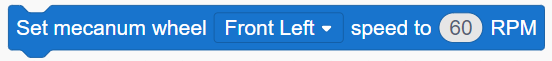 | Sets the rotation speed of a single wheel.                   |
| 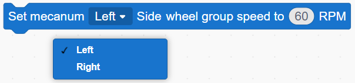 | Sets the rotation speed of the left wheels or right wheels.  |
| 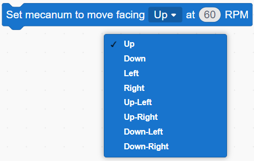 | Sets the car to move in one of eight directions at a specified speed. |
|  | Sets the car to move in a specified degree direction at a specified speed. |
|  | Sets the speeds of the car along the `x` and `y` axes.       |
|  | Stops the car.                                               |
| 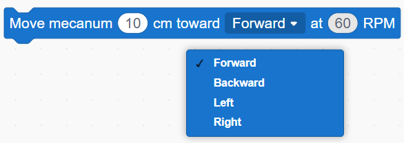 | Sets the moving distance of the car in four directions: forward, backward, left, and right. |
|  | Controls the translation distance of the car in a specified degree direction. |
| 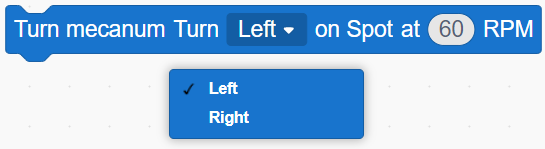 | Controls the car to turn left or right in place at a specified speed. |
|  | Gets the rotation angle of the motor in degrees.             |
|  | Determines whether a single motor has completed its movement. |
|  | Determines whether all motors have completed their movements. |

#### 4.3.12 Hands-On Project

Project 1: Precisely Controlling the Motor Rotation Degrees

Project Analysis: When the A key is pressed shortly, the block `Set car to move forward at ** rpm for ** cm` controls the rotation angle of the motors.

When Button B is short-pressed, the block `Set car to turn left in place at ** rpm` is executed, and the car stops after turning left for 1 s.

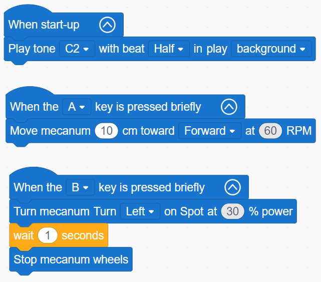

> [!NOTE]
>
> **The program source files can be downloaded from [Program Files/Main Controller](https://drive.google.com/drive/folders/1nSbM64pHo1P8oaKdCni9lIqaL96hW0rQ?usp=sharing).**

**Program Upload**:
Follow the animated images in order by clicking **Connect device**, selecting the serial port, and then clicking the upload button to complete the program upload. Once the upload is successful, place a hand near the ultrasonic sensor to test the program execution results.

## 4.4 Firmware Update

> [!NOTE]
>
> **The controller comes factory-flashed with the firmware program, so repeated flashing is unnecessary. This section serves only as a reference when updating the firmware or re-flashing due to firmware corruption.**

#### 4.4.1 AiMecha Controller Firmware:

[AIMECHA_20260710_0x000.bin](https://drive.google.com/drive/folders/13ssPvZY_IlLPO7Ge0c6lzfwMAQcyeA1f?usp=sharing)

#### 4.4.2 Firmware Flashing Tool:

[flash_download_tool_3.9.5.rar](https://drive.google.com/drive/folders/1jJD-8aT2aRAwouSmSIZKnFWsp2Pmkd9y?usp=sharing)

#### 4.4.3 Firmware Flashing Steps:

1. Double-click to open **flash_download_tool_3.9.7.exe** and select **ESP32**.

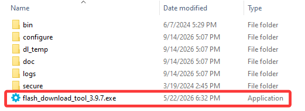

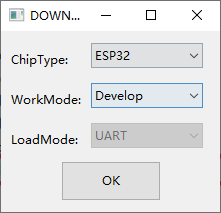

2. Click "**...**" to select and open the latest firmware file.

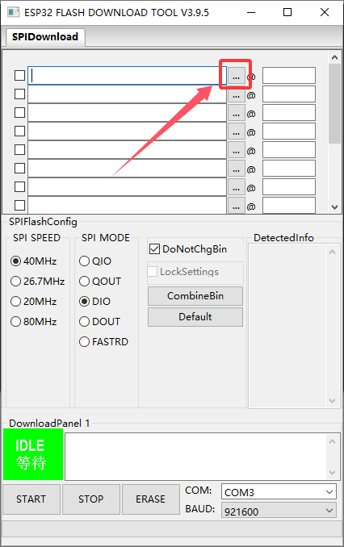

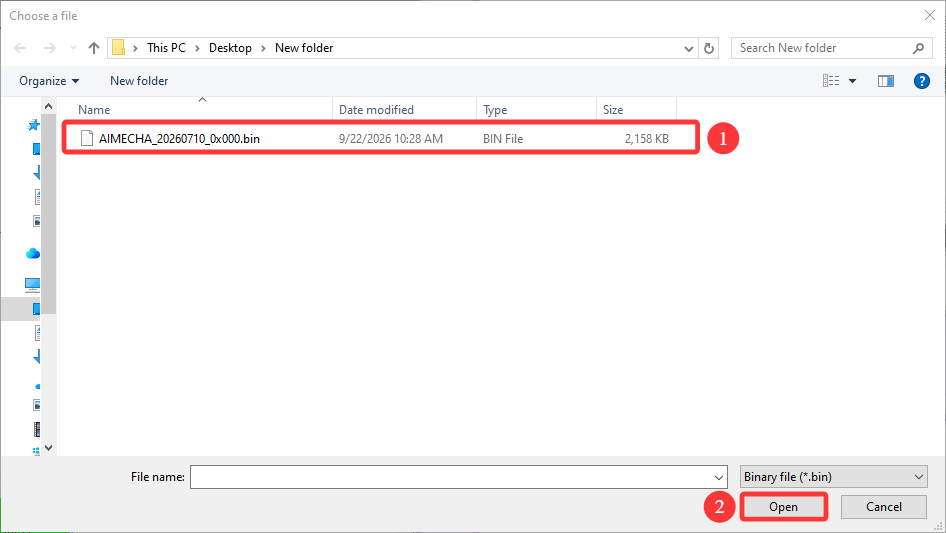

3. Select the configuration according to the icon below, then click the **ERASE** button.

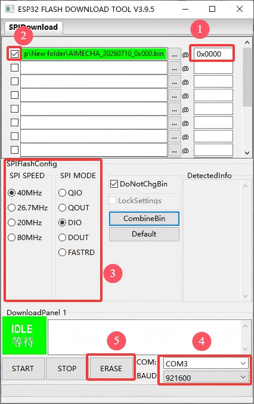

4. Click the **START** button after the process is complete.

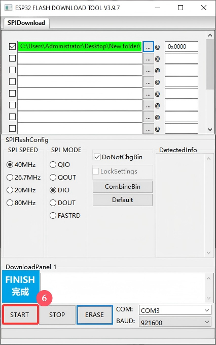

5. Finally, the **FINISH** icon indicates completion.

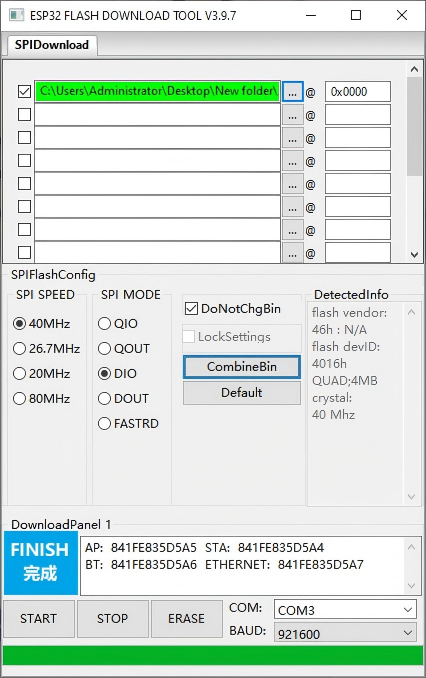

## 4.5 Technical Support and Product Discussion

Join the forum to share questions, ideas, or suggestions, and answers will be provided promptly. Click the hyperlink [Hiwonder Forum](http://forum.hiwonder.com) or enter the URL in a browser: http://forum.hiwonder.com